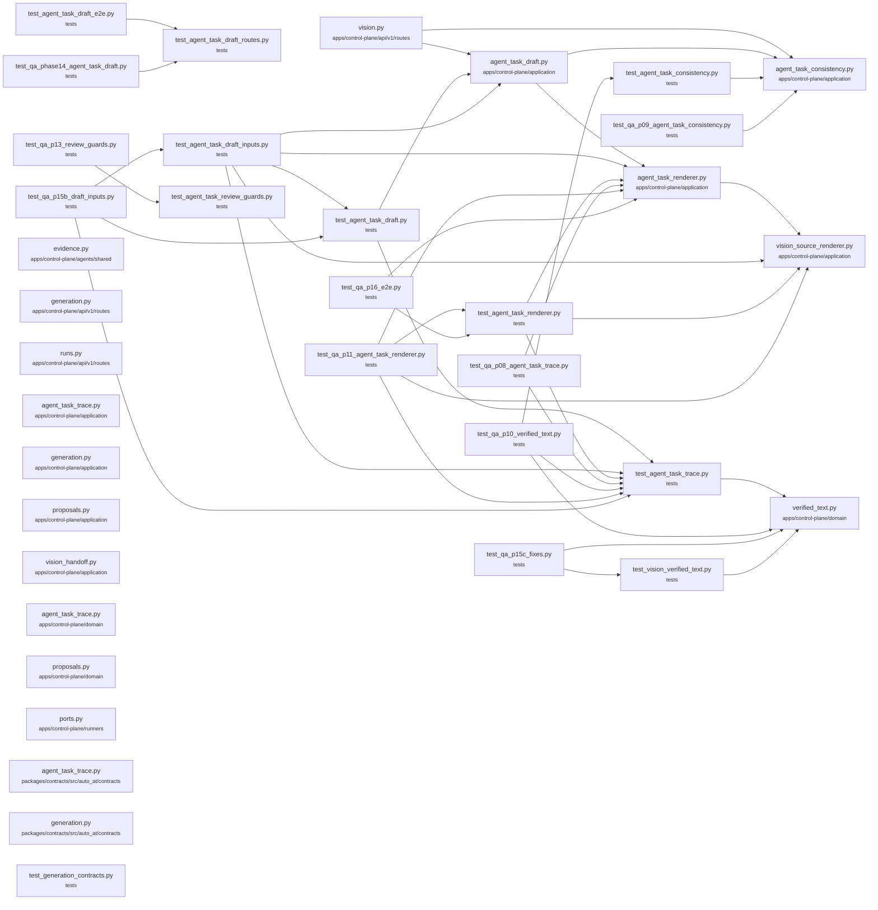

# Bản nháp test Playwright từ phiên agent-loop (ADR-047)

## Chức năng này làm gì

Từ một phiên agent-loop đã `completed` kèm `task_assessment`, người có quyền yêu cầu một bản nháp test Playwright chờ duyệt
(ADR-047; verdict thật chỉ đến từ lần chạy deterministic sau khi người khác duyệt). Graph này gom đường code của thiết kế đó. Hiện
có phase 08: gói vết `AgentTaskTrace` v1 (chuỗi bước tuyến tính, bất biến, có `trace_hash`); phase 09: báo cáo nhất quán; phase 10:
ứng viên assertion `verified_text`; phase 11: renderer tuyến tính `application/agent_task_renderer.py` (hàm thuần, không gọi model) và
các trường provenance additive; phase 13: ranh giới duyệt và guard đường tới model (đoạn "Ranh giới duyệt" dưới); phase 14: route và use case tạo draft (đoạn "Tạo draft (phase 14)" dưới); phase 15-15b: độ dài mong đợi (dashboard nằm ở graph `vision-dashboard`); phase 16:
test chuỗi `tests/test_agent_task_draft_e2e.py` (đoạn "End-to-end (phase 16)" dưới). Mọi file mới của phase 08-15b đã có trong graph này, `vision-dashboard`
(phase 15) hoặc `vision-exploration` (phase 12).

## Vì sao các file này ảnh hưởng lẫn nhau

`application/agent_task_trace.py::read_agent_task_trace` đọc một phiên theo scope (tenant, project, session) qua
`SqlAlchemyVisionRepository.get` + `SqlAlchemyVisualTraceRepository.agent_steps/snapshot`, rồi gọi hàm thuần
`domain/agent_task_trace.py::build_agent_task_trace`, hàm này dựng `AgentTaskTrace` của contract
`packages/contracts/.../agent_task_trace.py` (hash chuẩn tắc nằm ở contract, hàm dựng chỉ gọi `seal`). Phase 11
(`application/agent_task_renderer.py::render_agent_task_source(trace, input_values)`) đọc đúng contract này và trả
`GeneratedTestPlannerOutput`; nó import `literal`/`locator_expression` từ `vision_source_renderer.py` (file đó không bị sửa) và
`validate_playwright_test_source` từ `contracts/execution.py`. Giá trị gõ chỉ nằm trong source trả về; lỗi từ chối chỉ mang mã
(`AgentTaskRenderRefused.code`, `step_index`, `operation_id`). `contracts/generation.py::PlanningProvenance` có thêm
`agent_trace_source{session_id, trace_hash}`, `contains_test_values`, `owned_test_target`, `requested_by` (tất cả tuỳ chọn, bản ghi cũ
vẫn validate); phase 14 (API tạo draft) là nơi điền chúng. Đổi trường của step hay mã từ chối là đổi đầu vào của renderer và phase 14. Các file còn lại là chỗ
thiết kế sẽ chạm tới (`generation.py`, `proposals.py`, `runners/ports.py`, `vision_source_renderer.py`, `vision_handoff.py`) và chưa
thuộc graph nào trước đây. `vision_handoff.py` không bị sửa và KHÔNG được dùng cho gói vết (contract handoff chặn `type`, dựng cây).
Lưu ý công cụ: ba file `agent_task_trace.py` (contract, domain, application) trùng tên nên hgraph không giải được import của chúng, cột
"Import" trong bảng dưới để trống; quan hệ thật là chuỗi nêu ở trên.

## Ranh giới duyệt và guard (phase 13)

`routes/generation.py::decide` đòi `Permission.DECIDE_PROPOSAL` (reviewer, project_admin, tenant_admin; service bị từ chối) thay cho
`DECIDE_GENERATION` khi `application/generation.py::is_agent_task_draft(draft.provenance)` (có `agent_trace_source`). `DecideGeneratedDraft`
khi duyệt: `decided_by != provenance.requested_by` (thiếu `requested_by` thì từ chối), draft `contains_test_values` đòi
`acknowledge_disposable_credentials=true` (trường mới của `DecisionRequest`) và cờ `vision_owned_test_target` còn bật; mã lỗi
`reviewer_must_differ_from_requester`, `disposable_credentials_ack_required`, `owned_test_target_disabled` (HTTP 409, trước mọi ghi).
Sau duyệt `test_cases.specification` có thêm `contains_test_values: true`. Guard `credentials_in_source`: preflight lỗi của draft loại này
không tạo `generation_requests` sửa tự do (409), và `POST /runs/{id}/revised-draft` trả 409 `credentials_in_source` cho test case có khoá đó
(`routes/runs.py`). `agents/shared/evidence.py::build_run_report_evidence_bundle(..., contains_test_values=True)` bỏ mọi excerpt
(`playwright-output`, `worker-result`) và `review_context` (bản sao source). Nơi gọi hàm đó là `application/reporting_events.py` (graph `vision-exploration`): `ReportingEventProcessor` đọc test case của run và truyền `contains_test_values` từ `specification` (dựng ở `infrastructure/workflows/temporal_worker.py`).

## Tạo draft (phase 14)

`routes/vision.py::create_agent_task_draft` (`POST /api/v1/vision/explorations/{session_id}/test-draft`, CSRF + header `Idempotency-Key`
bắt buộc nhưng không lưu) mở một `transactional_session` và gọi `application/agent_task_draft.py::CreateAgentTaskDraft.execute`. Thứ tự:
`SUBMIT_GENERATION` (không đủ quyền hoặc khác tenant/project thì `AgentTaskDraftNotFound`, route trả 404) -> phiên `completed`, `agent_loop`, assessment
`achieved` -> `read_agent_task_trace` (phase 08) -> tìm request cũ theo khoá `agent_task_draft_key(session_id, trace_hash)` (có thì trả draft cũ, 200,
không so giá trị) -> `read_consistency` (phase 09) -> policy: origin allowlist, cờ `vision_owned_test_target` nếu chuỗi có `type` -> `render_agent_task_source`
(phase 11) -> ghi `generation_requests` (`completed`, `redacted_request` là câu cố định) + `generated_test_drafts` (`pending_review`) + audit
`generation.requested`/`generation.completed` với `actor` là người yêu cầu. Không test case, không run, không outbox, không gọi model. `routes/generation.py::decide`
(phase 13) là đường duyệt duy nhất tiếp theo. Mã lỗi: 409 `session_not_completed`, `assessment_unavailable`, `assessment_not_achieved`,
`assessment_inconsistent` (kèm báo cáo), `origin_not_allowed`, `input_value_not_allowed`, `evidence_expired` (builder báo `evidence_unavailable`),
các mã của builder (`operation_failed`, `action_outcome_unknown`, `locator_unavailable`, `ephemeral_locator`, `action_unsupported`),
`idempotency_key_conflict`; 422 `input_value_missing`, `input_value_mismatch`, `input_value_rejected_by_source_policy` (và `source_policy_rejected`,
`target_url_invalid`, `rendered_source_limit` của renderer, ánh xạ 409), `request_invalid`. Thêm mã mới ở builder hay renderer thì route trả 409 với mã đó.

Độ dài mong đợi (phase 15b): `routes/vision.py::get_agent_task_draft_inputs` (`GET /api/v1/vision/explorations/{session_id}/test-draft/inputs`, không CSRF,
`Cache-Control: private, no-store`) gọi `ReadAgentTaskDraftInputs.execute`, dùng cùng `_check_assessment` và `_read_trace` với POST (hai hàm nằm ở mixin
`_DraftSession`; route đổi refusal thành HTTP bằng `_draft_refusal` chung với POST) và `SUBMIT_GENERATION` + tenant như POST. Danh sách bước là
`agent_task_renderer.typed_steps(trace)`, chính hàm `_check_values`, bước tìm lỗi policy và `has_test_values` dùng, nên GET và POST không thể lệch nhau.
Trả `{owned_test_target, has_type_steps, type_steps: [{step_index, locator_name, text_chars}]}`; cờ `vision_owned_test_target` tắt (hoặc không có policy) thì `type_steps`
rỗng. Không đòi consistency, không ghi gì, không log. `step_index` là của bước agent (một bước có thể có nhiều `type`): thứ tự trong mảng mới là thứ tự giá trị.
Đổi `typed_steps` hay `_check_assessment` là đổi cả POST lẫn GET này.

Giá trị gõ: body `{"values": [...]}` được route parse bằng tay (`AgentTaskDraftRequest.model_validate` trong `try`, lỗi trả `request_invalid` cố định) để
lỗi validation của FastAPI không phản chiếu body. Giá trị chỉ vào source của draft; response của route chỉ có id, trạng thái, hash và hai cờ. Test
`tests/test_agent_task_draft_routes.py` quét mọi cột của mọi bảng, mọi response và log đã bắt (`caplog`, `capfd`) và khẳng định tập nơi có giá trị bằng
danh sách khai báo (`ALLOWED_AFTER_CREATE`, `ALLOWED_AFTER_APPROVAL`). `provenance` của draft có thêm khoá `consistency` (số phiên, đồng thuận); trường
này chưa có trong `PlanningProvenance` (contract `extra="forbid"`): dict lưu có khoá thừa, nên không `model_validate` cả dict được, phải bỏ `consistency`
trước (test làm vậy). Thêm field vào contract là việc của phase khác. Race hai request đồng thời cùng (session, trace): unique `(tenant_id, idempotency_key)`
làm request thứ hai lỗi `IntegrityError` (suy từ code, chưa có test: 500 và rollback), gọi lại sẽ nhận draft cũ.

## End-to-end (phase 16)

`tests/test_agent_task_draft_e2e.py` chạy chuỗi yêu cầu (contributor) -> duyệt (reviewer khác, có xác nhận) -> test case + run `queued` trên DB PostgreSQL
fixture (không model, không trình duyệt) và các ca âm a, c, d, e, f, g, h, i, j từng cái một; ca b (đổi chữ kết quả sau khi duyệt) cần trình duyệt thật nên chỉ có
ở `scripts/run_agent_task_draft_e2e.py` (graph `task-ui-stability`). Test ghim danh sách nơi lưu giá trị của script (`DECLARED_AFTER_CREATE`,
`DECLARED_AFTER_APPROVAL`, `MUST_BE_CLEAN_TABLES`) bằng danh sách của `test_agent_task_draft_routes.py`: thêm một nơi lưu giá trị là sửa cả hai, nếu không test hỏng. Test nhập
fixture `world` từ `test_agent_task_draft_routes.py` (đổi helper/fixture đó là đổi file này). Đo trên stack thật cho thấy ba điều mà test fixture không bắt được
(báo cáo `reports/phase-16/be-developer-r1.md`): F1 `POST /runs` không chạy lại được test sinh ra (`routes/runs.py` thêm `runner_config.traceparent`, worker `contract.ts`
đòi đúng 4 khoá; đã sửa ở phase 15c, r2 chạy lại qua API 15/15); F2 ứng viên `verified_text` lấy từ trạng thái TRƯỚC thao tác (bộ đếm "2 việc") vẫn được assert SAU thao tác (`agent_task_renderer.py`), test `todo-add` fail 6/6;
F3 giá trị nằm thêm ở `0-trace.network` + `resources/*.dat` (thân request form) và ở văn bản tự do của phiên khi giá trị có trong câu task.

## Chữ đã gõ trong ứng viên assertion (phase 17, F5/F4)

`domain/verified_text.py::verify_quotes(checks, observed, typed)` đánh cờ `derived_from_typed` cho ứng viên bằng, chứa hoặc nằm trong một giá trị agent đã gõ (vòng lặp
`vision_agent_loop.py::_loop` giữ danh sách `typed` chỉ trong bộ nhớ; chỉ cờ được lưu, không lưu giá trị). Cờ là trường tuỳ chọn của `VerifiedTextItem`
(`contracts/agent_task_trace.py`), false thì bị bỏ khỏi mọi bản dump nên `trace_hash` của phiên cũ không đổi. `agent_task_renderer.py::_candidate_lines` loại
ứng viên có cờ và `_stop_conditions` ghi số ứng viên bị loại. Phiên lưu trước phase 17 không có cờ (giữ hành vi cũ). Đổi quy tắc so khớp (`_overlaps`) là đổi
cả cờ lưu trong phiên mới lẫn assertion của draft. F4 (`search-results` chỉ assert tên điều khiển) chưa sửa: bộ đọc chữ trang của worker không lấy `<li>`
(`workers/playwright/src/vision-dom.ts`); xem ADR-047 mục Rủi ro.

## Chạm vào đây thì phải kiểm tra thêm

- Bảng nguồn (không đổi ở phase 08, không bảng mới, không migration): `visual_agent_steps`, `visual_operations`, `visual_locator_evidence`,
  `visual_operation_frames` (graph `vision-exploration`). Đổi hình dạng `actions` JSONB của step (`vision_agent_loop.py::_action_entry`:
  `kind`, `text_chars`, `delta_y`, `duration_ms`, `result`, `skipped_reason`) là đổi cách bộ dựng ghép action với operation.
- `domain/vision_task_assessment.py` (graph `vision-agent-loop`): `AgentTaskAssessmentCopy` phản chiếu schema `v1` của assessment;
  thêm/bỏ khoá trong assessment mà không đổi `schema_version` làm mọi phiên bị từ chối `assessment_unavailable`.
- Nếu thêm TTL cho ba bảng nguồn hoặc muốn gói vết sống lâu hơn `intent_retention_until`: quay lại PM (phase 08, mục "Không làm").
- `PlanningProvenance` (`contracts/generation.py`) được `generation_events.py`, `generation.py`, `routes/generation.py` và bảng
  `generated_test_drafts.provenance` (JSONB) dùng: chỉ thêm trường tuỳ chọn; `model_dump` giờ có thêm 4 khoá `null` cho draft cũ. Bỏ
  `extra="forbid"` hay làm trường mới bắt buộc là phá bản ghi cũ. Trường mới không được chứa chữ tự do của assessment hay giá trị gõ.
- Mã từ chối của renderer (`locator_unavailable`, `input_value_missing`, `input_value_mismatch`,
  `input_value_rejected_by_source_policy`, `source_policy_rejected`, `target_url_invalid`, `rendered_source_limit`) là mã phase 14 phải
  ánh xạ ra API; thêm/đổi mã là đổi contract của phase đó.
- Chữ do model viết (`summary`, `checks`) được chép nguyên từ bản đã redact của phiên; redaction theo mẫu không biết giá trị đã gõ.

<!-- hgraph:begin auto -->

## Quan hệ file — hgraph tự sinh, ĐỪNG sửa tay

Cập nhật: 2026-11-28 · `hgraph sync agent-task-draft --apply` để tạo lại.

| File | Vai trò | Import (trong graph) | Bị import bởi (trong graph) |
|---|---|---|---|
| `apps/control-plane/agents/shared/evidence.py` | other | — | — |
| `apps/control-plane/api/v1/routes/generation.py` | entry | — | — |
| `apps/control-plane/api/v1/routes/runs.py` | entry | — | — |
| `apps/control-plane/api/v1/routes/vision.py` | entry | `apps/control-plane/application/agent_task_consistency.py` `apps/control-plane/application/agent_task_draft.py` | — |
| `apps/control-plane/application/agent_task_consistency.py` | other | — | `apps/control-plane/application/agent_task_draft.py` `tests/test_agent_task_consistency.py` `tests/test_qa_p09_agent_task_consistency.py` `apps/control-plane/api/v1/routes/vision.py` |
| `apps/control-plane/application/agent_task_draft.py` | other | `apps/control-plane/application/agent_task_consistency.py` `apps/control-plane/application/agent_task_renderer.py` | `tests/test_agent_task_draft.py` `tests/test_agent_task_draft_inputs.py` `apps/control-plane/api/v1/routes/vision.py` |
| `apps/control-plane/application/agent_task_renderer.py` | other | `apps/control-plane/application/vision_source_renderer.py` | `apps/control-plane/application/agent_task_draft.py` `tests/test_agent_task_draft_inputs.py` `tests/test_agent_task_renderer.py` `tests/test_qa_p08_agent_task_trace.py` `tests/test_qa_p11_agent_task_renderer.py` `tests/test_qa_p16_e2e.py` |
| `apps/control-plane/application/agent_task_trace.py` | other | — | — |
| `apps/control-plane/application/generation.py` | other | — | — |
| `apps/control-plane/application/proposals.py` | other | — | — |
| `apps/control-plane/application/vision_handoff.py` | other | — | — |
| `apps/control-plane/application/vision_source_renderer.py` | other | — | `apps/control-plane/application/agent_task_renderer.py` `tests/test_agent_task_draft_inputs.py` `tests/test_agent_task_renderer.py` `tests/test_qa_p11_agent_task_renderer.py` |
| `apps/control-plane/domain/agent_task_trace.py` | service | — | — |
| `apps/control-plane/domain/proposals.py` | service | — | — |
| `apps/control-plane/domain/verified_text.py` | service | — | `tests/test_agent_task_trace.py` `tests/test_qa_p10_verified_text.py` `tests/test_qa_p15c_fixes.py` `tests/test_vision_verified_text.py` |
| `apps/control-plane/runners/ports.py` | other | — | — |
| `packages/contracts/src/auto_at/contracts/agent_task_trace.py` | other | — | — |
| `packages/contracts/src/auto_at/contracts/generation.py` | other | — | — |
| `tests/test_agent_task_consistency.py` | test | `apps/control-plane/application/agent_task_consistency.py` | `tests/test_qa_p10_verified_text.py` |
| `tests/test_agent_task_draft.py` | test | `apps/control-plane/application/agent_task_draft.py` `tests/test_agent_task_trace.py` | `tests/test_agent_task_draft_inputs.py` `tests/test_qa_p15b_draft_inputs.py` |
| `tests/test_agent_task_draft_e2e.py` | test | `tests/test_agent_task_draft_routes.py` | — |
| `tests/test_agent_task_draft_inputs.py` | test | `apps/control-plane/application/agent_task_draft.py` `apps/control-plane/application/agent_task_renderer.py` `apps/control-plane/application/vision_source_renderer.py` `tests/test_agent_task_draft.py` `tests/test_agent_task_trace.py` | `tests/test_qa_p15b_draft_inputs.py` |
| `tests/test_agent_task_draft_routes.py` | test | — | `tests/test_agent_task_draft_e2e.py` `tests/test_qa_phase14_agent_task_draft.py` |
| `tests/test_agent_task_renderer.py` | test | `apps/control-plane/application/agent_task_renderer.py` `apps/control-plane/application/vision_source_renderer.py` `tests/test_agent_task_trace.py` | `tests/test_qa_p11_agent_task_renderer.py` `tests/test_qa_p16_e2e.py` |
| `tests/test_agent_task_review_guards.py` | test | — | `tests/test_qa_p13_review_guards.py` |
| `tests/test_agent_task_trace.py` | test | `apps/control-plane/domain/verified_text.py` | `tests/test_agent_task_draft.py` `tests/test_agent_task_draft_inputs.py` `tests/test_agent_task_renderer.py` `tests/test_qa_p08_agent_task_trace.py` `tests/test_qa_p10_verified_text.py` `tests/test_qa_p11_agent_task_renderer.py` `tests/test_qa_p15b_draft_inputs.py` |
| `tests/test_generation_contracts.py` | test | — | — |
| `tests/test_qa_p08_agent_task_trace.py` | test | `tests/test_agent_task_trace.py` `apps/control-plane/application/agent_task_renderer.py` | — |
| `tests/test_qa_p09_agent_task_consistency.py` | test | `apps/control-plane/application/agent_task_consistency.py` | — |
| `tests/test_qa_p10_verified_text.py` | test | `apps/control-plane/domain/verified_text.py` `tests/test_agent_task_consistency.py` `tests/test_agent_task_trace.py` | — |
| `tests/test_qa_p11_agent_task_renderer.py` | test | `apps/control-plane/application/agent_task_renderer.py` `apps/control-plane/application/vision_source_renderer.py` `tests/test_agent_task_renderer.py` `tests/test_agent_task_trace.py` | — |
| `tests/test_qa_p13_review_guards.py` | test | `tests/test_agent_task_review_guards.py` | — |
| `tests/test_qa_p15b_draft_inputs.py` | test | `tests/test_agent_task_draft.py` `tests/test_agent_task_draft_inputs.py` `tests/test_agent_task_trace.py` | — |
| `tests/test_qa_p15c_fixes.py` | test | `tests/test_vision_verified_text.py` `apps/control-plane/domain/verified_text.py` | — |
| `tests/test_qa_p16_e2e.py` | test | `apps/control-plane/application/agent_task_renderer.py` `tests/test_agent_task_renderer.py` | — |
| `tests/test_qa_phase14_agent_task_draft.py` | test | `tests/test_agent_task_draft_routes.py` | — |
| `tests/test_vision_verified_text.py` | test | `apps/control-plane/domain/verified_text.py` | `tests/test_qa_p15c_fixes.py` |

### Ranh giới (blast radius ra ngoài graph)

- **File ngoài graph đang gọi vào** (5): `apps/control-plane/application/generation_events.py`, `apps/control-plane/application/vision_agent_loop.py`, `apps/control-plane/application/vision_trace_events.py`, `tests/test_vision_handoff.py`, `tests/test_vision_source_renderer.py`
- **File ngoài graph bị graph này gọi** (33): `apps/control-plane/agents/generation/vision_plan.py`, `apps/control-plane/agents/shared/redaction.py`, `apps/control-plane/agents/shared/runtime.py`, `apps/control-plane/agents/shared/vision_providers.py`, `apps/control-plane/api/v1/routes/activities.py`, `apps/control-plane/application/reporting.py`, `apps/control-plane/application/reporting_events.py`, `apps/control-plane/application/vision_debug_evidence.py`, `apps/control-plane/application/vision_policy.py`, `apps/control-plane/application/vision_reload.py`, `apps/control-plane/application/vision_replay.py`, `apps/control-plane/application/vision_results.py`, `apps/control-plane/application/vision_screen.py`, `apps/control-plane/application/vision_trajectory.py`, `apps/control-plane/config.py`, `apps/control-plane/domain/entities.py`, `apps/control-plane/domain/vision_task_assessment.py`, `apps/control-plane/infrastructure/artifacts/rustfs.py`, `apps/control-plane/infrastructure/observability/logging.py`, `apps/control-plane/infrastructure/persistence/repositories.py`, `apps/control-plane/infrastructure/persistence/session.py`, `apps/control-plane/infrastructure/runners.py`, `apps/control-plane/main.py`, `benchmark/task_ui/stability.py`, `packages/contracts/src/auto_at/contracts/agent.py`, `packages/contracts/src/auto_at/contracts/events.py`, `packages/contracts/src/auto_at/contracts/execution.py`, `scripts/run_agent_task_draft_e2e.py`, `tests/test_codex_candidate_service.py`, `tests/test_vision_agent_loop.py`, `tests/test_vision_agent_task_assessment.py`, `tests/vision_trace_fixtures.py`, `workers/playwright/src/observability.ts`

<!-- hgraph:end auto -->
