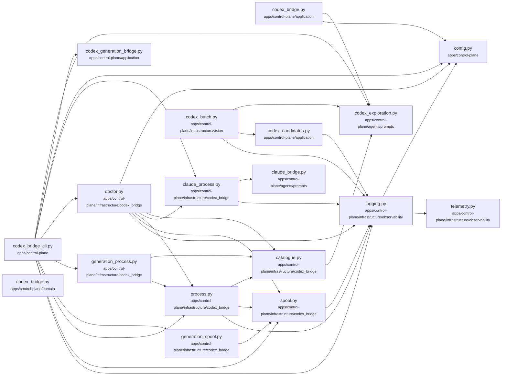

# Bridge Codex/Claude local

## Chức năng này làm gì

Người vận hành chạy một container bridge cục bộ (`python codex_bridge_cli.py run`, `codex_bridge_cli.py:61-79`). Container này dùng CLI Codex hoặc Claude đã đăng nhập để trả lời yêu cầu từ Vision (đề xuất hành động từ DOM, có thể kèm ảnh) và từ sinh test (generation). Không có API key trong ứng dụng: control-plane và bridge chỉ trao đổi qua một thư mục spool dùng chung. Kết quả là câu trả lời có cấu trúc, đã kiểm hash và fencing, hoặc mã lỗi an toàn như `bridge_offline`, `bridge_cancelled`. Đường dẫn bên dưới tính từ `apps/control-plane/`.

## Vì sao các file này ảnh hưởng lẫn nhau

1. **Khởi động.** `codex_bridge_cli.py:61-73` chạy `doctor` (`infrastructure/codex_bridge/doctor.py:75`) và thoát nếu CLI chưa đủ điều kiện hoặc chưa đăng nhập. Sau đó `run` (`:22-58`) ghép `FileSpool`, `CodexProcess` hoặc `ClaudeProcess` (theo `codex_bridge_engine`, `:35-50`) và `BridgeService` (`:51`). `doctor` đối chiếu phiên bản CLI ghim ở `domain/codex_bridge.py:20-23`, `process.py:23` (`TOOL_ISOLATION_QUALIFIED_VERSIONS`) và `doctor.py:85,108`. Đổi phiên bản mà quên một nơi thì `doctor` trả `bridge_cli_unsupported`.
2. **Sống/chết.** `BridgeService.serve` (`application/codex_bridge.py:107-139`) ghi `.heartbeat.json` (`spool.py:579`). Phía control-plane `FileReadiness.read` (`doctor.py:171`) đọc lại file đó và bác nếu cũ hơn `codex_bridge_stale_seconds`, hoặc lệch tenant, bridge_id, model, cli_version. Đổi định dạng heartbeat một phía thì Vision báo `bridge_offline` (`application/vision.py:127-130`).
3. **Gửi việc (producer, ngoài graph).** `CodexModelBatch.__call__` (`infrastructure/vision/codex_batch.py:41-159`) đăng ký dòng `codex_bridge_jobs` (`persistence/codex_bridge_repository.py:175`), gọi `spool.publish` (`spool.py:275`, kiểm hash và giới hạn trước khi `rename`), rồi lặp: `authorize` mỗi 2 giây với TTL 8 giây (`codex_batch.py:121-125`), đọc `stages` và `result`.
4. **Nhận việc.** `_run_locked` (`codex_bridge.py:35-105`) duyệt `spool.jobs()`. Nó chỉ chạy job khi `stop_reason` (`spool.py:367-396`) rỗng, tức là có `authorization.json` còn hạn và TTL không quá 10 giây. Sau đó `claim` (`spool.py:398`), rồi `process.run` (`process.py:149`) chạy `codex exec` với đối số cố định (`process.py:56-72`). Nếu nâng TTL ở `codex_batch.py:124` quá 10 giây (giới hạn ở `spool.py:392`), mọi job bị `bridge_policy_revoked`.
5. **Trả kết quả.** `spool.complete` (`spool.py:418`) kiểm `request_hash` và `validate_response` (`domain/codex_bridge.py:88`). Producer đọc `response.json`, gọi `gateway.finish` (`codex_bridge_repository.py:229`) rồi `spool.acknowledge`. Job đã có `claim.json` mà chưa có `response.json` (bridge chết giữa chừng) bị ghi `bridge_interrupted` thay vì chạy lại (`codex_bridge.py:49-50`).
6. **Generation.** `serve` còn gọi `GenerationBridgeService.run_once` (`codex_bridge.py:116-122`, `application/codex_generation_bridge.py:14`) trên spool con `.generation` (`generation_spool.py`). `GenerationSpool` kế thừa `FileSpool` nên đổi `FileSpool` là đổi cả hai. Producer là `generation_model.py:90-107` (chưa thuộc graph).

## Chạm vào đây thì phải kiểm tra thêm

- **Bảng DB** `codex_bridge_jobs` (`persistence/models.py:180-228`): bridge không tự ghi DB, chỉ gateway của control-plane ghi. Migration `c0d1e2f3a4b5` (tạo bảng) và `d1e2f3a4b5c6` (thêm `dom_sha256`, `dom_element_count`). Đổi cột hoặc CHECK `status`/`stage` thì thêm migration có downgrade và chạy `tests/test_codex_bridge_migrations.py`, `test_codex_bridge_repository.py`.
- **Contract**: `packages/contracts/src/auto_at/contracts/codex_bridge.py` và `codex_generation.py` (chưa thuộc graph; `CodexBridgeRequest`, `Response`, `Receipt`, `Readiness`). Sửa các model này thì `spool.py`, `domain/codex_bridge.py` và `codex_batch.py` cùng vỡ. Chạy `tests/test_codex_bridge_contracts.py`.
- **Worker và container**: `docker-compose.codex.yml` (service `codex-bridge`, spool bind mount dùng chung, `read_only`, `cap_drop`), `docker/codex-bridge/Dockerfile` (ghim `@openai/codex@0.164.0`), `seccomp.json`, `qualify.py`. Temporal worker và control-plane cũng mount spool này, vì producer chạy trong temporal worker (`vision_publisher.py:31` qua `codex_candidate_factory`, `temporal_worker.py:68` qua `generation_model_factory`).
- **Cờ config** (`config.py:59-74`): `codex_bridge_enabled`, `codex_bridge_id`, `codex_bridge_allowed_tenant`, `codex_bridge_container_spool`, `codex_bridge_engine`, `heartbeat/stale/cancel_poll/kill_grace_seconds`. Validator ở `config.py:151-173` bắt buộc `environment=local` và `stale > heartbeat`.
- **Prompt**: `agents/prompts/codex_exploration.py` (`PROMPT_VERSION = "codex-dom-v11"`, dòng 7) được producer ghi vào request và bridge kiểm (`:80`). Sửa prompt phải tăng version và cập nhật `agents/prompts/README.md`. `claude_bridge.py:9` tương tự.
- **Test hồi quy**: `tests/test_codex_bridge_{spool,service,process,qualification,end_to_end}.py`, `test_claude_bridge.py`, `test_codex_model_batch.py`, `test_codex_candidate_service.py`, `test_codex_generation*.py`.

<!-- hgraph:begin auto -->

## Quan hệ file — hgraph tự sinh, ĐỪNG sửa tay

Cập nhật: 2026-11-19 · `hgraph sync codex-bridge --apply` để tạo lại.

| File | Vai trò | Import (trong graph) | Bị import bởi (trong graph) |
|---|---|---|---|
| `apps/control-plane/agents/prompts/claude_bridge.py` | other | — | `apps/control-plane/infrastructure/codex_bridge/claude_process.py` |
| `apps/control-plane/agents/prompts/codex_exploration.py` | other | — | `apps/control-plane/application/codex_bridge.py` `apps/control-plane/codex_bridge_cli.py` `apps/control-plane/infrastructure/codex_bridge/catalogue.py` `apps/control-plane/infrastructure/vision/codex_batch.py` |
| `apps/control-plane/application/codex_bridge.py` | other | `apps/control-plane/agents/prompts/codex_exploration.py` `apps/control-plane/config.py` | — |
| `apps/control-plane/application/codex_candidates.py` | other | `apps/control-plane/infrastructure/observability/logging.py` | `apps/control-plane/infrastructure/vision/codex_batch.py` |
| `apps/control-plane/application/codex_generation_bridge.py` | other | — | `apps/control-plane/codex_bridge_cli.py` |
| `apps/control-plane/codex_bridge_cli.py` | other | `apps/control-plane/agents/prompts/codex_exploration.py` `apps/control-plane/application/codex_generation_bridge.py` `apps/control-plane/config.py` `apps/control-plane/infrastructure/codex_bridge/claude_process.py` `apps/control-plane/infrastructure/codex_bridge/doctor.py` `apps/control-plane/infrastructure/codex_bridge/generation_process.py` `apps/control-plane/infrastructure/codex_bridge/generation_spool.py` `apps/control-plane/infrastructure/codex_bridge/process.py` `apps/control-plane/infrastructure/codex_bridge/spool.py` `apps/control-plane/infrastructure/observability/logging.py` | — |
| `apps/control-plane/config.py` | other | — | `apps/control-plane/application/codex_bridge.py` `apps/control-plane/codex_bridge_cli.py` `apps/control-plane/infrastructure/codex_bridge/doctor.py` `apps/control-plane/infrastructure/observability/logging.py` |
| `apps/control-plane/domain/codex_bridge.py` | service | — | — |
| `apps/control-plane/infrastructure/codex_bridge/catalogue.py` | other | `apps/control-plane/agents/prompts/codex_exploration.py` | `apps/control-plane/infrastructure/codex_bridge/doctor.py` `apps/control-plane/infrastructure/codex_bridge/generation_process.py` `apps/control-plane/infrastructure/codex_bridge/process.py` |
| `apps/control-plane/infrastructure/codex_bridge/claude_process.py` | other | `apps/control-plane/agents/prompts/claude_bridge.py` `apps/control-plane/infrastructure/observability/logging.py` | `apps/control-plane/codex_bridge_cli.py` `apps/control-plane/infrastructure/codex_bridge/doctor.py` |
| `apps/control-plane/infrastructure/codex_bridge/doctor.py` | other | `apps/control-plane/config.py` `apps/control-plane/infrastructure/codex_bridge/catalogue.py` `apps/control-plane/infrastructure/codex_bridge/claude_process.py` `apps/control-plane/infrastructure/codex_bridge/process.py` `apps/control-plane/infrastructure/codex_bridge/spool.py` `apps/control-plane/infrastructure/observability/logging.py` | `apps/control-plane/codex_bridge_cli.py` |
| `apps/control-plane/infrastructure/codex_bridge/generation_process.py` | other | `apps/control-plane/infrastructure/codex_bridge/catalogue.py` `apps/control-plane/infrastructure/codex_bridge/process.py` | `apps/control-plane/codex_bridge_cli.py` |
| `apps/control-plane/infrastructure/codex_bridge/generation_spool.py` | other | `apps/control-plane/infrastructure/codex_bridge/spool.py` | `apps/control-plane/codex_bridge_cli.py` |
| `apps/control-plane/infrastructure/codex_bridge/process.py` | other | `apps/control-plane/infrastructure/codex_bridge/catalogue.py` `apps/control-plane/infrastructure/codex_bridge/spool.py` `apps/control-plane/infrastructure/observability/logging.py` | `apps/control-plane/codex_bridge_cli.py` `apps/control-plane/infrastructure/codex_bridge/doctor.py` `apps/control-plane/infrastructure/codex_bridge/generation_process.py` |
| `apps/control-plane/infrastructure/codex_bridge/spool.py` | other | `apps/control-plane/infrastructure/observability/logging.py` | `apps/control-plane/codex_bridge_cli.py` `apps/control-plane/infrastructure/codex_bridge/doctor.py` `apps/control-plane/infrastructure/codex_bridge/generation_spool.py` `apps/control-plane/infrastructure/codex_bridge/process.py` |
| `apps/control-plane/infrastructure/observability/logging.py` | other | `apps/control-plane/config.py` `apps/control-plane/infrastructure/observability/telemetry.py` | `apps/control-plane/infrastructure/codex_bridge/claude_process.py` `apps/control-plane/application/codex_candidates.py` `apps/control-plane/codex_bridge_cli.py` `apps/control-plane/infrastructure/codex_bridge/doctor.py` `apps/control-plane/infrastructure/codex_bridge/process.py` `apps/control-plane/infrastructure/codex_bridge/spool.py` `apps/control-plane/infrastructure/vision/codex_batch.py` |
| `apps/control-plane/infrastructure/observability/telemetry.py` | other | — | `apps/control-plane/infrastructure/observability/logging.py` |
| `apps/control-plane/infrastructure/vision/codex_batch.py` | other | `apps/control-plane/agents/prompts/codex_exploration.py` `apps/control-plane/application/codex_candidates.py` `apps/control-plane/infrastructure/observability/logging.py` | — |

### Ranh giới (blast radius ra ngoài graph)

- **File ngoài graph đang gọi vào** (98): `apps/control-plane/agents/shared/gemini.py`, `apps/control-plane/agents/shared/openrouter.py`, `apps/control-plane/agents/shared/runtime.py`, `apps/control-plane/api/v1/dependencies/authorization.py`, `apps/control-plane/api/v1/dependencies/generation_policy.py`, `apps/control-plane/api/v1/dependencies/vision.py`, `apps/control-plane/api/v1/routes/activities.py`, `apps/control-plane/api/v1/routes/auth.py`, `apps/control-plane/api/v1/routes/catalog.py`, `apps/control-plane/api/v1/routes/demo.py`, `apps/control-plane/api/v1/routes/generation.py`, `apps/control-plane/api/v1/routes/operations.py`, `apps/control-plane/api/v1/routes/proposals.py`, `apps/control-plane/api/v1/routes/runs.py`, `apps/control-plane/api/v1/routes/vision.py`, `apps/control-plane/api/v1/routes/worker_progress.py`, `apps/control-plane/application/generation_events.py`, `apps/control-plane/application/reporting_events.py`, `apps/control-plane/application/triage_events.py`, `apps/control-plane/application/vision.py`, `apps/control-plane/application/vision_events.py`, `apps/control-plane/application/vision_operations.py`, `apps/control-plane/application/vision_policy.py`, `apps/control-plane/application/vision_reload.py`, `apps/control-plane/application/vision_trace_events.py`, `apps/control-plane/cli.py`, `apps/control-plane/infrastructure/artifacts/rustfs.py`, `apps/control-plane/infrastructure/codex_bridge/generation_model.py`, `apps/control-plane/infrastructure/observability/__init__.py`, `apps/control-plane/infrastructure/persistence/session.py`, `apps/control-plane/infrastructure/runners.py`, `apps/control-plane/infrastructure/vision/codex_composition.py`, `apps/control-plane/infrastructure/vision/model_batch.py`, `apps/control-plane/infrastructure/vision_worker.py`, `apps/control-plane/infrastructure/workflows/temporal.py`, `apps/control-plane/infrastructure/workflows/temporal_worker.py`, `apps/control-plane/main.py`, `benchmark/vision/codex/live_canary.py`, `benchmark/vision/codex/offline_suite.py`, `benchmark/vision/gehihi/run_offline.py`, `docker/codex-bridge/check_mount.py`, `migrations/env.py`, `scripts/migrate_minio_to_rustfs.py`, `tests/fixtures/codex_bridge_mount_probe.py`, `tests/fixtures/codex_bridge_tool_probe.py`, `tests/test_agent_runtime.py`, `tests/test_catalog_routes.py`, `tests/test_claude_bridge.py`, `tests/test_codex_bridge_benchmark.py`, `tests/test_codex_bridge_end_to_end.py`, `tests/test_codex_bridge_migrations.py`, `tests/test_codex_bridge_process.py`, `tests/test_codex_bridge_qualification.py`, `tests/test_codex_bridge_repository.py`, `tests/test_codex_bridge_service.py`, `tests/test_codex_bridge_spool.py`, `tests/test_codex_candidate_service.py`, `tests/test_codex_exploration_integration.py`, `tests/test_codex_generation.py`, `tests/test_codex_model_batch.py`, `tests/test_config.py`, `tests/test_gemini_vision_model.py`, `tests/test_generation_event_processor.py`, `tests/test_generation_planner.py`, `tests/test_generation_provider_routes.py`, `tests/test_playwright_worker_compose.py`, `tests/test_reporting_event_processor.py`, `tests/test_reporting_routes.py`, `tests/test_run_report_repository.py`, `tests/test_run_repository.py`, `tests/test_run_routes.py`, `tests/test_rustfs_artifacts.py`, `tests/test_rustfs_operation_storage.py`, `tests/test_rustfs_read_after_write.py`, `tests/test_telemetry.py`, `tests/test_temporal_cancellation.py`, `tests/test_triage_event_processor.py`, `tests/test_vision_event_processor.py`, `tests/test_vision_handoff_repository.py`, `tests/test_vision_live_persistence.py`, `tests/test_vision_locator_pipeline.py`, `tests/test_vision_migration_compatibility.py`, `tests/test_vision_model_batch.py`, `tests/test_vision_operation_failure_stage.py`, `tests/test_vision_operation_transport.py`, `tests/test_vision_page_batch.py`, `tests/test_vision_policy.py`, `tests/test_vision_policy_persistence.py`, `tests/test_vision_policy_routes.py`, `tests/test_vision_progress.py`, `tests/test_vision_provider_integration.py`, `tests/test_vision_provider_submission.py`, `tests/test_vision_reload.py`, `tests/test_vision_target_preflight.py`, `tests/test_vision_tree_capacity.py`, `tests/test_vision_viewport_scan.py`, `tests/test_vision_worker_observability.py`, `tests/test_worker_progress.py`
- **File ngoài graph bị graph này gọi** (4): `apps/control-plane/agents/shared/runtime.py`, `apps/control-plane/agents/shared/vision_providers.py`, `apps/control-plane/agents/vision/codex_service.py`, `apps/control-plane/application/vision_model_batch.py`

<!-- hgraph:end auto -->
