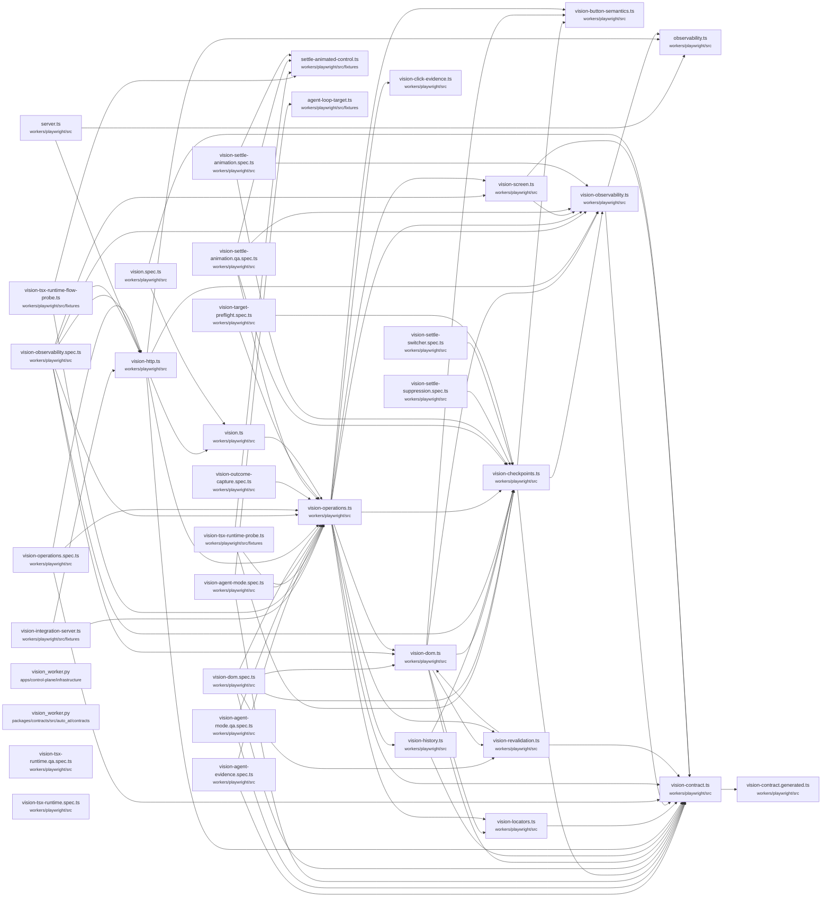

# Worker Playwright Vision

## Chức năng này làm gì

Đây là trình duyệt Chromium headless mà control-plane (actor duy nhất, xác thực bằng secret) điều khiển qua HTTP nội bộ `/visual-explorations/*` trong lúc khám phá Vision. Worker mở phiên trên URL đích, quan sát DOM, chụp ảnh before/after, chạy đúng một thao tác (click, gõ, cuộn...) rồi trả kết quả có checksum. Worker không giữ DB: phiên nằm trong RAM (`Map` ở `vision-operations.ts:47`), ảnh tạm nằm dưới `ARTIFACT_ROOT/vision-v4` đến khi control-plane xác nhận đã lưu (`vision-operations.ts:312-317,916-929`). Control-plane quyết định bước nào chạy tiếp. Đường dẫn bên dưới tính từ `workers/playwright/src/`.

## Vì sao các file này ảnh hưởng lẫn nhau

1. `server.ts:36-40` chuyển mọi URL bắt đầu bằng `/visual-explorations` cho `visualHttpHandler` (`vision-http.ts:9`). `server.ts` cũng phục vụ `/execute`, `/preflight`, `/cancel` của runner kiểm thử (`:42-45`), nên sửa `server.ts` chạm cả hai chức năng.
2. `vision-http.ts` kiểm secret (`:45-50`), giới hạn body 64 KB (`:8,53-55`), tách identity từ header `x-auto-at-vision-*` rồi định tuyến (`:64-125`). Mã lỗi 422 `{detail: code}` khớp với `HttpVisualWorker._request` phía Python (`apps/control-plane/infrastructure/vision_worker.py:71-116`). Đổi tên route hoặc mã lỗi thì control-plane vỡ. Phiên không phải v4 rơi xuống `vision.ts` (legacy, `:68-76`), nhưng bị chặn bằng `legacy_fallback_forbidden` nếu id đã là phiên v4.
3. Mọi payload đi qua `validateVision` (`vision-contract.ts:86`) với schema trong `vision-contract.generated.ts`, sinh từ model Python. Hai bên phải cùng sửa, vì file `.generated.ts` chỉ được sinh, không sửa tay.
4. `VisualOperationWorker.open` (`vision-operations.ts:113`) mở trình duyệt và trả `capabilities` (`:185`) cùng `operation_budget = 1 + max_states*(2*max_hops+3)` (`:189`). Control-plane yêu cầu đúng các giá trị này (`vision_worker.py:118-134`). Thêm capability phía Python mà worker chưa khai báo thì `open` thất bại.
5. Mỗi lệnh sau đó đi qua `identity()` (`:57-66`, so tenant, project, session và `fencing_token`) rồi `serialized()` (`:72`, từ chối `session_busy`). `prepare` (`:441`) chụp ảnh before, `execute` (`:584`) khoá click bằng `prepared_handle` và checksum, `acknowledge` (`:916`) xoá thư mục ảnh tạm. Dưới đó là các helper: `vision-dom.ts` (quan sát DOM), `vision-locators.ts` (định vị), `vision-checkpoints.ts` và `vision-history.ts` (khôi phục trạng thái), `vision-revalidation.ts` (kiểm target còn đúng), `vision-click-evidence.ts`, `vision-screen.ts`, `vision-button-semantics.ts`. Đổi chữ ký ở helper thì `vision-operations.ts` vỡ trước, rồi mới tới HTTP.

## Chạm vào đây thì phải kiểm tra thêm

- **Contract sinh tự động**: sửa model Python (`packages/contracts/src/auto_at/contracts/vision.py`, `vision_worker.py`, chưa thuộc graph) rồi chạy `uv run python packages/contracts/export_vision_worker.py` (có `--check` cho CI). `tests/test_vision_worker_contracts.py:15` so file `vision-contract.generated.ts` với bản render mới. Fixture dùng chung ở `packages/contracts/fixtures/vision-worker-v4/` và `vision-locator-v1/` (xem `vision.spec.ts:30-48`). Đừng sửa tay `vision-contract.generated.ts`.
- **Phía Python gọi vào**: `apps/control-plane/infrastructure/vision_worker.py`, `application/vision_operations.py`, `application/vision_trace_events.py` (graph `vision-exploration`; `vision_worker.py` chưa thuộc graph nào). Đổi bất kỳ header, route hay mã lỗi nào ở đây thì sửa cả hai bên.
- **Cờ config và compose**: biến `VISION_WORKER_SECRET` (`vision-http.ts` nhận qua `server.ts:7`; Python: `config.py:97`), `ARTIFACT_ROOT`, `PORT`; service `playwright-worker` ở `docker-compose.yml:78-90`; `workers/playwright/Dockerfile` ghim Playwright 1.50.1 (`package.json`). Không có job nền hay migration DB.
- **Không đổi hành vi giữa lease**: phiên mất RAM thì control-plane chỉ đối soát chứ không click lại (`vision_trace_events.py:178-205`), nên đừng thêm trạng thái chỉ sống trong RAM mà control-plane cần đọc sau khi worker restart.
- **Chẩn đoán `state_mismatch`**: `logStateMismatch` (`vision-checkpoints.ts`) phát `vision.state.mismatch` với `failure_stage` ∈ `prepare_start`, `observe_start`, `dom_collection`, `state_age_ms` và đếm/tag HTML của control đổi (`interaction_content_added/removed`, `interaction_geometry_only`, `interaction_changed_tags`); `RuntimeState.privateInteractions` chỉ chứa digest, không lộ ra transport/log. Từ r14 (ADR 042) `equivalentState` là so sánh có dung sai hình học (tâm <= 3 px, IoU >= 0.8; hộp layout cho animation vô hạn scale/rotate/opacity) dùng chung cho settle và mọi cổng trước dispatch (vision-dom, vision-history, vision-operations); fingerprint lưu trữ không đổi. Di chuyển/đổi label/xuất hiện/biến mất vẫn bị từ chối. Chạm `equivalentState` hay `privateInteractions` thì chạy `vision-settle-animation.spec.ts`. Hash lưu trữ chỉ so với state worker đang giữ (`session.state`) cộng `equivalentState`, không so inspect mới với hash trên wire; dispatch click dùng `force` chỉ khi `isPresentationOnlyAnimated` (checkpoints) đúng, chạm thì chạy thêm `vision-settle-animation.qa.spec.ts`.
- **Chạy kiểm tra**: `pnpm --filter @auto-at/playwright-worker typecheck`, `lint`, `test` (`vision-operations.spec.ts`, `vision-dom.spec.ts`, `vision-outcome-capture.spec.ts`, `vision-target-preflight.spec.ts`, `vision-observability.spec.ts`, `vision.spec.ts`; fixture server `fixtures/vision-integration-server.ts`). Phía Python: `tests/test_vision_worker_contracts.py`, `test_vision_operation_transport.py`, `test_vision_locator_pipeline.py`, `test_vision_dom_transport.py`, `test_vision_target_preflight.py`.

<!-- hgraph:begin auto -->

## Quan hệ file — hgraph tự sinh, ĐỪNG sửa tay

Cập nhật: 2026-11-21 · `hgraph sync playwright-vision-worker --apply` để tạo lại.

| File | Vai trò | Import (trong graph) | Bị import bởi (trong graph) |
|---|---|---|---|
| `apps/control-plane/infrastructure/vision_worker.py` | other | — | — |
| `packages/contracts/src/auto_at/contracts/vision_worker.py` | other | — | — |
| `workers/playwright/src/fixtures/agent-loop-target.ts` | job | — | `workers/playwright/src/vision-agent-mode.spec.ts` |
| `workers/playwright/src/fixtures/settle-animated-control.ts` | job | — | `workers/playwright/src/fixtures/vision-tsx-runtime-flow-probe.ts` `workers/playwright/src/fixtures/vision-tsx-runtime-probe.ts` `workers/playwright/src/vision-settle-animation.qa.spec.ts` `workers/playwright/src/vision-settle-animation.spec.ts` |
| `workers/playwright/src/fixtures/vision-integration-server.ts` | job | `workers/playwright/src/vision-http.ts` `workers/playwright/src/vision-operations.ts` | — |
| `workers/playwright/src/fixtures/vision-tsx-runtime-flow-probe.ts` | job | `workers/playwright/src/vision-operations.ts` `workers/playwright/src/vision-http.ts` `workers/playwright/src/fixtures/settle-animated-control.ts` | — |
| `workers/playwright/src/fixtures/vision-tsx-runtime-probe.ts` | job | `workers/playwright/src/vision-operations.ts` `workers/playwright/src/vision-checkpoints.ts` `workers/playwright/src/fixtures/settle-animated-control.ts` | — |
| `workers/playwright/src/observability.ts` | job | — | `workers/playwright/src/server.ts` `workers/playwright/src/vision-http.ts` `workers/playwright/src/vision-observability.ts` |
| `workers/playwright/src/server.ts` | job | `workers/playwright/src/observability.ts` `workers/playwright/src/vision-http.ts` | — |
| `workers/playwright/src/vision-agent-evidence.spec.ts` | test | `workers/playwright/src/vision-operations.ts` `workers/playwright/src/vision-contract.ts` | — |
| `workers/playwright/src/vision-agent-mode.qa.spec.ts` | test | `workers/playwright/src/vision-operations.ts` `workers/playwright/src/vision-contract.ts` | — |
| `workers/playwright/src/vision-agent-mode.spec.ts` | test | `workers/playwright/src/vision-operations.ts` `workers/playwright/src/vision-contract.ts` `workers/playwright/src/fixtures/agent-loop-target.ts` | — |
| `workers/playwright/src/vision-button-semantics.ts` | job | — | `workers/playwright/src/vision-checkpoints.ts` `workers/playwright/src/vision-dom.ts` `workers/playwright/src/vision-operations.ts` |
| `workers/playwright/src/vision-checkpoints.ts` | job | `workers/playwright/src/vision-button-semantics.ts` `workers/playwright/src/vision-contract.ts` `workers/playwright/src/vision-observability.ts` | `workers/playwright/src/fixtures/vision-tsx-runtime-probe.ts` `workers/playwright/src/vision-settle-animation.qa.spec.ts` `workers/playwright/src/vision-settle-animation.spec.ts` `workers/playwright/src/vision-settle-suppression.spec.ts` `workers/playwright/src/vision-settle-switcher.spec.ts` `workers/playwright/src/vision-dom.spec.ts` `workers/playwright/src/vision-dom.ts` `workers/playwright/src/vision-history.ts` `workers/playwright/src/vision-observability.spec.ts` `workers/playwright/src/vision-operations.ts` `workers/playwright/src/vision-target-preflight.spec.ts` |
| `workers/playwright/src/vision-click-evidence.ts` | job | — | `workers/playwright/src/vision-operations.ts` |
| `workers/playwright/src/vision-contract.generated.ts` | job | — | `workers/playwright/src/vision-contract.ts` |
| `workers/playwright/src/vision-contract.ts` | job | `workers/playwright/src/vision-contract.generated.ts` | `workers/playwright/src/vision-agent-evidence.spec.ts` `workers/playwright/src/vision-agent-mode.qa.spec.ts` `workers/playwright/src/vision-agent-mode.spec.ts` `workers/playwright/src/vision-checkpoints.ts` `workers/playwright/src/vision-dom.spec.ts` `workers/playwright/src/vision-dom.ts` `workers/playwright/src/vision-history.ts` `workers/playwright/src/vision-http.ts` `workers/playwright/src/vision-locators.ts` `workers/playwright/src/vision-observability.ts` `workers/playwright/src/vision-operations.spec.ts` `workers/playwright/src/vision-operations.ts` `workers/playwright/src/vision-revalidation.ts` `workers/playwright/src/vision-screen.ts` `workers/playwright/src/vision.spec.ts` |
| `workers/playwright/src/vision-dom.spec.ts` | test | `workers/playwright/src/vision-dom.ts` `workers/playwright/src/vision-checkpoints.ts` `workers/playwright/src/vision-contract.ts` `workers/playwright/src/vision-operations.ts` `workers/playwright/src/vision-revalidation.ts` | — |
| `workers/playwright/src/vision-dom.ts` | job | `workers/playwright/src/vision-button-semantics.ts` `workers/playwright/src/vision-contract.ts` `workers/playwright/src/vision-checkpoints.ts` `workers/playwright/src/vision-locators.ts` `workers/playwright/src/vision-observability.ts` `workers/playwright/src/vision-revalidation.ts` | `workers/playwright/src/vision-dom.spec.ts` `workers/playwright/src/vision-observability.spec.ts` `workers/playwright/src/vision-operations.ts` `workers/playwright/src/vision-revalidation.ts` |
| `workers/playwright/src/vision-history.ts` | job | `workers/playwright/src/vision-contract.ts` `workers/playwright/src/vision-checkpoints.ts` | `workers/playwright/src/vision-operations.ts` |
| `workers/playwright/src/vision-http.ts` | job | `workers/playwright/src/vision.ts` `workers/playwright/src/vision-contract.ts` `workers/playwright/src/vision-operations.ts` `workers/playwright/src/observability.ts` `workers/playwright/src/vision-observability.ts` | `workers/playwright/src/fixtures/vision-tsx-runtime-flow-probe.ts` `workers/playwright/src/fixtures/vision-integration-server.ts` `workers/playwright/src/server.ts` `workers/playwright/src/vision-observability.spec.ts` `workers/playwright/src/vision-operations.spec.ts` |
| `workers/playwright/src/vision-locators.ts` | job | `workers/playwright/src/vision-contract.ts` | `workers/playwright/src/vision-dom.ts` `workers/playwright/src/vision-operations.ts` |
| `workers/playwright/src/vision-observability.spec.ts` | test | `workers/playwright/src/vision-http.ts` `workers/playwright/src/vision-operations.ts` `workers/playwright/src/vision-screen.ts` `workers/playwright/src/vision-observability.ts` `workers/playwright/src/vision-checkpoints.ts` `workers/playwright/src/vision-dom.ts` | — |
| `workers/playwright/src/vision-observability.ts` | job | `workers/playwright/src/observability.ts` `workers/playwright/src/vision-contract.ts` | `workers/playwright/src/vision-settle-animation.qa.spec.ts` `workers/playwright/src/vision-settle-animation.spec.ts` `workers/playwright/src/vision-checkpoints.ts` `workers/playwright/src/vision-dom.ts` `workers/playwright/src/vision-http.ts` `workers/playwright/src/vision-observability.spec.ts` `workers/playwright/src/vision-operations.ts` `workers/playwright/src/vision-screen.ts` |
| `workers/playwright/src/vision-operations.spec.ts` | test | `workers/playwright/src/vision-operations.ts` `workers/playwright/src/vision-http.ts` `workers/playwright/src/vision-contract.ts` | — |
| `workers/playwright/src/vision-operations.ts` | job | `workers/playwright/src/vision-button-semantics.ts` `workers/playwright/src/vision-contract.ts` `workers/playwright/src/vision-locators.ts` `workers/playwright/src/vision-dom.ts` `workers/playwright/src/vision-revalidation.ts` `workers/playwright/src/vision-screen.ts` `workers/playwright/src/vision-click-evidence.ts` `workers/playwright/src/vision-observability.ts` `workers/playwright/src/vision-checkpoints.ts` `workers/playwright/src/vision-history.ts` | `workers/playwright/src/fixtures/vision-tsx-runtime-flow-probe.ts` `workers/playwright/src/fixtures/vision-tsx-runtime-probe.ts` `workers/playwright/src/vision-agent-evidence.spec.ts` `workers/playwright/src/vision-agent-mode.qa.spec.ts` `workers/playwright/src/vision-agent-mode.spec.ts` `workers/playwright/src/vision-settle-animation.qa.spec.ts` `workers/playwright/src/fixtures/vision-integration-server.ts` `workers/playwright/src/vision-dom.spec.ts` `workers/playwright/src/vision-http.ts` `workers/playwright/src/vision-observability.spec.ts` `workers/playwright/src/vision-operations.spec.ts` `workers/playwright/src/vision-outcome-capture.spec.ts` `workers/playwright/src/vision-target-preflight.spec.ts` `workers/playwright/src/vision.ts` |
| `workers/playwright/src/vision-outcome-capture.spec.ts` | test | `workers/playwright/src/vision-operations.ts` | — |
| `workers/playwright/src/vision-revalidation.ts` | job | `workers/playwright/src/vision-contract.ts` `workers/playwright/src/vision-dom.ts` | `workers/playwright/src/vision-dom.spec.ts` `workers/playwright/src/vision-dom.ts` `workers/playwright/src/vision-operations.ts` |
| `workers/playwright/src/vision-screen.ts` | job | `workers/playwright/src/vision-contract.ts` `workers/playwright/src/vision-observability.ts` | `workers/playwright/src/vision-observability.spec.ts` `workers/playwright/src/vision-operations.ts` |
| `workers/playwright/src/vision-settle-animation.qa.spec.ts` | test | `workers/playwright/src/vision-checkpoints.ts` `workers/playwright/src/vision-observability.ts` `workers/playwright/src/vision-operations.ts` `workers/playwright/src/fixtures/settle-animated-control.ts` | — |
| `workers/playwright/src/vision-settle-animation.spec.ts` | test | `workers/playwright/src/vision-checkpoints.ts` `workers/playwright/src/vision-observability.ts` `workers/playwright/src/fixtures/settle-animated-control.ts` | — |
| `workers/playwright/src/vision-settle-suppression.spec.ts` | test | `workers/playwright/src/vision-checkpoints.ts` | — |
| `workers/playwright/src/vision-settle-switcher.spec.ts` | test | `workers/playwright/src/vision-checkpoints.ts` | — |
| `workers/playwright/src/vision-target-preflight.spec.ts` | test | `workers/playwright/src/vision-operations.ts` `workers/playwright/src/vision-checkpoints.ts` | — |
| `workers/playwright/src/vision-tsx-runtime.qa.spec.ts` | test | — | — |
| `workers/playwright/src/vision-tsx-runtime.spec.ts` | test | — | — |
| `workers/playwright/src/vision.spec.ts` | test | `workers/playwright/src/vision.ts` `workers/playwright/src/vision-contract.ts` | — |
| `workers/playwright/src/vision.ts` | job | `workers/playwright/src/vision-operations.ts` | `workers/playwright/src/vision-http.ts` `workers/playwright/src/vision.spec.ts` |

### Ranh giới (blast radius ra ngoài graph)

- **File ngoài graph đang gọi vào** (20): `apps/control-plane/api/v1/routes/runs.py`, `apps/control-plane/infrastructure/runners.py`, `apps/control-plane/infrastructure/workflows/temporal.py`, `apps/control-plane/infrastructure/workflows/temporal_worker.py`, `apps/control-plane/main.py`, `tests/test_runner_transport.py`, `tests/test_telemetry.py`, `workers/playwright/src/execute.ts`, `workers/playwright/src/fixtures/exploration-strategy-benchmark.ts`, `workers/playwright/src/fixtures/vision-capture-probe.ts`, `workers/playwright/src/fixtures/vision-revalidation-probe.ts`, `workers/playwright/src/fixtures/visual-buttons-audit.ts`, `workers/playwright/src/observability.spec.ts`, `workers/playwright/src/vision-click-evidence.spec.ts`, `workers/playwright/src/vision-history.spec.ts`, `workers/playwright/src/vision-locators.spec.ts`, `workers/playwright/src/vision-readiness.spec.ts`, `workers/playwright/src/vision-sample-guard.spec.ts`, `workers/playwright/src/vision-settle-observability.spec.ts`, `workers/playwright/src/vision-visual-buttons.spec.ts`
- **File ngoài graph bị graph này gọi** (4): `apps/control-plane/infrastructure/observability/logging.py`, `apps/control-plane/infrastructure/observability/telemetry.py`, `workers/playwright/src/execute.ts`, `workers/playwright/src/fixtures/vision-target.ts`

<!-- hgraph:end auto -->
