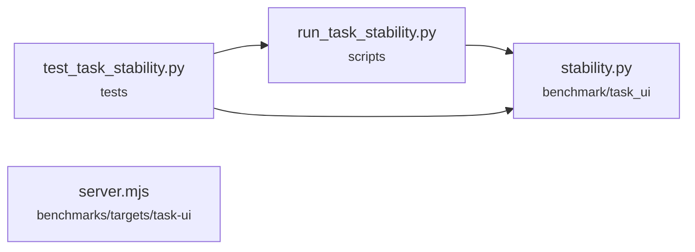

# Fixture task-ui và bộ đo ổn định agent loop theo task (ADR-046)

## Chức năng này làm gì

Người phát triển chạy `scripts/run_task_stability.py` để gửi bộ 10 task (`benchmarks/task-ui/tasks.v1.json`) tới
app mẫu `benchmarks/targets/task-ui/server.mjs`, lặp mỗi task nhiều lần bằng engine agent loop và nhận báo cáo
mức nhất quán giữa các lần chạy (ADR-046).

## Vì sao các file này ảnh hưởng lẫn nhau

`scripts/run_task_stability.py` là CLI mỏng gọi logic tính toán trong `benchmark/task_ui/stability.py`;
`tests/test_task_stability.py` kiểm cả hai và kiểm dữ liệu task. `server.mjs` là app độc lập (không import Python):
đổi route hoặc nhãn trên đó thì phải đổi `tasks.v1.json` (ngoài graph) và kỳ vọng trong test.

## Chạm vào đây thì phải kiểm tra thêm

- `benchmarks/task-ui/tasks.v1.json` và `benchmarks/targets/task-ui/{Dockerfile,README.md}` không được hgraph lập chỉ mục.
- `docker-compose.agent-loop.yml` chạy fixture; đổi cổng/tên service thì sửa cả compose.
- Runner gọi API control-plane đang chạy (vision sessions); đổi response của API đó thì sửa `stability.py`.

<!-- hgraph:begin auto -->

## Quan hệ file — hgraph tự sinh, ĐỪNG sửa tay

Cập nhật: 2026-11-26 · `hgraph sync task-ui-stability --apply` để tạo lại.

| File | Vai trò | Import (trong graph) | Bị import bởi (trong graph) |
|---|---|---|---|
| `benchmark/task_ui/stability.py` | other | — | `scripts/run_task_stability.py` `tests/test_task_stability.py` |
| `benchmarks/targets/task-ui/server.mjs` | other | — | — |
| `scripts/run_task_stability.py` | other | `benchmark/task_ui/stability.py` | `tests/test_task_stability.py` |
| `tests/test_task_stability.py` | test | `scripts/run_task_stability.py` `benchmark/task_ui/stability.py` | — |

### Ranh giới (blast radius ra ngoài graph)

- **File ngoài graph đang gọi vào** (0): —
- **File ngoài graph bị graph này gọi** (0): —

<!-- hgraph:end auto -->
