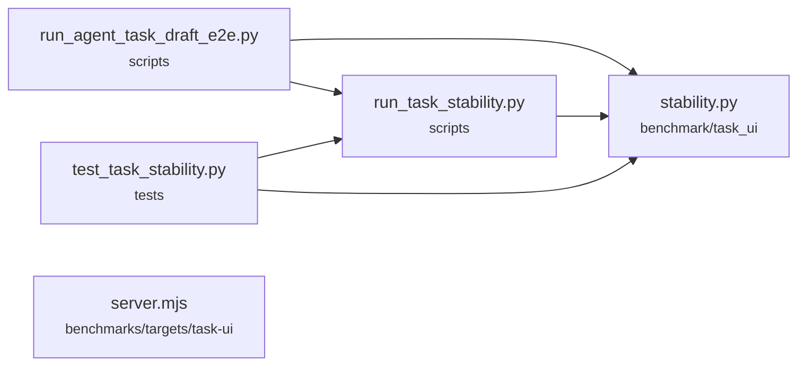

# Fixture task-ui và bộ đo ổn định agent loop theo task (ADR-046)

## Chức năng này làm gì

Người phát triển chạy `scripts/run_task_stability.py` để gửi bộ 10 task (`benchmarks/task-ui/tasks.v1.json`) tới
app mẫu `benchmarks/targets/task-ui/server.mjs`, lặp mỗi task nhiều lần bằng engine agent loop và nhận báo cáo
mức nhất quán giữa các lần chạy (ADR-046).

## Vì sao các file này ảnh hưởng lẫn nhau

`scripts/run_task_stability.py` là CLI mỏng gọi logic tính toán trong `benchmark/task_ui/stability.py`;
`tests/test_task_stability.py` kiểm cả hai và kiểm dữ liệu task. `server.mjs` là app độc lập (không import Python):
đổi route hoặc nhãn trên đó thì phải đổi `tasks.v1.json` (ngoài graph) và kỳ vọng trong test.

## Đo end-to-end của bản nháp test (ADR-047, phase 16)

`scripts/run_agent_task_draft_e2e.py` chạy từng bước (`setup`, `sessions`, `positive`, `reruns`, `case <a|bj|c|def|g|h|i>`, `scan`, `summary`,
`teardown`) trên stack thật, ghi `state.json` và `events.jsonl` (chỉ id, độ dài, mã lỗi; không bao giờ giá trị) để chạy tiếp được. Nó dùng
lại `run_task_stability.py` (HTTP, reset) và `stability.rerun_summary` (độ ổn định của MỘT test đã duyệt chạy lại: số `passed` / số lần, cùng
ngưỡng `STABLE_THRESHOLD`; công thức cũ không đổi). Nó dựng container fixture thứ hai `auto-at-ui-task-target-e2e` (alias `task-target-e2e`) từ bản sao
`server.mjs` có thêm `POST /__mode?broken=&pw=` (đổi chữ lời chào, đổi nhãn ô thành "Password"); `server.mjs` trong repo KHÔNG đổi và
`patch_fixture_source` báo lỗi nếu mất neo, nên đổi chữ trong `server.mjs` (lời chào `Xin chào, `, nhãn `Mật khẩu`, vị trí `case "GET /healthz"`)
là đổi cả script này. Danh sách nơi lưu giá trị được khai báo (`DECLARED_AFTER_CREATE/APPROVAL`, `MUST_BE_CLEAN_TABLES`) nằm trong script và được
`tests/test_agent_task_draft_e2e.py` (graph `agent-task-draft`) ghim; script đọc DB thật bằng `docker exec ... psql` (container `auto-at-ui-postgres-1`).
Chạy lại test đã duyệt đi qua `POST /api/v1/runs` (như dashboard): thân là request đã lưu của run đầu bỏ `traceparent` (route tự thêm; worker nhận nó từ phase 15c, F1 đã hết).
`--project-suffix` đổi tên hai project phụ để một vòng mới không thừa phiên của vòng cũ: kiểm đồng thuận gom phiên theo project + URL + task, nên phiên `not_achieved` cũ kéo tỉ lệ dưới 0,9.

## Chạm vào đây thì phải kiểm tra thêm

- Tên container, mạng `auto-at-ui_default`, image `auto-at-ui-task-target` và tên DB/user (`auto_at`) được ghi cứng trong script phase 16.

- `benchmarks/task-ui/tasks.v1.json` và `benchmarks/targets/task-ui/{Dockerfile,README.md}` không được hgraph lập chỉ mục.
- `docker-compose.agent-loop.yml` chạy fixture; đổi cổng/tên service thì sửa cả compose.
- Runner gọi API control-plane đang chạy (vision sessions); đổi response của API đó thì sửa `stability.py`.

<!-- hgraph:begin auto -->

## Quan hệ file — hgraph tự sinh, ĐỪNG sửa tay

Cập nhật: 2026-11-28 · `hgraph sync task-ui-stability --apply` để tạo lại.

| File | Vai trò | Import (trong graph) | Bị import bởi (trong graph) |
|---|---|---|---|
| `benchmark/task_ui/stability.py` | other | — | `scripts/run_agent_task_draft_e2e.py` `scripts/run_task_stability.py` `tests/test_task_stability.py` |
| `benchmarks/targets/task-ui/server.mjs` | other | — | — |
| `scripts/run_agent_task_draft_e2e.py` | other | `scripts/run_task_stability.py` `benchmark/task_ui/stability.py` | — |
| `scripts/run_task_stability.py` | other | `benchmark/task_ui/stability.py` | `scripts/run_agent_task_draft_e2e.py` `tests/test_task_stability.py` |
| `tests/test_task_stability.py` | test | `scripts/run_task_stability.py` `benchmark/task_ui/stability.py` | — |

### Ranh giới (blast radius ra ngoài graph)

- **File ngoài graph đang gọi vào** (3): `tests/test_agent_task_consistency.py`, `tests/test_agent_task_draft_e2e.py`, `tests/test_qa_p09_agent_task_consistency.py`
- **File ngoài graph bị graph này gọi** (0): —

<!-- hgraph:end auto -->
