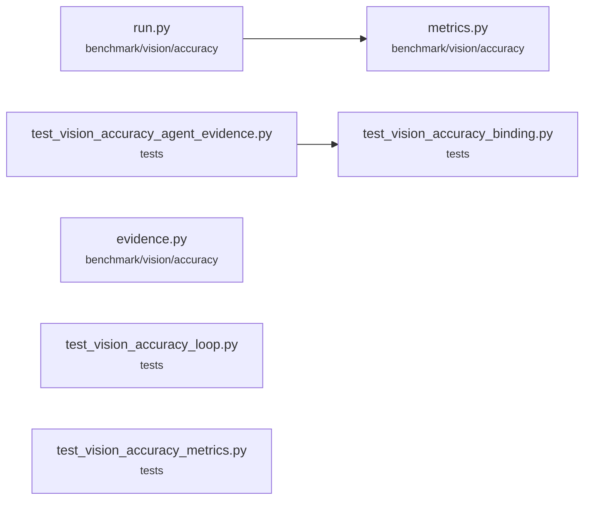

# Harness chấm điểm benchmark độ chính xác Vision (collect, ground, evaluate)

## Chức năng này làm gì

Harness benchmark đọc một phiên Vision đã kết thúc qua API (chỉ GET), xuất evidence allowlist, rồi chấm C/A/P/R theo oracle
cố định mà không suy ra đúng/sai từ `completed`. Hỗ trợ locator `dom_path` (engine planner) và locator `role` (engine `agent_loop`,
ADR-039). Kết quả là điểm benchmark, không phải verdict thực thi.

## Vì sao các file này ảnh hưởng lẫn nhau

`run.py` (Loop: collect, ground, evaluate) gọi `evidence.py` để xuất operation/locator/grounding và để kiểm tra binding
(`binding_error`), rồi gọi `metrics.py` (`score`, `Assessment`, `Detection`) để chấm. `evaluate` đọc `evidence.json`,
`grounding.json`, `oracle.json` và các review content-addressed trong thư mục run. Các test nạp `run.py` bằng `importlib`, nên
hgraph không thấy quan hệ import; quan hệ này nằm ở danh sách file của graph.

## Chạm vào đây thì phải kiểm tra thêm

- Không được đổi oracle `oracle-mongchiton-1280-v1.json` (hash `9242b33d...`), ngưỡng >95% hay định nghĩa C/A/P/R mà không có quyết định của user.
- Đổi `binding_error` thì chạy `tests/test_vision_accuracy_binding.py`: có test dựng lại mọi run cũ trong `runs/` và so với `score.json`.
- Trace API (`/trace`: `executed_click`, `descriptor`, `bounding_box`) là đầu vào của `export_grounding`; đổi các trường này ở control-plane
  (graph `vision-agent-loop`) thì phải xem lại `evidence.py`.
- ADR-040: `executed_click.scroll_x/scroll_y/url_fingerprint` (cờ A1) và `/result` `pages` (cờ A3) là đầu vào tuỳ chọn của `export_contexts`,
  `export_inventory`, `derive_detection`; thiếu hoặc hỏng thì phải rơi về hành vi cũ. `tests/test_vision_accuracy_agent_evidence.py`
  chạy lại từng tổ hợp `--sources`/`--label`.
- Không có DB riêng: mọi artifact nằm ở `benchmark/vision/accuracy/runs/<iteration>/` và bất biến (`retain_json`).

<!-- hgraph:begin auto -->

## Quan hệ file — hgraph tự sinh, ĐỪNG sửa tay

Cập nhật: 2026-11-21 · `hgraph sync vision-accuracy-harness --apply` để tạo lại.

| File | Vai trò | Import (trong graph) | Bị import bởi (trong graph) |
|---|---|---|---|
| `benchmark/vision/accuracy/evidence.py` | other | — | — |
| `benchmark/vision/accuracy/metrics.py` | other | — | `benchmark/vision/accuracy/run.py` |
| `benchmark/vision/accuracy/run.py` | other | `benchmark/vision/accuracy/metrics.py` | — |
| `tests/test_vision_accuracy_agent_evidence.py` | test | `tests/test_vision_accuracy_binding.py` | — |
| `tests/test_vision_accuracy_binding.py` | test | — | `tests/test_vision_accuracy_agent_evidence.py` |
| `tests/test_vision_accuracy_loop.py` | test | — | — |
| `tests/test_vision_accuracy_metrics.py` | test | — | — |

### Ranh giới (blast radius ra ngoài graph)

- **File ngoài graph đang gọi vào** (1): `tests/test_qa_r8_agent_evidence.py`
- **File ngoài graph bị graph này gọi** (0): —

<!-- hgraph:end auto -->
