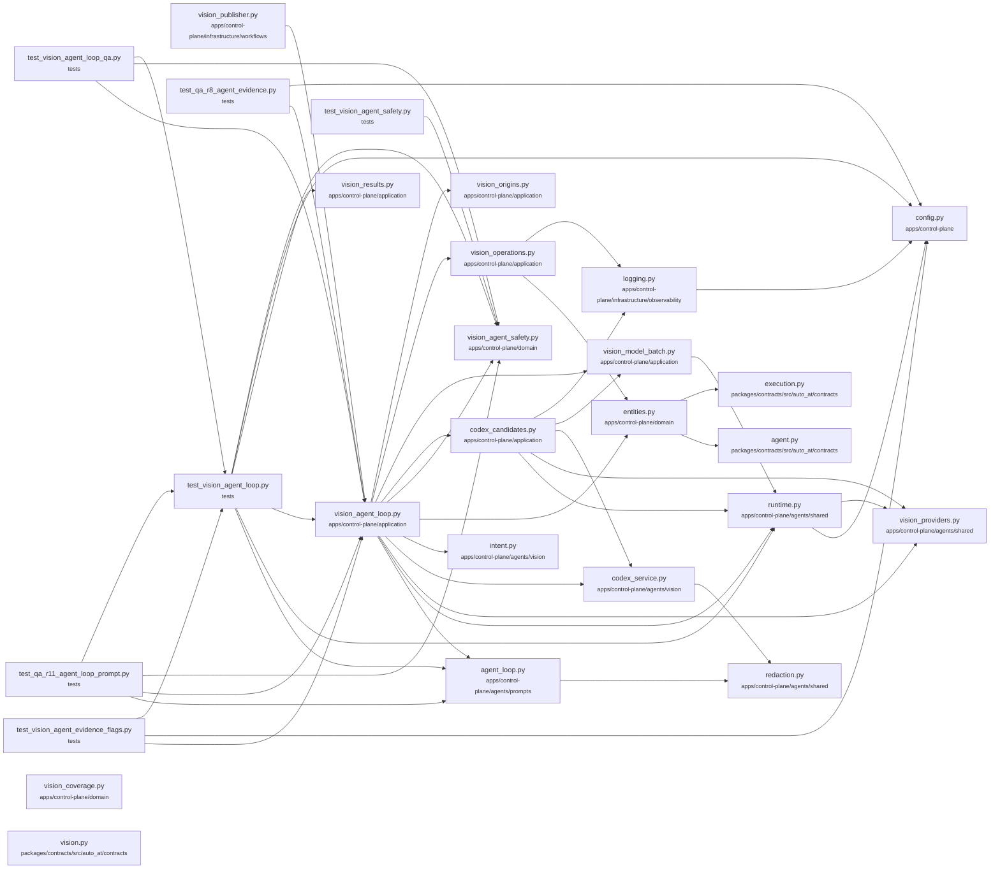

# Vòng agent loop Vision

## Chức năng này làm gì

Người dùng chọn `engine=agent_loop` khi tạo session Vision. Processor `VisionAgentLoopProcessor` lặp: observe DOM, render snapshot
(ref `version:n`, cắt theo `vision_agent_snapshot_chars`), gọi model qua bridge (`agent-loop-v2`), kiểm an toàn bằng code
(`domain/vision_agent_safety.py`), chạy từng action qua `ExecuteVisualOperation`, dừng batch khi trang đổi, ghi step log
(`visual_agent_steps`) rồi lặp tới `agent_done` / `agent_stopped` / `agent_step_limit` / `session_timeout`. Không restore/replay.

## Vì sao các file này ảnh hưởng lẫn nhau

`vision_publisher.py` chọn processor theo `record.exploration_engine` (planner v4 giữ nguyên ở `vision_trace_events.py`).
`vision_agent_loop.py` dựng `VisualWorkerOpen(agent_mode=True, blocked_action_terms=BLOCKED_ACTION_TERMS)`; danh sách từ khoá chỉ có
một nguồn ở `vision_agent_safety.py` và worker (`vision-operations.ts`) khớp kiểu "chứa" không bỏ dấu, nên đổi danh sách phải giữ cả
dạng có dấu và không dấu. Prompt ở `agents/prompts/agent_loop.py`; ref/snapshot render ở đây phải khớp định dạng prompt nêu.
`vision_results.py` chỉ đọc step log để thêm `agent_step` vào trace. Ngân sách operation của worker `1 + max_states*(2*max_hops+3)`
phải >= 401 (hằng `WORKER_MAX_STATES`/`WORKER_MAX_HOPS`).

## Chạm vào đây thì phải kiểm tra thêm

- Worker Playwright (graph `playwright-vision-worker`): đổi mã outcome (`origin_blocked`, `sensitive_action_blocked`, `stale_dom_snapshot`) hoặc cách
  worker tính fingerprint sau `type` thì phải xem lại `stop_cause()`.
- Bridge (graph `codex-bridge`): `agent_context`, trần `AGENT_REQUEST_MAX_BYTES`, mỗi lần gọi (retry, stage image) đều qua `CodexCallBudget.reserve`.
- DB `visual_agent_steps` (phase 1): `record_agent_step` redact và fence; `agent_steps(scope)` chưa có trên `SqlAlchemyVisualTraceRepository` nên
  trace chỉ có `agent_step` khi repository đó được nối `agent_steps`.
- Benchmark `benchmark/vision/accuracy/evidence.py` đọc mọi operation (purpose chỉ `setup`/`explore`).
- ADR-040, ba cờ mặc định tắt chỉ `temporal-worker` đọc (`VISION_AGENT_CLICK_CONTEXT_ENABLED`, `VISION_AGENT_DOM_PATH_ENABLED`,
  `VISION_AGENT_INVENTORY_ENABLED`): `worker_capabilities()` quyết định capability gửi worker (`click-context-v1`, `agent-dom-path-v1`);
  `_save_inventory` ghi `page_inventory` qua `domain/vision_coverage.py`; `VisualExecutedClick` (contracts `vision.py`) có
  `scroll_x/scroll_y/url_fingerprint` tuỳ chọn và serializer bỏ key vắng để payload/revision cũ không đổi. Đổi các trường này
  phải xem lại `benchmark/vision/accuracy/evidence.py` (graph `vision-accuracy-harness`) và worker (graph `playwright-vision-worker`).

<!-- hgraph:begin auto -->

## Quan hệ file — hgraph tự sinh, ĐỪNG sửa tay

Cập nhật: 2026-11-21 · `hgraph sync vision-agent-loop --apply` để tạo lại.

| File | Vai trò | Import (trong graph) | Bị import bởi (trong graph) |
|---|---|---|---|
| `apps/control-plane/agents/prompts/agent_loop.py` | other | `apps/control-plane/agents/shared/redaction.py` | `apps/control-plane/application/vision_agent_loop.py` `tests/test_qa_r11_agent_loop_prompt.py` `tests/test_vision_agent_loop.py` |
| `apps/control-plane/agents/shared/redaction.py` | other | — | `apps/control-plane/agents/prompts/agent_loop.py` `apps/control-plane/agents/vision/codex_service.py` |
| `apps/control-plane/agents/shared/runtime.py` | other | `apps/control-plane/config.py` `apps/control-plane/agents/shared/vision_providers.py` | `apps/control-plane/application/vision_agent_loop.py` `tests/test_vision_agent_loop.py` `apps/control-plane/application/codex_candidates.py` `apps/control-plane/application/vision_model_batch.py` |
| `apps/control-plane/agents/shared/vision_providers.py` | other | — | `apps/control-plane/application/vision_agent_loop.py` `apps/control-plane/agents/shared/runtime.py` `apps/control-plane/application/codex_candidates.py` |
| `apps/control-plane/agents/vision/codex_service.py` | service | `apps/control-plane/agents/shared/redaction.py` | `apps/control-plane/application/vision_agent_loop.py` `apps/control-plane/application/codex_candidates.py` |
| `apps/control-plane/agents/vision/intent.py` | other | — | `apps/control-plane/application/vision_agent_loop.py` |
| `apps/control-plane/application/codex_candidates.py` | other | `apps/control-plane/agents/shared/runtime.py` `apps/control-plane/agents/shared/vision_providers.py` `apps/control-plane/agents/vision/codex_service.py` `apps/control-plane/application/vision_model_batch.py` `apps/control-plane/infrastructure/observability/logging.py` | `apps/control-plane/application/vision_agent_loop.py` |
| `apps/control-plane/application/vision_agent_loop.py` | other | `apps/control-plane/agents/prompts/agent_loop.py` `apps/control-plane/agents/shared/runtime.py` `apps/control-plane/agents/shared/vision_providers.py` `apps/control-plane/agents/vision/codex_service.py` `apps/control-plane/agents/vision/intent.py` `apps/control-plane/domain/entities.py` `apps/control-plane/domain/vision_agent_safety.py` `apps/control-plane/application/codex_candidates.py` `apps/control-plane/application/vision_model_batch.py` `apps/control-plane/application/vision_operations.py` `apps/control-plane/application/vision_origins.py` | `tests/test_qa_r11_agent_loop_prompt.py` `tests/test_qa_r8_agent_evidence.py` `tests/test_vision_agent_evidence_flags.py` `tests/test_vision_agent_loop.py` `tests/test_vision_agent_loop_qa.py` `apps/control-plane/infrastructure/workflows/vision_publisher.py` |
| `apps/control-plane/application/vision_model_batch.py` | model | `apps/control-plane/agents/shared/runtime.py` | `apps/control-plane/application/vision_agent_loop.py` `apps/control-plane/application/codex_candidates.py` |
| `apps/control-plane/application/vision_operations.py` | other | `apps/control-plane/domain/entities.py` `apps/control-plane/infrastructure/observability/logging.py` | `apps/control-plane/application/vision_agent_loop.py` |
| `apps/control-plane/application/vision_origins.py` | other | — | `apps/control-plane/application/vision_agent_loop.py` |
| `apps/control-plane/application/vision_results.py` | other | — | `tests/test_vision_agent_loop.py` |
| `apps/control-plane/config.py` | other | — | `tests/test_qa_r8_agent_evidence.py` `tests/test_vision_agent_evidence_flags.py` `tests/test_vision_agent_loop.py` `apps/control-plane/agents/shared/runtime.py` `apps/control-plane/infrastructure/observability/logging.py` |
| `apps/control-plane/domain/entities.py` | service | `packages/contracts/src/auto_at/contracts/agent.py` `packages/contracts/src/auto_at/contracts/execution.py` | `apps/control-plane/application/vision_agent_loop.py` `apps/control-plane/application/vision_operations.py` |
| `apps/control-plane/domain/vision_agent_safety.py` | service | — | `apps/control-plane/application/vision_agent_loop.py` `tests/test_qa_r11_agent_loop_prompt.py` `tests/test_vision_agent_loop.py` `tests/test_vision_agent_loop_qa.py` `tests/test_vision_agent_safety.py` |
| `apps/control-plane/domain/vision_coverage.py` | service | — | — |
| `apps/control-plane/infrastructure/observability/logging.py` | other | `apps/control-plane/config.py` | `apps/control-plane/application/codex_candidates.py` `apps/control-plane/application/vision_operations.py` |
| `apps/control-plane/infrastructure/workflows/vision_publisher.py` | other | `apps/control-plane/application/vision_agent_loop.py` | — |
| `packages/contracts/src/auto_at/contracts/agent.py` | other | — | `apps/control-plane/domain/entities.py` |
| `packages/contracts/src/auto_at/contracts/execution.py` | other | — | `apps/control-plane/domain/entities.py` |
| `packages/contracts/src/auto_at/contracts/vision.py` | other | — | — |
| `tests/test_qa_r11_agent_loop_prompt.py` | test | `apps/control-plane/agents/prompts/agent_loop.py` `apps/control-plane/application/vision_agent_loop.py` `apps/control-plane/domain/vision_agent_safety.py` `tests/test_vision_agent_loop.py` | — |
| `tests/test_qa_r8_agent_evidence.py` | test | `apps/control-plane/application/vision_agent_loop.py` `apps/control-plane/config.py` | — |
| `tests/test_vision_agent_evidence_flags.py` | test | `apps/control-plane/application/vision_agent_loop.py` `apps/control-plane/config.py` `tests/test_vision_agent_loop.py` | — |
| `tests/test_vision_agent_loop.py` | test | `apps/control-plane/agents/prompts/agent_loop.py` `apps/control-plane/agents/shared/runtime.py` `apps/control-plane/application/vision_agent_loop.py` `apps/control-plane/application/vision_results.py` `apps/control-plane/config.py` `apps/control-plane/domain/vision_agent_safety.py` | `tests/test_qa_r11_agent_loop_prompt.py` `tests/test_vision_agent_evidence_flags.py` `tests/test_vision_agent_loop_qa.py` |
| `tests/test_vision_agent_loop_qa.py` | test | `apps/control-plane/application/vision_agent_loop.py` `apps/control-plane/domain/vision_agent_safety.py` `tests/test_vision_agent_loop.py` | — |
| `tests/test_vision_agent_safety.py` | test | `apps/control-plane/domain/vision_agent_safety.py` | — |

### Ranh giới (blast radius ra ngoài graph)

- **File ngoài graph đang gọi vào** (156): `apps/control-plane/agents/healing/service.py`, `apps/control-plane/agents/reporting/executor.py`, `apps/control-plane/agents/reporting/service.py`, `apps/control-plane/agents/shared/evidence.py`, `apps/control-plane/agents/shared/gemini.py`, `apps/control-plane/agents/shared/openrouter.py`, `apps/control-plane/agents/triage/executor.py`, `apps/control-plane/agents/triage/service.py`, `apps/control-plane/agents/vision/evidence.py`, `apps/control-plane/agents/vision/executor.py`, `apps/control-plane/api/v1/dependencies/authorization.py`, `apps/control-plane/api/v1/dependencies/generation_policy.py`, `apps/control-plane/api/v1/dependencies/vision.py`, `apps/control-plane/api/v1/routes/activities.py`, `apps/control-plane/api/v1/routes/auth.py`, `apps/control-plane/api/v1/routes/catalog.py`, `apps/control-plane/api/v1/routes/demo.py`, `apps/control-plane/api/v1/routes/generation.py`, `apps/control-plane/api/v1/routes/operations.py`, `apps/control-plane/api/v1/routes/proposals.py`, `apps/control-plane/api/v1/routes/runs.py`, `apps/control-plane/api/v1/routes/vision.py`, `apps/control-plane/api/v1/routes/worker_progress.py`, `apps/control-plane/application/codex_bridge.py`, `apps/control-plane/application/generation.py`, `apps/control-plane/application/generation_events.py`, `apps/control-plane/application/generation_policy.py`, `apps/control-plane/application/proposals.py`, `apps/control-plane/application/reporting.py`, `apps/control-plane/application/reporting_events.py`, `apps/control-plane/application/runs.py`, `apps/control-plane/application/triage.py`, `apps/control-plane/application/triage_events.py`, `apps/control-plane/application/vision.py`, `apps/control-plane/application/vision_events.py`, `apps/control-plane/application/vision_policy.py`, `apps/control-plane/application/vision_reload.py`, `apps/control-plane/application/vision_source_renderer.py`, `apps/control-plane/application/vision_trace_events.py`, `apps/control-plane/benchmark/models.py`, `apps/control-plane/cli.py`, `apps/control-plane/codex_bridge_cli.py`, `apps/control-plane/domain/knowledge.py`, `apps/control-plane/domain/ports.py`, `apps/control-plane/domain/proposals.py`, `apps/control-plane/domain/runs.py`, `apps/control-plane/infrastructure/artifacts/rustfs.py`, `apps/control-plane/infrastructure/codex_bridge/claude_process.py`, `apps/control-plane/infrastructure/codex_bridge/doctor.py`, `apps/control-plane/infrastructure/codex_bridge/generation_model.py`, `apps/control-plane/infrastructure/codex_bridge/process.py`, `apps/control-plane/infrastructure/codex_bridge/spool.py`, `apps/control-plane/infrastructure/observability/__init__.py`, `apps/control-plane/infrastructure/persistence/codex_bridge_repository.py`, `apps/control-plane/infrastructure/persistence/repositories.py`, `apps/control-plane/infrastructure/persistence/session.py`, `apps/control-plane/infrastructure/persistence/vision_unit_of_work.py`, `apps/control-plane/infrastructure/runners.py`, `apps/control-plane/infrastructure/vision/codex_batch.py`, `apps/control-plane/infrastructure/vision/codex_composition.py`, `apps/control-plane/infrastructure/vision/model_batch.py`, `apps/control-plane/infrastructure/vision_worker.py`, `apps/control-plane/infrastructure/workflows/temporal.py`, `apps/control-plane/infrastructure/workflows/temporal_worker.py`, `apps/control-plane/main.py`, `apps/control-plane/runners/ports.py`, `benchmark/vision/codex/live_canary.py`, `benchmark/vision/codex/offline_suite.py`, `benchmark/vision/gehihi/run_offline.py`, `migrations/env.py`, `packages/contracts/src/auto_at/contracts/generation.py`, `plan/20261119-2212-browser-agent-loop/reports/phase-00/v4_identity.py`, `scripts/migrate_minio_to_rustfs.py`, `tests/fixtures/codex_bridge_mount_probe.py`, `tests/fixtures/codex_bridge_tool_probe.py`, `tests/test_agent_boundaries.py`, `tests/test_agent_loop_bridge.py`, `tests/test_agent_loop_bridge_qa.py`, `tests/test_agent_loop_contracts.py`, `tests/test_agent_loop_prompt.py`, `tests/test_agent_runtime.py`, `tests/test_artifact_retention.py`, `tests/test_catalog_routes.py`, `tests/test_claude_bridge.py`, `tests/test_codex_bridge_benchmark.py`, `tests/test_codex_bridge_end_to_end.py`, `tests/test_codex_bridge_migrations.py`, `tests/test_codex_bridge_qualification.py`, `tests/test_codex_bridge_repository.py`, `tests/test_codex_bridge_service.py`, `tests/test_codex_bridge_spool.py`, `tests/test_codex_candidate_service.py`, `tests/test_codex_exploration_integration.py`, `tests/test_codex_generation.py`, `tests/test_codex_model_batch.py`, `tests/test_config.py`, `tests/test_execution_contract_fixtures.py`, `tests/test_gemini_vision_model.py`, `tests/test_generation_contracts.py`, `tests/test_generation_event_processor.py`, `tests/test_generation_planner.py`, `tests/test_generation_preflight.py`, `tests/test_generation_provider_routes.py`, `tests/test_healing_proposals.py`, `tests/test_knowledge_promotion.py`, `tests/test_playwright_worker_compose.py`, `tests/test_proposal_domain.py`, `tests/test_proposal_use_cases.py`, `tests/test_reporting_event_processor.py`, `tests/test_reporting_executor.py`, `tests/test_reporting_routes.py`, `tests/test_run_domain.py`, `tests/test_run_report_contract.py`, `tests/test_run_report_repository.py`, `tests/test_run_repository.py`, `tests/test_run_routes.py`, `tests/test_run_use_cases.py`, `tests/test_runner_transport.py`, `tests/test_rustfs_artifacts.py`, `tests/test_rustfs_operation_storage.py`, `tests/test_rustfs_read_after_write.py`, `tests/test_telemetry.py`, `tests/test_temporal_cancellation.py`, `tests/test_triage_event_processor.py`, `tests/test_triage_executor.py`, `tests/test_verified_artifacts.py`, `tests/test_vision_agent_engine_selection.py`, `tests/test_vision_benchmark.py`, `tests/test_vision_event_processor.py`, `tests/test_vision_evidence.py`, `tests/test_vision_executor.py`, `tests/test_vision_handoff_repository.py`, `tests/test_vision_intent.py`, `tests/test_vision_live_persistence.py`, `tests/test_vision_locator_pipeline.py`, `tests/test_vision_migration_compatibility.py`, `tests/test_vision_model_batch.py`, `tests/test_vision_operation_failure_stage.py`, `tests/test_vision_operation_transport.py`, `tests/test_vision_origins.py`, `tests/test_vision_page_batch.py`, `tests/test_vision_policy.py`, `tests/test_vision_policy_persistence.py`, `tests/test_vision_policy_routes.py`, `tests/test_vision_progress.py`, `tests/test_vision_provider_integration.py`, `tests/test_vision_provider_submission.py`, `tests/test_vision_reload.py`, `tests/test_vision_replay.py`, `tests/test_vision_target_preflight.py`, `tests/test_vision_trajectory_repository.py`, `tests/test_vision_tree_capacity.py`, `tests/test_vision_viewport_scan.py`, `tests/test_vision_worker_observability.py`, `tests/test_worker_progress.py`, `tests/vision_trace_fixtures.py`
- **File ngoài graph bị graph này gọi** (17): `apps/control-plane/application/vision_replay.py`, `apps/control-plane/application/vision_trace_events.py`, `apps/control-plane/codex_bridge_cli.py`, `apps/control-plane/domain/vision_conclusion.py`, `apps/control-plane/infrastructure/artifacts/rustfs.py`, `apps/control-plane/infrastructure/observability/telemetry.py`, `apps/control-plane/infrastructure/persistence/repositories.py`, `apps/control-plane/infrastructure/persistence/session.py`, `apps/control-plane/infrastructure/persistence/vision_unit_of_work.py`, `apps/control-plane/infrastructure/vision/codex_composition.py`, `apps/control-plane/infrastructure/vision/model_batch.py`, `tests/test_agent_loop_bridge.py`, `tests/test_codex_bridge_contracts.py`, `tests/test_codex_candidate_service.py`, `tests/test_vision_accuracy_agent_evidence.py`, `tests/test_vision_accuracy_binding.py`, `tests/vision_trace_fixtures.py`

<!-- hgraph:end auto -->
