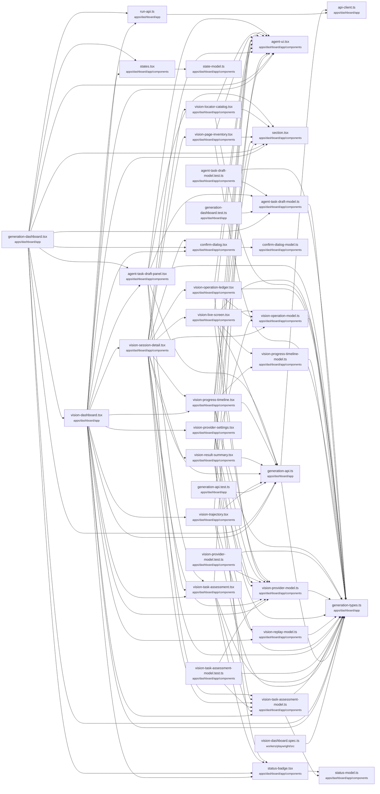

# Dashboard Vision

## Chức năng này làm gì

Actor là người dùng tenant (xem session, tạo exploration) và `tenant_admin` (lưu Vision policy, xoá replay/evidence; vai trò đọc từ `/api/v1/auth/me` ở `vision-dashboard.tsx:99`, kiểm tra tại `:168`, `:227`). Màn Vision nằm trong tab "vision" của `generation-dashboard.tsx:143`. Người dùng chọn project, nhập target URL và intent để tạo một exploration tư vấn (advisory) bằng provider đã được đồng ý chuyển dữ liệu (`vision-dashboard.tsx:243-252`), hoặc Reload một session cũ (`:180-184`). Sau đó xem session: live screen của browser, ledger các operation ("Browser steps"), kết quả/báo cáo, page inventory, locator catalog (`vision-session-detail.tsx:84-100`), và đổi provider/model/consent trong Vision settings (`vision-provider-settings.tsx:5`). Kết quả là bằng chứng và draft test chờ duyệt, không phải verdict kiểm thử (`vision-dashboard.tsx:223`, `:254`).

## Vì sao các file này ảnh hưởng lẫn nhau

Đi theo hành động "Start advisory exploration":
1. `vision-dashboard.tsx:84` nạp policy + providers qua `getVisionPolicy`/`getVisionProviders`. `enabled` (`:77`) lấy từ `hasVisionConsent`/`isBridgeProvider` trong `vision-provider-model.ts:6,54`. Đổi tên hoặc ngữ nghĩa các hàm này là nút Start và `vision-provider-settings.tsx:26-29` đổi hành vi cùng lúc.
2. Submit form gọi `requestExploration` (`:174`), rồi `visionConfirmation` (`vision-provider-model.ts:68`) tạo `expected_provider/model/fingerprint`. `submitExploration` (`:185-193`) gửi các field đó qua `submitVisualExploration` (`generation-api.ts:48`), dùng `apiRequest` thêm CSRF cookie và `Idempotency-Key` (`api-client.ts:14-19`). Đổi field ở đây mà không đổi `SubmitExplorationRequest` ở BE là 422.
3. Lỗi `409 vision_policy_changed` làm `:199` tải lại settings. Mã lỗi được dịch bởi `failureMessages` (`vision-provider-model.ts:73`); thêm `reason_code` mới ở BE mà không thêm vào map thì UI chỉ hiện chuỗi chung.
4. Session trả về gắn vào URL `?vision=` (`:196`) và mount `VisionSessionDetail` với `key` theo apiUrl/project/session (`:257`). Đổi `key` là mất toàn bộ state con.
5. `vision-session-detail.tsx:42-65` poll result/trace/locators mỗi 5s tới khi `shouldPollVisionResult` (`vision-operation-model.ts:19`) hết pending. Trace v4 đi vào `VisionLiveScreen` (`:86`) và `VisionOperationLedger` (`:87`), cả hai dùng `operationLabel/operationStatus` (`vision-operation-model.ts:3,11`) và type `VisualOperation/VisualLocator`. Đổi các hàm này là cả live screen lẫn ledger đổi chữ.
6. `ScreenImage` (`vision-live-screen.tsx:57`) poll `getVisionScreen` mỗi 1s khi live (`:85`, `:122`), hoặc `getOperationFrameBlob` cho frame đã lưu. `onFollow/selectedId` do detail giữ (`:66`), sửa `selectedOperation` (`vision-operation-model.ts:15`) làm đổi follow-live.
7. `generation-types.ts` được cả 16 file trong graph import, trong đó có `generation-dashboard.tsx:17` (GenerationRequest, GeneratedDraft, Run). Đổi `VisualExploration/VisualOperation/VisualTrace/VisionResult/VisionPolicy` làm vỡ typecheck ở nhiều component; đổi type chung của generation làm vỡ ngược lại tab Generation. Vision tab chỉ nhận `onProjectChange`/`projectPolicy` từ `generation-dashboard.tsx:143`, đổi props này thì cả hai màn vỡ.
8. Session cũ không phải v4 dùng nhánh legacy: `VisionTrajectory` + `vision-replay-model.ts` (`vision-dashboard.tsx:16,258`).

## Chạm vào đây thì phải kiểm tra thêm

- **API control-plane**: `apps/control-plane/api/v1/routes/vision.py`, router prefix `/vision` (`:58`). FE phụ thuộc `GET/PUT /policy` (`:276`, `:306`), `GET /providers` (`:292`), `POST /explorations` (`:330`, cần header `Idempotency-Key`), `POST /explorations/{id}/reload` (`:362`), `GET /explorations`, `/trajectory`, `/actions`, `/replay-frames`, `/activities/stream`, `/trace` (`:735`), `/locators` (`:763`), `/result` (`:790`), `/screen` (`:61`), `/operation-frames` (`:815`, DELETE `:838`). Danh sách URL FE gọi nằm ở `generation-api.ts:45-111`. Đổi route, response field hay error `detail.code` ở BE phải đối chiếu `generation-types.ts` và `failureMessages`.
- **Bản nháp test từ phiên agent-loop (ADR-047, phase 15)**: `components/agent-task-draft-panel.tsx` (+ `agent-task-draft-model.ts`) gọi `GET /vision/explorations/{id}/consistency`, `GET .../test-draft/inputs` (phase 15b) và `POST /vision/explorations/{id}/test-draft` (`generation-api.ts`: `getAgentTaskConsistency`, `getAgentTaskDraftInputs`, `createAgentTaskDraft`; body `{values}` chỉ đi trong request, không vào URL/storage/log; xoá khỏi state khi gửi). `vision-dashboard.tsx` gắn panel trên `VisionSessionDetail`; `generation-dashboard.tsx` gắn `AgentTaskDraftReview` + hộp `acknowledge_disposable_credentials` cho `decideDraft`. Hình dạng response/mã lỗi lấy từ graph `agent-task-draft` (routes `vision.py`, `generation.py`); đổi mã lỗi ở đó phải đối chiếu `draftFailureMessage`/`decisionFailureMessage`. Danh sách bước `type` và độ dài mong đợi (`text_chars`) lấy từ một nguồn là `/test-draft/inputs` (`draftInputs` trong model; không còn suy từ `/trace`); `step_index` có thể lặp nên khoá là vị trí trong mảng. `owned_test_target:false` hoặc answer sai hình dạng thì form không mở (chỉ hiện thông báo), dashboard không tự chặn gửi theo độ dài. Đổi shape route này ở BE phải đối chiếu `AgentTaskDraftInputs` (`generation-types.ts`) và `draftInputs`.
- **Graph liên quan**: `vision-exploration` (phía BE/worker), `agent-task-draft` (API tạo/duyệt draft). Auth `/api/v1/auth/me` được gọi trực tiếp ở `vision-dashboard.tsx:99`.
- **Type dùng chung**: `generation-types.ts` (type Vision và Generation chung một file) còn được `generation-dashboard.tsx:17` và `generation-polling.ts` import; `generation-dashboard.tsx` mount `VisionDashboard` (`:143`), nên đổi props của `VisionDashboard` phải sửa cả file đó. `SubmitExplorationRequest` ở BE dùng `extra="forbid"` (`vision.py:99-100`), field thừa từ FE bị từ chối.
- **Test unit** (`apps/dashboard/app/**/*.test.ts`): `components/vision-provider-model.test.ts`, `vision-operation-model.test.ts`, `vision-replay-model.test.ts`, `vision-progress-timeline-model.test.ts`, `vision-click-model.test.ts`, `generation-api.test.ts`, `generation-dashboard.test.ts`. Các component `.tsx` chưa có test riêng; hành vi UI được phủ bởi Playwright `workers/playwright/src/vision-dashboard.spec.ts` (live screen, report, inventory).
- **Lệnh kiểm tra** (package `@auto-at/dashboard`, `apps/dashboard/package.json:9-11`): `pnpm --filter @auto-at/dashboard test`, `pnpm --filter @auto-at/dashboard typecheck`, `pnpm --filter @auto-at/dashboard lint`.
- **Cần xem lại bằng tay**: poll 5s/1s và cleanup `URL.revokeObjectURL` (`vision-live-screen.tsx:122`, `vision-dashboard.tsx:153-164`); chưa có test tự động cho các luồng này ngoài Playwright.

<!-- hgraph:begin auto -->

## Quan hệ file — hgraph tự sinh, ĐỪNG sửa tay

Cập nhật: 2026-11-27 · `hgraph sync vision-dashboard --apply` để tạo lại.

| File | Vai trò | Import (trong graph) | Bị import bởi (trong graph) |
|---|---|---|---|
| `apps/dashboard/app/api-client.ts` | other | — | `apps/dashboard/app/generation-api.ts` `apps/dashboard/app/run-api.ts` |
| `apps/dashboard/app/components/agent-task-draft-model.test.ts` | test | `apps/dashboard/app/generation-types.ts` `apps/dashboard/app/components/agent-task-draft-model.ts` | — |
| `apps/dashboard/app/components/agent-task-draft-model.ts` | model | `apps/dashboard/app/generation-types.ts` | `apps/dashboard/app/components/agent-task-draft-model.test.ts` `apps/dashboard/app/components/agent-task-draft-panel.tsx` `apps/dashboard/app/generation-dashboard.test.ts` `apps/dashboard/app/generation-dashboard.tsx` |
| `apps/dashboard/app/components/agent-task-draft-panel.tsx` | ui | `apps/dashboard/app/components/agent-ui.tsx` `apps/dashboard/app/components/section.tsx` `apps/dashboard/app/components/vision-task-assessment.tsx` `apps/dashboard/app/components/vision-task-assessment-model.ts` `apps/dashboard/app/components/agent-task-draft-model.ts` `apps/dashboard/app/generation-api.ts` `apps/dashboard/app/generation-types.ts` | `apps/dashboard/app/generation-dashboard.tsx` `apps/dashboard/app/vision-dashboard.tsx` |
| `apps/dashboard/app/components/agent-ui.tsx` | ui | — | `apps/dashboard/app/components/agent-task-draft-panel.tsx` `apps/dashboard/app/components/vision-live-screen.tsx` `apps/dashboard/app/components/vision-locator-catalog.tsx` `apps/dashboard/app/components/vision-operation-ledger.tsx` `apps/dashboard/app/components/vision-page-inventory.tsx` `apps/dashboard/app/components/vision-progress-timeline.tsx` `apps/dashboard/app/components/vision-provider-settings.tsx` `apps/dashboard/app/components/vision-result-summary.tsx` `apps/dashboard/app/components/vision-session-detail.tsx` `apps/dashboard/app/components/vision-task-assessment.tsx` `apps/dashboard/app/components/vision-trajectory.tsx` `apps/dashboard/app/generation-dashboard.tsx` `apps/dashboard/app/vision-dashboard.tsx` |
| `apps/dashboard/app/components/confirm-dialog-model.ts` | model | — | `apps/dashboard/app/components/confirm-dialog.tsx` |
| `apps/dashboard/app/components/confirm-dialog.tsx` | ui | `apps/dashboard/app/components/confirm-dialog-model.ts` | `apps/dashboard/app/components/vision-session-detail.tsx` `apps/dashboard/app/generation-dashboard.tsx` `apps/dashboard/app/vision-dashboard.tsx` |
| `apps/dashboard/app/components/section.tsx` | ui | — | `apps/dashboard/app/components/agent-task-draft-panel.tsx` `apps/dashboard/app/components/vision-locator-catalog.tsx` `apps/dashboard/app/components/vision-page-inventory.tsx` `apps/dashboard/app/components/vision-progress-timeline.tsx` `apps/dashboard/app/components/vision-result-summary.tsx` `apps/dashboard/app/generation-dashboard.tsx` `apps/dashboard/app/vision-dashboard.tsx` |
| `apps/dashboard/app/components/state-model.ts` | model | — | `apps/dashboard/app/components/states.tsx` |
| `apps/dashboard/app/components/states.tsx` | ui | `apps/dashboard/app/components/state-model.ts` | `apps/dashboard/app/generation-dashboard.tsx` `apps/dashboard/app/vision-dashboard.tsx` |
| `apps/dashboard/app/components/status-badge.tsx` | ui | `apps/dashboard/app/components/status-model.ts` | `apps/dashboard/app/components/vision-progress-timeline.tsx` `apps/dashboard/app/components/vision-task-assessment.tsx` `apps/dashboard/app/generation-dashboard.tsx` `apps/dashboard/app/vision-dashboard.tsx` |
| `apps/dashboard/app/components/status-model.ts` | model | — | `apps/dashboard/app/components/status-badge.tsx` `apps/dashboard/app/components/vision-task-assessment-model.ts` |
| `apps/dashboard/app/components/vision-live-screen.tsx` | ui | `apps/dashboard/app/generation-api.ts` `apps/dashboard/app/generation-types.ts` `apps/dashboard/app/components/agent-ui.tsx` `apps/dashboard/app/components/vision-provider-model.ts` `apps/dashboard/app/components/vision-operation-model.ts` `apps/dashboard/app/components/vision-progress-timeline-model.ts` | `apps/dashboard/app/components/vision-session-detail.tsx` |
| `apps/dashboard/app/components/vision-locator-catalog.tsx` | ui | `apps/dashboard/app/generation-types.ts` `apps/dashboard/app/components/agent-ui.tsx` `apps/dashboard/app/components/section.tsx` | `apps/dashboard/app/components/vision-session-detail.tsx` |
| `apps/dashboard/app/components/vision-operation-ledger.tsx` | ui | `apps/dashboard/app/generation-types.ts` `apps/dashboard/app/components/agent-ui.tsx` `apps/dashboard/app/components/vision-operation-model.ts` `apps/dashboard/app/components/vision-provider-model.ts` | `apps/dashboard/app/components/vision-session-detail.tsx` |
| `apps/dashboard/app/components/vision-operation-model.ts` | model | `apps/dashboard/app/generation-types.ts` | `apps/dashboard/app/components/vision-live-screen.tsx` `apps/dashboard/app/components/vision-operation-ledger.tsx` `apps/dashboard/app/components/vision-result-summary.tsx` `apps/dashboard/app/components/vision-session-detail.tsx` |
| `apps/dashboard/app/components/vision-page-inventory.tsx` | ui | `apps/dashboard/app/generation-types.ts` `apps/dashboard/app/components/agent-ui.tsx` `apps/dashboard/app/components/section.tsx` | `apps/dashboard/app/components/vision-session-detail.tsx` |
| `apps/dashboard/app/components/vision-progress-timeline-model.ts` | model | `apps/dashboard/app/generation-types.ts` | `apps/dashboard/app/components/vision-live-screen.tsx` `apps/dashboard/app/components/vision-progress-timeline.tsx` |
| `apps/dashboard/app/components/vision-progress-timeline.tsx` | ui | `apps/dashboard/app/generation-api.ts` `apps/dashboard/app/generation-types.ts` `apps/dashboard/app/components/agent-ui.tsx` `apps/dashboard/app/components/section.tsx` `apps/dashboard/app/components/status-badge.tsx` `apps/dashboard/app/components/vision-progress-timeline-model.ts` `apps/dashboard/app/components/vision-provider-model.ts` | `apps/dashboard/app/components/vision-session-detail.tsx` `apps/dashboard/app/vision-dashboard.tsx` |
| `apps/dashboard/app/components/vision-provider-model.test.ts` | test | `apps/dashboard/app/generation-types.ts` `apps/dashboard/app/components/vision-provider-model.ts` | — |
| `apps/dashboard/app/components/vision-provider-model.ts` | model | `apps/dashboard/app/generation-types.ts` | `apps/dashboard/app/components/vision-live-screen.tsx` `apps/dashboard/app/components/vision-operation-ledger.tsx` `apps/dashboard/app/components/vision-progress-timeline.tsx` `apps/dashboard/app/components/vision-provider-model.test.ts` `apps/dashboard/app/components/vision-provider-settings.tsx` `apps/dashboard/app/components/vision-result-summary.tsx` `apps/dashboard/app/components/vision-session-detail.tsx` `apps/dashboard/app/components/vision-task-assessment-model.test.ts` `apps/dashboard/app/vision-dashboard.tsx` |
| `apps/dashboard/app/components/vision-provider-settings.tsx` | ui | `apps/dashboard/app/generation-types.ts` `apps/dashboard/app/components/agent-ui.tsx` `apps/dashboard/app/components/vision-provider-model.ts` | `apps/dashboard/app/vision-dashboard.tsx` |
| `apps/dashboard/app/components/vision-replay-model.ts` | model | `apps/dashboard/app/generation-types.ts` | `apps/dashboard/app/components/vision-trajectory.tsx` `apps/dashboard/app/vision-dashboard.tsx` |
| `apps/dashboard/app/components/vision-result-summary.tsx` | ui | `apps/dashboard/app/generation-types.ts` `apps/dashboard/app/generation-api.ts` `apps/dashboard/app/components/vision-operation-model.ts` `apps/dashboard/app/components/vision-provider-model.ts` `apps/dashboard/app/components/vision-task-assessment-model.ts` `apps/dashboard/app/components/agent-ui.tsx` `apps/dashboard/app/components/section.tsx` | `apps/dashboard/app/components/vision-session-detail.tsx` |
| `apps/dashboard/app/components/vision-session-detail.tsx` | ui | `apps/dashboard/app/generation-api.ts` `apps/dashboard/app/generation-types.ts` `apps/dashboard/app/components/agent-ui.tsx` `apps/dashboard/app/components/confirm-dialog.tsx` `apps/dashboard/app/components/vision-locator-catalog.tsx` `apps/dashboard/app/components/vision-operation-model.ts` `apps/dashboard/app/components/vision-operation-ledger.tsx` `apps/dashboard/app/components/vision-result-summary.tsx` `apps/dashboard/app/components/vision-provider-model.ts` `apps/dashboard/app/components/vision-task-assessment-model.ts` `apps/dashboard/app/components/vision-task-assessment.tsx` `apps/dashboard/app/components/vision-live-screen.tsx` `apps/dashboard/app/components/vision-progress-timeline.tsx` `apps/dashboard/app/components/vision-page-inventory.tsx` | `apps/dashboard/app/vision-dashboard.tsx` |
| `apps/dashboard/app/components/vision-task-assessment-model.test.ts` | test | `apps/dashboard/app/generation-types.ts` `apps/dashboard/app/components/vision-task-assessment-model.ts` `apps/dashboard/app/components/vision-provider-model.ts` | — |
| `apps/dashboard/app/components/vision-task-assessment-model.ts` | model | `apps/dashboard/app/generation-types.ts` `apps/dashboard/app/components/status-model.ts` | `apps/dashboard/app/components/agent-task-draft-panel.tsx` `apps/dashboard/app/components/vision-result-summary.tsx` `apps/dashboard/app/components/vision-session-detail.tsx` `apps/dashboard/app/components/vision-task-assessment-model.test.ts` `apps/dashboard/app/components/vision-task-assessment.tsx` `apps/dashboard/app/vision-dashboard.tsx` |
| `apps/dashboard/app/components/vision-task-assessment.tsx` | ui | `apps/dashboard/app/generation-types.ts` `apps/dashboard/app/components/agent-ui.tsx` `apps/dashboard/app/components/status-badge.tsx` `apps/dashboard/app/components/vision-task-assessment-model.ts` | `apps/dashboard/app/components/agent-task-draft-panel.tsx` `apps/dashboard/app/components/vision-session-detail.tsx` `apps/dashboard/app/vision-dashboard.tsx` |
| `apps/dashboard/app/components/vision-trajectory.tsx` | ui | `apps/dashboard/app/generation-api.ts` `apps/dashboard/app/generation-types.ts` `apps/dashboard/app/components/agent-ui.tsx` `apps/dashboard/app/components/vision-replay-model.ts` | `apps/dashboard/app/vision-dashboard.tsx` |
| `apps/dashboard/app/generation-api.test.ts` | test | `apps/dashboard/app/generation-api.ts` | — |
| `apps/dashboard/app/generation-api.ts` | other | `apps/dashboard/app/api-client.ts` `apps/dashboard/app/generation-types.ts` | `apps/dashboard/app/components/agent-task-draft-panel.tsx` `apps/dashboard/app/components/vision-live-screen.tsx` `apps/dashboard/app/components/vision-progress-timeline.tsx` `apps/dashboard/app/components/vision-result-summary.tsx` `apps/dashboard/app/components/vision-session-detail.tsx` `apps/dashboard/app/components/vision-trajectory.tsx` `apps/dashboard/app/generation-api.test.ts` `apps/dashboard/app/generation-dashboard.tsx` `apps/dashboard/app/vision-dashboard.tsx` |
| `apps/dashboard/app/generation-dashboard.test.ts` | test | `apps/dashboard/app/components/agent-task-draft-model.ts` | — |
| `apps/dashboard/app/generation-dashboard.tsx` | other | `apps/dashboard/app/components/agent-ui.tsx` `apps/dashboard/app/components/section.tsx` `apps/dashboard/app/components/confirm-dialog.tsx` `apps/dashboard/app/components/states.tsx` `apps/dashboard/app/components/status-badge.tsx` `apps/dashboard/app/vision-dashboard.tsx` `apps/dashboard/app/components/agent-task-draft-panel.tsx` `apps/dashboard/app/components/agent-task-draft-model.ts` `apps/dashboard/app/generation-api.ts` `apps/dashboard/app/generation-types.ts` `apps/dashboard/app/run-api.ts` | — |
| `apps/dashboard/app/generation-types.ts` | other | — | `apps/dashboard/app/components/agent-task-draft-model.test.ts` `apps/dashboard/app/components/agent-task-draft-model.ts` `apps/dashboard/app/components/agent-task-draft-panel.tsx` `apps/dashboard/app/components/vision-live-screen.tsx` `apps/dashboard/app/components/vision-locator-catalog.tsx` `apps/dashboard/app/components/vision-operation-ledger.tsx` `apps/dashboard/app/components/vision-operation-model.ts` `apps/dashboard/app/components/vision-page-inventory.tsx` `apps/dashboard/app/components/vision-progress-timeline-model.ts` `apps/dashboard/app/components/vision-progress-timeline.tsx` `apps/dashboard/app/components/vision-provider-model.test.ts` `apps/dashboard/app/components/vision-provider-model.ts` `apps/dashboard/app/components/vision-provider-settings.tsx` `apps/dashboard/app/components/vision-replay-model.ts` `apps/dashboard/app/components/vision-result-summary.tsx` `apps/dashboard/app/components/vision-session-detail.tsx` `apps/dashboard/app/components/vision-task-assessment-model.test.ts` `apps/dashboard/app/components/vision-task-assessment-model.ts` `apps/dashboard/app/components/vision-task-assessment.tsx` `apps/dashboard/app/components/vision-trajectory.tsx` `apps/dashboard/app/generation-api.ts` `apps/dashboard/app/generation-dashboard.tsx` `apps/dashboard/app/vision-dashboard.tsx` `workers/playwright/src/vision-dashboard.spec.ts` |
| `apps/dashboard/app/run-api.ts` | other | `apps/dashboard/app/api-client.ts` | `apps/dashboard/app/generation-dashboard.tsx` `apps/dashboard/app/vision-dashboard.tsx` |
| `apps/dashboard/app/vision-dashboard.tsx` | other | `apps/dashboard/app/components/agent-ui.tsx` `apps/dashboard/app/components/section.tsx` `apps/dashboard/app/components/vision-session-detail.tsx` `apps/dashboard/app/components/vision-provider-settings.tsx` `apps/dashboard/app/components/vision-provider-model.ts` `apps/dashboard/app/generation-api.ts` `apps/dashboard/app/generation-types.ts` `apps/dashboard/app/components/confirm-dialog.tsx` `apps/dashboard/app/components/states.tsx` `apps/dashboard/app/components/status-badge.tsx` `apps/dashboard/app/components/vision-task-assessment.tsx` `apps/dashboard/app/components/vision-task-assessment-model.ts` `apps/dashboard/app/components/agent-task-draft-panel.tsx` `apps/dashboard/app/components/vision-progress-timeline.tsx` `apps/dashboard/app/components/vision-trajectory.tsx` `apps/dashboard/app/components/vision-replay-model.ts` `apps/dashboard/app/run-api.ts` | `apps/dashboard/app/generation-dashboard.tsx` |
| `workers/playwright/src/vision-dashboard.spec.ts` | test | `apps/dashboard/app/generation-types.ts` | — |

### Ranh giới (blast radius ra ngoài graph)

- **File ngoài graph đang gọi vào** (26): `apps/dashboard/app/admin/page.tsx`, `apps/dashboard/app/agent/page.tsx`, `apps/dashboard/app/components/activity-timeline-model.ts`, `apps/dashboard/app/components/activity-timeline.tsx`, `apps/dashboard/app/components/app-shell.test.ts`, `apps/dashboard/app/components/fixtures/vision-trajectory.ts`, `apps/dashboard/app/components/generation-provider-settings.tsx`, `apps/dashboard/app/components/vision-click-model.test.ts`, `apps/dashboard/app/components/vision-click-model.ts`, `apps/dashboard/app/components/vision-click-overlay.tsx`, `apps/dashboard/app/components/vision-conclusion.tsx`, `apps/dashboard/app/components/vision-operation-model.test.ts`, `apps/dashboard/app/components/vision-progress-timeline-model.test.ts`, `apps/dashboard/app/components/vision-replay-model.test.ts`, `apps/dashboard/app/generation-polling.ts`, `apps/dashboard/app/page.tsx`, `apps/dashboard/app/projects/page.tsx`, `apps/dashboard/app/reviews/reviews-dashboard.tsx`, `apps/dashboard/app/run-api.test.ts`, `apps/dashboard/app/runs/[id]/page.tsx`, `apps/dashboard/app/runs/_components/action-ledger.tsx`, `apps/dashboard/app/runs/_components/artifacts-section.tsx`, `apps/dashboard/app/runs/_components/run-sections.tsx`, `apps/dashboard/app/runs/_components/run-summary.tsx`, `apps/dashboard/app/runs/page.tsx`, `apps/dashboard/app/select-tenant/page.tsx`
- **File ngoài graph bị graph này gọi** (7): `apps/dashboard/app/components/activity-timeline.tsx`, `apps/dashboard/app/components/agent-workspace-model.ts`, `apps/dashboard/app/components/generation-provider-settings.tsx`, `apps/dashboard/app/components/vision-click-model.ts`, `apps/dashboard/app/components/vision-click-overlay.tsx`, `apps/dashboard/app/components/vision-conclusion.tsx`, `apps/dashboard/app/generation-polling.ts`

<!-- hgraph:end auto -->
