# Khám phá Vision (control-plane)

## Chức năng này làm gì

Người dùng có quyền `SUBMIT_GENERATION` gửi URL của dự án `web_ui` cùng mô tả tác vụ (`application/vision.py:39,87`). Control-plane tạo một phiên khám phá, rồi điều khiển trình duyệt Playwright theo kiểu BFS (giới hạn `max_hops`/`max_states`). Mỗi trạng thái trang được đưa cho provider (Gemini, Hugging Face, Codex hoặc Claude) để đề xuất hành động tiếp theo. Kết quả là cây trạng thái, ảnh replay, bằng chứng locator và bản handoff locator để người xem lại và dashboard dùng. Đây chỉ là gợi ý (advisory), không tự đổi bộ test hay verdict (`application/vision.py:1`, `AGENTS.md`). Đường dẫn bên dưới tính từ `apps/control-plane/`.

## Vì sao các file này ảnh hưởng lẫn nhau

1. `POST /explorations` (`api/v1/routes/vision.py:330-359`) gọi `RequestVisualExploration` (`application/vision.py:38-48`), rồi `SubmitVisualExploration.execute` (`:63-223`). Hàm này kiểm tra policy provider và consent (`:112-135`), giới hạn dự án (`:136-151`), mã hoá intent (`:152-155`). Sau đó ghi phiên `state="queued"`, `trace_version` v4 hoặc legacy (`:165,175`) và một outbox `agent.visual_exploration.requested.v1` (`:211-221`). Đổi lỗi hoặc chữ ký ở đây thì khối `except` ở `routes/vision.py:354-359` và dashboard vỡ.
2. `temporal_worker.py:79-92` chạy hai bộ xử lý cho cùng một event. `VisionEventProcessor` trả `"deferred"` với phiên v4 (`vision_events.py:66-68`). `publish_vision_once` chỉ nhận phiên v4 (`vision_publisher.py:39-40`) và chỉ `mark_published` khi kết quả khác `"busy"` (`:42-46`). Đổi cách gán `trace_version` thì event bị bỏ sót hoặc xử lý hai lần.
3. `VisionTraceEventProcessor.execute` (`vision_trace_events.py:66`) lấy lease bằng `claim` (`:75`). `claim` tăng `fencing_token` bằng UPDATE có điều kiện (`repositories.py:914-941`). `check_policy` (`:104`) so provider, model và consent với policy hiện hành. `worker.open` (`:217`, `infrastructure/vision_worker.py:118-134`) đòi worker trả đủ capabilities và `operation_budget = 1 + max_states*(2*max_hops+3)`, công thức này lặp lại ở `:169`. Đổi công thức hay danh sách capabilities một phía thì `open` ném `VisualWorkerUnavailable`.
4. Mỗi thao tác đi qua `ExecuteVisualOperation.execute` (`vision_operations.py:228`). Thứ tự là `commit_prepared` (`vision_unit_of_work.py:320`), `worker.prepare`, chụp ảnh before, `execute`, chụp ảnh after, `_ack` (`vision_operations.py:213`). `guard` và `bounded` gia hạn lease (`:81-115`). `_fence` khoá dòng phiên và loại token cũ (`repositories.py:943-964`). Phiên chạy lại khi `fencing_token > 1` chỉ đối soát bằng chứng rồi kết thúc `worker_state_unavailable` (`vision_trace_events.py:178-205`), không click lại.
5. Đề xuất hành động: Gemini/HF qua `infrastructure/vision/model_batch.py` (`agents/shared/openrouter.py`, `gemini.py`). Provider bridge ở đây trả `bridge_offline` (`model_batch.py:40-43`) và đi qua `codex_propose` (`vision_trace_events.py:524`), thuộc graph `codex-bridge`.
6. Đọc kết quả: `routes/vision.py:471` (replay), `:606` (SSE activity), `:735` (trace), `:790` (result). Các route này dùng `vision_results/replay/trajectory/screen.py` và `domain/vision_conclusion.py`, nên đổi schema ở các file đó là đổi response mà dashboard đang đọc.

## Chạm vào đây thì phải kiểm tra thêm

- **Bảng DB** (`infrastructure/persistence/models.py:106-458`): 10 bảng khai ở frontmatter. Đổi cột thì cần migration Alembic mới trong `migrations/versions/` (chuỗi `a4b5c6d7e8f9` đến `f9a0b1c2d3e4`, `c0d1e2f3a4b5` thêm `model_input_policy`) cùng lệnh downgrade. Chạy `tests/test_vision_migration_compatibility.py` và `tests/test_vision_operation_repository.py`.
- **Worker nền**: `temporal_worker.py:92` (vòng outbox) và `:135-163` (xoá debug evidence hết hạn, `application/vision_debug_retention.py`). Sửa `vision_publisher.py` phải chạy lại `tests/test_vision_provider_integration.py`.
- **Contract sinh tự động**: các model trong `packages/contracts/src/auto_at/contracts/vision.py` và `vision_worker.py` (hai file này chưa thuộc graph nào) sinh ra `workers/playwright/src/vision-contract.generated.ts`. Sau khi sửa chạy `uv run python packages/contracts/export_vision_worker.py` rồi `tests/test_vision_worker_contracts.py:15`. Xem thêm graph `playwright-vision-worker`.
- **Cờ config** (`config.py`): `vision_trace_v4_enabled` (`:58`), `vision_intent_encryption_key` (`:86`), `vision_debug_evidence_*` (`:89-96`), `vision_worker_secret` (`:97`), `playwright_worker_url` (`:134`).
- **Prompt**: đổi `agents/prompts/*` thì tăng `VISION_PROMPT_VERSION` hoặc `PROMPT_VERSION` và cập nhật `agents/prompts/README.md`.
- **Dashboard**: đổi response ở `routes/vision.py:142-260` thì kiểm tra graph `vision-dashboard` (`apps/dashboard/app/generation-types.ts`).
- **Test hồi quy**: `tests/test_vision_routes.py`, `test_vision_event_processor.py`, `test_vision_live_persistence.py`, `test_vision_model_batch.py`, `test_vision_operation_failure_stage.py`, `test_vision_provider_submission.py`, `test_vision_policy*.py`.

<!-- hgraph:begin auto -->

## Quan hệ file — hgraph tự sinh, ĐỪNG sửa tay

Cập nhật: 2026-11-26 · `hgraph sync vision-exploration --apply` để tạo lại.

| File | Vai trò | Import (trong graph) | Bị import bởi (trong graph) |
|---|---|---|---|
| `apps/control-plane/agents/prompts/codex_exploration.py` | other | — | `apps/control-plane/application/vision.py` `tests/test_agent_loop_contracts.py` |
| `apps/control-plane/agents/shared/gemini.py` | other | `apps/control-plane/agents/shared/vision_providers.py` `apps/control-plane/infrastructure/observability/logging.py` | `apps/control-plane/agents/shared/openrouter.py` `tests/test_vision_provider_integration.py` |
| `apps/control-plane/agents/shared/openrouter.py` | entry | `apps/control-plane/config.py` `apps/control-plane/agents/shared/gemini.py` `apps/control-plane/agents/shared/runtime.py` `apps/control-plane/agents/shared/vision_providers.py` | `apps/control-plane/infrastructure/vision/model_batch.py` `tests/test_vision_model_batch.py` |
| `apps/control-plane/agents/shared/redaction.py` | other | — | `apps/control-plane/infrastructure/persistence/vision_unit_of_work.py` |
| `apps/control-plane/agents/shared/runtime.py` | other | `apps/control-plane/config.py` `apps/control-plane/agents/shared/vision_providers.py` | `apps/control-plane/agents/shared/openrouter.py` `apps/control-plane/application/vision.py` `apps/control-plane/application/vision_agent_loop.py` `apps/control-plane/application/vision_events.py` `apps/control-plane/application/vision_model_batch.py` `apps/control-plane/application/vision_policy.py` `apps/control-plane/application/vision_reload.py` `apps/control-plane/application/vision_trace_events.py` `apps/control-plane/infrastructure/vision/model_batch.py` `tests/test_vision_agent_loop.py` `tests/test_vision_event_processor.py` `tests/test_vision_model_batch.py` `tests/test_vision_provider_integration.py` `tests/test_vision_provider_submission.py` |
| `apps/control-plane/agents/shared/vision_providers.py` | other | — | `apps/control-plane/agents/shared/gemini.py` `apps/control-plane/agents/shared/openrouter.py` `apps/control-plane/agents/shared/runtime.py` `apps/control-plane/api/v1/routes/vision.py` `apps/control-plane/application/vision.py` `apps/control-plane/application/vision_agent_loop.py` `apps/control-plane/application/vision_policy.py` `apps/control-plane/application/vision_reload.py` `apps/control-plane/application/vision_trace_events.py` `apps/control-plane/infrastructure/persistence/vision_unit_of_work.py` `apps/control-plane/infrastructure/vision/model_batch.py` |
| `apps/control-plane/agents/vision/debug_evidence.py` | other | — | `apps/control-plane/application/vision_debug_evidence.py` `apps/control-plane/application/vision_events.py` |
| `apps/control-plane/agents/vision/intent.py` | other | — | `apps/control-plane/application/vision.py` `apps/control-plane/application/vision_agent_loop.py` `apps/control-plane/application/vision_events.py` `apps/control-plane/application/vision_reload.py` `apps/control-plane/application/vision_trace_events.py` `tests/test_vision_provider_integration.py` |
| `apps/control-plane/agents/vision/temporary_images.py` | other | — | `apps/control-plane/infrastructure/vision/model_batch.py` `tests/test_vision_model_batch.py` |
| `apps/control-plane/api/v1/routes/activities.py` | entry | `apps/control-plane/config.py` `apps/control-plane/infrastructure/persistence/repositories.py` `apps/control-plane/infrastructure/persistence/session.py` | `apps/control-plane/api/v1/routes/vision.py` |
| `apps/control-plane/api/v1/routes/generation.py` | entry | `apps/control-plane/config.py` `apps/control-plane/infrastructure/persistence/repositories.py` `apps/control-plane/infrastructure/persistence/session.py` | — |
| `apps/control-plane/api/v1/routes/vision.py` | entry | `apps/control-plane/agents/shared/vision_providers.py` `apps/control-plane/application/vision_debug_evidence.py` `apps/control-plane/application/vision_policy.py` `apps/control-plane/application/vision_reload.py` `apps/control-plane/application/vision_replay.py` `apps/control-plane/application/vision_results.py` `apps/control-plane/application/vision_screen.py` `apps/control-plane/application/vision_trajectory.py` `apps/control-plane/config.py` `apps/control-plane/infrastructure/artifacts/rustfs.py` `apps/control-plane/infrastructure/persistence/repositories.py` `apps/control-plane/infrastructure/persistence/session.py` `apps/control-plane/api/v1/routes/activities.py` | — |
| `apps/control-plane/application/vision.py` | other | `apps/control-plane/agents/prompts/codex_exploration.py` `apps/control-plane/agents/shared/runtime.py` `apps/control-plane/agents/shared/vision_providers.py` `apps/control-plane/agents/vision/intent.py` `apps/control-plane/domain/activity.py` | — |
| `apps/control-plane/application/vision_agent_loop.py` | other | `apps/control-plane/agents/shared/runtime.py` `apps/control-plane/agents/shared/vision_providers.py` `apps/control-plane/agents/vision/intent.py` `apps/control-plane/domain/entities.py` `apps/control-plane/application/vision_model_batch.py` `apps/control-plane/application/vision_operations.py` | `apps/control-plane/infrastructure/workflows/vision_publisher.py` `tests/test_vision_agent_loop.py` |
| `apps/control-plane/application/vision_debug_evidence.py` | other | `apps/control-plane/agents/vision/debug_evidence.py` | `apps/control-plane/api/v1/routes/vision.py` |
| `apps/control-plane/application/vision_events.py` | other | `apps/control-plane/agents/shared/runtime.py` `apps/control-plane/agents/vision/debug_evidence.py` `apps/control-plane/agents/vision/intent.py` `apps/control-plane/config.py` `apps/control-plane/domain/activity.py` `apps/control-plane/domain/entities.py` `apps/control-plane/application/vision_model_batch.py` `apps/control-plane/application/vision_operations.py` | `apps/control-plane/infrastructure/workflows/temporal_worker.py` `tests/test_vision_event_processor.py` `tests/test_vision_provider_integration.py` |
| `apps/control-plane/application/vision_model_batch.py` | model | `apps/control-plane/agents/shared/runtime.py` | `apps/control-plane/application/vision_agent_loop.py` `apps/control-plane/application/vision_events.py` `apps/control-plane/application/vision_trace_events.py` `apps/control-plane/infrastructure/vision/model_batch.py` `tests/test_vision_model_batch.py` |
| `apps/control-plane/application/vision_operations.py` | other | `apps/control-plane/domain/entities.py` `apps/control-plane/infrastructure/observability/logging.py` | `apps/control-plane/application/vision_agent_loop.py` `apps/control-plane/application/vision_events.py` `apps/control-plane/application/vision_trace_events.py` `tests/test_vision_live_persistence.py` `tests/test_vision_operation_failure_stage.py` |
| `apps/control-plane/application/vision_policy.py` | other | `apps/control-plane/agents/shared/runtime.py` `apps/control-plane/agents/shared/vision_providers.py` `apps/control-plane/config.py` | `apps/control-plane/api/v1/routes/vision.py` |
| `apps/control-plane/application/vision_reload.py` | other | `apps/control-plane/agents/shared/runtime.py` `apps/control-plane/agents/shared/vision_providers.py` `apps/control-plane/agents/vision/intent.py` `apps/control-plane/config.py` | `apps/control-plane/api/v1/routes/vision.py` |
| `apps/control-plane/application/vision_replay.py` | other | — | `apps/control-plane/api/v1/routes/vision.py` `apps/control-plane/application/vision_results.py` `apps/control-plane/application/vision_screen.py` |
| `apps/control-plane/application/vision_results.py` | other | `apps/control-plane/domain/vision_conclusion.py` `apps/control-plane/application/vision_replay.py` | `apps/control-plane/api/v1/routes/vision.py` `tests/test_vision_agent_loop.py` |
| `apps/control-plane/application/vision_screen.py` | other | `apps/control-plane/application/vision_replay.py` | `apps/control-plane/api/v1/routes/vision.py` |
| `apps/control-plane/application/vision_trace_events.py` | other | `apps/control-plane/agents/shared/runtime.py` `apps/control-plane/agents/shared/vision_providers.py` `apps/control-plane/agents/vision/intent.py` `apps/control-plane/domain/entities.py` `apps/control-plane/application/vision_model_batch.py` `apps/control-plane/application/vision_operations.py` | `apps/control-plane/infrastructure/workflows/vision_publisher.py` `tests/test_vision_live_persistence.py` `tests/test_vision_provider_integration.py` |
| `apps/control-plane/application/vision_trajectory.py` | other | — | `apps/control-plane/api/v1/routes/vision.py` |
| `apps/control-plane/config.py` | other | — | `apps/control-plane/agents/shared/openrouter.py` `apps/control-plane/agents/shared/runtime.py` `apps/control-plane/api/v1/routes/activities.py` `apps/control-plane/api/v1/routes/generation.py` `apps/control-plane/api/v1/routes/vision.py` `apps/control-plane/application/vision_events.py` `apps/control-plane/application/vision_policy.py` `apps/control-plane/application/vision_reload.py` `apps/control-plane/infrastructure/artifacts/rustfs.py` `apps/control-plane/infrastructure/observability/logging.py` `apps/control-plane/infrastructure/persistence/session.py` `apps/control-plane/infrastructure/vision/model_batch.py` `apps/control-plane/infrastructure/workflows/temporal_worker.py` `tests/test_codex_bridge_repository.py` `tests/test_vision_agent_engine_selection.py` `tests/test_vision_agent_loop.py` `tests/test_vision_event_processor.py` `tests/test_vision_handoff_repository.py` `tests/test_vision_live_persistence.py` `tests/test_vision_model_batch.py` `tests/test_vision_operation_transport.py` `tests/test_vision_provider_integration.py` `tests/test_vision_provider_submission.py` `tests/test_vision_tree_capacity.py` |
| `apps/control-plane/domain/activity.py` | service | — | `apps/control-plane/application/vision.py` `apps/control-plane/application/vision_events.py` `apps/control-plane/domain/ports.py` `apps/control-plane/infrastructure/persistence/codex_bridge_repository.py` `apps/control-plane/infrastructure/persistence/repositories.py` `apps/control-plane/infrastructure/persistence/vision_unit_of_work.py` |
| `apps/control-plane/domain/entities.py` | service | `packages/contracts/src/auto_at/contracts/agent.py` `packages/contracts/src/auto_at/contracts/execution.py` | `apps/control-plane/application/vision_agent_loop.py` `apps/control-plane/application/vision_events.py` `apps/control-plane/application/vision_operations.py` `apps/control-plane/application/vision_trace_events.py` `apps/control-plane/domain/ports.py` `apps/control-plane/infrastructure/artifacts/rustfs.py` `apps/control-plane/infrastructure/persistence/codex_bridge_repository.py` `apps/control-plane/infrastructure/persistence/repositories.py` `apps/control-plane/infrastructure/persistence/vision_unit_of_work.py` `tests/vision_trace_fixtures.py` |
| `apps/control-plane/domain/ports.py` | service | `packages/contracts/src/auto_at/contracts/execution.py` `apps/control-plane/domain/activity.py` `apps/control-plane/domain/entities.py` | — |
| `apps/control-plane/domain/vision_conclusion.py` | service | — | `apps/control-plane/application/vision_results.py` |
| `apps/control-plane/infrastructure/artifacts/rustfs.py` | other | `apps/control-plane/config.py` `apps/control-plane/domain/entities.py` | `apps/control-plane/api/v1/routes/vision.py` `apps/control-plane/infrastructure/workflows/temporal_worker.py` `apps/control-plane/infrastructure/workflows/vision_publisher.py` `tests/test_vision_operation_transport.py` |
| `apps/control-plane/infrastructure/observability/logging.py` | other | `apps/control-plane/config.py` `apps/control-plane/infrastructure/observability/telemetry.py` | `apps/control-plane/agents/shared/gemini.py` `apps/control-plane/application/vision_operations.py` `apps/control-plane/infrastructure/workflows/temporal_worker.py` `tests/test_codex_bridge_repository.py` `tests/test_vision_agent_engine_selection.py` `tests/test_vision_operation_failure_stage.py` |
| `apps/control-plane/infrastructure/observability/telemetry.py` | other | — | `apps/control-plane/infrastructure/observability/logging.py` |
| `apps/control-plane/infrastructure/persistence/codex_bridge_repository.py` | repository | `apps/control-plane/domain/activity.py` `apps/control-plane/domain/entities.py` `apps/control-plane/infrastructure/persistence/repositories.py` `apps/control-plane/infrastructure/persistence/session.py` | `apps/control-plane/infrastructure/persistence/vision_unit_of_work.py` `tests/test_codex_bridge_repository.py` |
| `apps/control-plane/infrastructure/persistence/models.py` | model | — | — |
| `apps/control-plane/infrastructure/persistence/repositories.py` | repository | `packages/contracts/src/auto_at/contracts/agent.py` `packages/contracts/src/auto_at/contracts/execution.py` `apps/control-plane/domain/activity.py` `apps/control-plane/domain/entities.py` | `apps/control-plane/api/v1/routes/activities.py` `apps/control-plane/api/v1/routes/generation.py` `apps/control-plane/api/v1/routes/vision.py` `apps/control-plane/infrastructure/persistence/codex_bridge_repository.py` `apps/control-plane/infrastructure/persistence/vision_unit_of_work.py` `apps/control-plane/infrastructure/workflows/temporal_worker.py` `apps/control-plane/infrastructure/workflows/vision_publisher.py` `tests/test_vision_agent_loop.py` `tests/test_vision_handoff_repository.py` `tests/test_vision_live_persistence.py` `tests/test_vision_provider_integration.py` `tests/test_vision_provider_submission.py` |
| `apps/control-plane/infrastructure/persistence/session.py` | other | `apps/control-plane/config.py` | `apps/control-plane/api/v1/routes/activities.py` `apps/control-plane/api/v1/routes/generation.py` `apps/control-plane/api/v1/routes/vision.py` `apps/control-plane/infrastructure/persistence/codex_bridge_repository.py` `apps/control-plane/infrastructure/persistence/vision_unit_of_work.py` `apps/control-plane/infrastructure/workflows/temporal_worker.py` `apps/control-plane/infrastructure/workflows/vision_publisher.py` |
| `apps/control-plane/infrastructure/persistence/vision_unit_of_work.py` | other | `apps/control-plane/agents/shared/redaction.py` `apps/control-plane/agents/shared/vision_providers.py` `apps/control-plane/domain/activity.py` `apps/control-plane/domain/entities.py` `apps/control-plane/infrastructure/persistence/codex_bridge_repository.py` `apps/control-plane/infrastructure/persistence/repositories.py` `apps/control-plane/infrastructure/persistence/session.py` | `apps/control-plane/infrastructure/workflows/temporal_worker.py` `apps/control-plane/infrastructure/workflows/vision_publisher.py` `tests/test_codex_bridge_repository.py` `tests/test_vision_agent_loop.py` `tests/test_vision_operation_failure_stage.py` `tests/test_vision_provider_integration.py` `tests/test_vision_provider_submission.py` `tests/vision_trace_fixtures.py` |
| `apps/control-plane/infrastructure/vision/model_batch.py` | model | `apps/control-plane/agents/shared/openrouter.py` `apps/control-plane/agents/shared/runtime.py` `apps/control-plane/agents/shared/vision_providers.py` `apps/control-plane/agents/vision/temporary_images.py` `apps/control-plane/application/vision_model_batch.py` `apps/control-plane/config.py` | `apps/control-plane/infrastructure/workflows/temporal_worker.py` `apps/control-plane/infrastructure/workflows/vision_publisher.py` `tests/test_vision_event_processor.py` `tests/test_vision_model_batch.py` `tests/test_vision_provider_integration.py` |
| `apps/control-plane/infrastructure/workflows/temporal_worker.py` | other | `apps/control-plane/application/vision_events.py` `apps/control-plane/config.py` `apps/control-plane/infrastructure/artifacts/rustfs.py` `apps/control-plane/infrastructure/persistence/repositories.py` `apps/control-plane/infrastructure/persistence/session.py` `apps/control-plane/infrastructure/persistence/vision_unit_of_work.py` `apps/control-plane/infrastructure/vision/model_batch.py` `apps/control-plane/infrastructure/workflows/vision_publisher.py` `apps/control-plane/infrastructure/observability/logging.py` | — |
| `apps/control-plane/infrastructure/workflows/vision_publisher.py` | other | `apps/control-plane/application/vision_agent_loop.py` `apps/control-plane/application/vision_trace_events.py` `apps/control-plane/infrastructure/artifacts/rustfs.py` `apps/control-plane/infrastructure/persistence/repositories.py` `apps/control-plane/infrastructure/persistence/session.py` `apps/control-plane/infrastructure/persistence/vision_unit_of_work.py` `apps/control-plane/infrastructure/vision/model_batch.py` | `apps/control-plane/infrastructure/workflows/temporal_worker.py` `tests/test_vision_live_persistence.py` |
| `migrations/versions/b7c9d1e3f5a7_add_agent_loop_engine.py` | migration | — | — |
| `migrations/versions/c8d0e2f4a6b8_agent_task_assessment.py` | migration | — | — |
| `packages/contracts/src/auto_at/contracts/agent.py` | other | — | `apps/control-plane/domain/entities.py` `apps/control-plane/infrastructure/persistence/repositories.py` |
| `packages/contracts/src/auto_at/contracts/codex_bridge.py` | other | — | — |
| `packages/contracts/src/auto_at/contracts/execution.py` | other | — | `apps/control-plane/domain/entities.py` `apps/control-plane/domain/ports.py` `apps/control-plane/infrastructure/persistence/repositories.py` |
| `tests/test_agent_loop_contracts.py` | test | `apps/control-plane/agents/prompts/codex_exploration.py` | — |
| `tests/test_codex_bridge_repository.py` | test | `apps/control-plane/config.py` `apps/control-plane/infrastructure/persistence/codex_bridge_repository.py` `apps/control-plane/infrastructure/persistence/vision_unit_of_work.py` `tests/vision_trace_fixtures.py` `apps/control-plane/infrastructure/observability/logging.py` | — |
| `tests/test_qa_phase01_edges.py` | test | `tests/test_vision_provider_submission.py` `tests/vision_trace_fixtures.py` | — |
| `tests/test_vision_agent_engine_selection.py` | test | `apps/control-plane/config.py` `tests/test_vision_provider_submission.py` `tests/vision_trace_fixtures.py` `apps/control-plane/infrastructure/observability/logging.py` | — |
| `tests/test_vision_agent_loop.py` | test | `apps/control-plane/agents/shared/runtime.py` `apps/control-plane/application/vision_agent_loop.py` `apps/control-plane/application/vision_results.py` `apps/control-plane/config.py` `apps/control-plane/infrastructure/persistence/repositories.py` `apps/control-plane/infrastructure/persistence/vision_unit_of_work.py` `tests/vision_trace_fixtures.py` | — |
| `tests/test_vision_event_processor.py` | test | `apps/control-plane/agents/shared/runtime.py` `apps/control-plane/application/vision_events.py` `apps/control-plane/config.py` `apps/control-plane/infrastructure/vision/model_batch.py` | — |
| `tests/test_vision_handoff_repository.py` | test | `apps/control-plane/config.py` `apps/control-plane/infrastructure/persistence/repositories.py` `tests/vision_trace_fixtures.py` | — |
| `tests/test_vision_live_persistence.py` | test | `apps/control-plane/application/vision_operations.py` `apps/control-plane/infrastructure/persistence/repositories.py` `tests/vision_trace_fixtures.py` `apps/control-plane/application/vision_trace_events.py` `apps/control-plane/config.py` `apps/control-plane/infrastructure/workflows/vision_publisher.py` | `tests/test_vision_provider_integration.py` |
| `tests/test_vision_model_batch.py` | test | `apps/control-plane/agents/shared/openrouter.py` `apps/control-plane/agents/shared/runtime.py` `apps/control-plane/agents/vision/temporary_images.py` `apps/control-plane/application/vision_model_batch.py` `apps/control-plane/config.py` `apps/control-plane/infrastructure/vision/model_batch.py` | — |
| `tests/test_vision_operation_failure_stage.py` | test | `apps/control-plane/application/vision_operations.py` `apps/control-plane/infrastructure/persistence/vision_unit_of_work.py` `tests/vision_trace_fixtures.py` `apps/control-plane/infrastructure/observability/logging.py` | — |
| `tests/test_vision_operation_transport.py` | test | `apps/control-plane/config.py` `apps/control-plane/infrastructure/artifacts/rustfs.py` `tests/vision_trace_fixtures.py` | — |
| `tests/test_vision_provider_integration.py` | test | `apps/control-plane/agents/shared/gemini.py` `apps/control-plane/agents/shared/runtime.py` `apps/control-plane/agents/vision/intent.py` `apps/control-plane/application/vision_events.py` `apps/control-plane/application/vision_trace_events.py` `apps/control-plane/config.py` `apps/control-plane/infrastructure/persistence/repositories.py` `apps/control-plane/infrastructure/persistence/vision_unit_of_work.py` `apps/control-plane/infrastructure/vision/model_batch.py` `tests/test_vision_live_persistence.py` | — |
| `tests/test_vision_provider_submission.py` | test | `apps/control-plane/agents/shared/runtime.py` `apps/control-plane/config.py` `apps/control-plane/infrastructure/persistence/repositories.py` `apps/control-plane/infrastructure/persistence/vision_unit_of_work.py` | `tests/test_qa_phase01_edges.py` `tests/test_vision_agent_engine_selection.py` |
| `tests/test_vision_tree_capacity.py` | test | `apps/control-plane/config.py` | — |
| `tests/vision_trace_fixtures.py` | test | `apps/control-plane/domain/entities.py` `apps/control-plane/infrastructure/persistence/vision_unit_of_work.py` | `tests/test_codex_bridge_repository.py` `tests/test_qa_phase01_edges.py` `tests/test_vision_agent_engine_selection.py` `tests/test_vision_agent_loop.py` `tests/test_vision_handoff_repository.py` `tests/test_vision_live_persistence.py` `tests/test_vision_operation_failure_stage.py` `tests/test_vision_operation_transport.py` |

### Ranh giới (blast radius ra ngoài graph)

- **File ngoài graph đang gọi vào** (147): `apps/control-plane/agents/healing/service.py`, `apps/control-plane/agents/prompts/agent_loop.py`, `apps/control-plane/agents/reporting/executor.py`, `apps/control-plane/agents/reporting/service.py`, `apps/control-plane/agents/shared/evidence.py`, `apps/control-plane/agents/triage/executor.py`, `apps/control-plane/agents/triage/service.py`, `apps/control-plane/agents/vision/codex_service.py`, `apps/control-plane/agents/vision/evidence.py`, `apps/control-plane/agents/vision/executor.py`, `apps/control-plane/api/v1/dependencies/authorization.py`, `apps/control-plane/api/v1/dependencies/generation_policy.py`, `apps/control-plane/api/v1/dependencies/vision.py`, `apps/control-plane/api/v1/router.py`, `apps/control-plane/api/v1/routes/auth.py`, `apps/control-plane/api/v1/routes/catalog.py`, `apps/control-plane/api/v1/routes/demo.py`, `apps/control-plane/api/v1/routes/operations.py`, `apps/control-plane/api/v1/routes/proposals.py`, `apps/control-plane/api/v1/routes/runs.py`, `apps/control-plane/api/v1/routes/worker_progress.py`, `apps/control-plane/application/codex_bridge.py`, `apps/control-plane/application/codex_candidates.py`, `apps/control-plane/application/generation.py`, `apps/control-plane/application/generation_events.py`, `apps/control-plane/application/generation_policy.py`, `apps/control-plane/application/proposals.py`, `apps/control-plane/application/reporting.py`, `apps/control-plane/application/reporting_events.py`, `apps/control-plane/application/runs.py`, `apps/control-plane/application/triage.py`, `apps/control-plane/application/triage_events.py`, `apps/control-plane/application/vision_source_renderer.py`, `apps/control-plane/benchmark/models.py`, `apps/control-plane/cli.py`, `apps/control-plane/codex_bridge_cli.py`, `apps/control-plane/domain/knowledge.py`, `apps/control-plane/domain/proposals.py`, `apps/control-plane/domain/runs.py`, `apps/control-plane/infrastructure/codex_bridge/catalogue.py`, `apps/control-plane/infrastructure/codex_bridge/claude_process.py`, `apps/control-plane/infrastructure/codex_bridge/doctor.py`, `apps/control-plane/infrastructure/codex_bridge/generation_model.py`, `apps/control-plane/infrastructure/codex_bridge/process.py`, `apps/control-plane/infrastructure/codex_bridge/spool.py`, `apps/control-plane/infrastructure/observability/__init__.py`, `apps/control-plane/infrastructure/runners.py`, `apps/control-plane/infrastructure/vision/codex_batch.py`, `apps/control-plane/infrastructure/vision/codex_composition.py`, `apps/control-plane/infrastructure/vision_worker.py`, `apps/control-plane/infrastructure/workflows/temporal.py`, `apps/control-plane/main.py`, `apps/control-plane/runners/ports.py`, `benchmark/vision/codex/live_canary.py`, `benchmark/vision/codex/offline_suite.py`, `benchmark/vision/gehihi/run_offline.py`, `migrations/env.py`, `packages/contracts/src/auto_at/contracts/generation.py`, `plan/20261119-2212-browser-agent-loop/reports/phase-00/v4_identity.py`, `scripts/migrate_minio_to_rustfs.py`, `tests/fixtures/codex_bridge_mount_probe.py`, `tests/fixtures/codex_bridge_tool_probe.py`, `tests/test_activity.py`, `tests/test_agent_boundaries.py`, `tests/test_agent_loop_bridge.py`, `tests/test_agent_runtime.py`, `tests/test_artifact_retention.py`, `tests/test_catalog_routes.py`, `tests/test_claude_bridge.py`, `tests/test_codex_bridge_benchmark.py`, `tests/test_codex_bridge_end_to_end.py`, `tests/test_codex_bridge_migrations.py`, `tests/test_codex_bridge_qualification.py`, `tests/test_codex_bridge_service.py`, `tests/test_codex_bridge_spool.py`, `tests/test_codex_candidate_service.py`, `tests/test_codex_exploration_integration.py`, `tests/test_codex_generation.py`, `tests/test_codex_generation_reservation.py`, `tests/test_codex_model_batch.py`, `tests/test_config.py`, `tests/test_execution_contract_fixtures.py`, `tests/test_gemini_vision_model.py`, `tests/test_generation_contracts.py`, `tests/test_generation_event_processor.py`, `tests/test_generation_planner.py`, `tests/test_generation_preflight.py`, `tests/test_generation_provider_routes.py`, `tests/test_google_drive_temporary_images.py`, `tests/test_healing_proposals.py`, `tests/test_knowledge_promotion.py`, `tests/test_playwright_worker_compose.py`, `tests/test_proposal_domain.py`, `tests/test_proposal_use_cases.py`, `tests/test_qa_r11_agent_loop_prompt.py`, `tests/test_qa_r8_agent_evidence.py`, `tests/test_reporting_event_processor.py`, `tests/test_reporting_executor.py`, `tests/test_reporting_routes.py`, `tests/test_run_domain.py`, `tests/test_run_report_contract.py`, `tests/test_run_report_repository.py`, `tests/test_run_repository.py`, `tests/test_run_routes.py`, `tests/test_run_use_cases.py`, `tests/test_runner_transport.py`, `tests/test_rustfs_artifacts.py`, `tests/test_rustfs_operation_storage.py`, `tests/test_rustfs_read_after_write.py`, `tests/test_telemetry.py`, `tests/test_temporal_cancellation.py`, `tests/test_tenant_selection.py`, `tests/test_transaction_boundary.py`, `tests/test_triage_event_processor.py`, `tests/test_triage_executor.py`, `tests/test_verified_artifacts.py`, `tests/test_vision_agent_evidence_flags.py`, `tests/test_vision_agent_loop_qa.py`, `tests/test_vision_agent_task_assessment.py`, `tests/test_vision_benchmark.py`, `tests/test_vision_conclusion.py`, `tests/test_vision_debug_access.py`, `tests/test_vision_debug_evidence.py`, `tests/test_vision_evidence.py`, `tests/test_vision_executor.py`, `tests/test_vision_handoff.py`, `tests/test_vision_intent.py`, `tests/test_vision_locator_pipeline.py`, `tests/test_vision_migration_compatibility.py`, `tests/test_vision_operation_repository.py`, `tests/test_vision_origins.py`, `tests/test_vision_page_batch.py`, `tests/test_vision_policy.py`, `tests/test_vision_policy_persistence.py`, `tests/test_vision_policy_routes.py`, `tests/test_vision_progress.py`, `tests/test_vision_reload.py`, `tests/test_vision_replay.py`, `tests/test_vision_results.py`, `tests/test_vision_routes.py`, `tests/test_vision_screen.py`, `tests/test_vision_source_renderer.py`, `tests/test_vision_target_preflight.py`, `tests/test_vision_trajectory_repository.py`, `tests/test_vision_viewport_scan.py`, `tests/test_vision_worker_observability.py`, `tests/test_worker_progress.py`
- **File ngoài graph bị graph này gọi** (25): `apps/control-plane/agents/prompts/agent_loop.py`, `apps/control-plane/agents/vision/codex_service.py`, `apps/control-plane/application/artifact_retention.py`, `apps/control-plane/application/codex_candidates.py`, `apps/control-plane/application/generation_events.py`, `apps/control-plane/application/reporting_events.py`, `apps/control-plane/application/triage_events.py`, `apps/control-plane/application/vision_debug_retention.py`, `apps/control-plane/application/vision_handoff.py`, `apps/control-plane/application/vision_origins.py`, `apps/control-plane/domain/vision_agent_safety.py`, `apps/control-plane/domain/vision_restoration.py`, `apps/control-plane/domain/vision_scope.py`, `apps/control-plane/domain/vision_task_assessment.py`, `apps/control-plane/infrastructure/codex_bridge/claude_process.py`, `apps/control-plane/infrastructure/codex_bridge/generation_model.py`, `apps/control-plane/infrastructure/runners.py`, `apps/control-plane/infrastructure/vision/codex_composition.py`, `apps/control-plane/infrastructure/workflows/temporal.py`, `apps/control-plane/main.py`, `apps/dashboard/lib/utils.ts`, `tests/test_codex_bridge_contracts.py`, `tests/test_codex_candidate_service.py`, `tests/test_codex_model_batch.py`, `workers/playwright/src/observability.ts`

```mermaid
graph LR
  n0["gemini.py<br/><small>apps/control-plane/agents/shared</small>"]
  n1["vision_providers.py<br/><small>apps/control-plane/agents/shared</small>"]
  n2["logging.py<br/><small>apps/control-plane/infrastructure/observability</small>"]
  n3["openrouter.py<br/><small>apps/control-plane/agents/shared</small>"]
  n4["config.py<br/><small>apps/control-plane</small>"]
  n5["runtime.py<br/><small>apps/control-plane/agents/shared</small>"]
  n6["activities.py<br/><small>apps/control-plane/api/v1/routes</small>"]
  n7["repositories.py<br/><small>apps/control-plane/infrastructure/persistence</small>"]
  n8["session.py<br/><small>apps/control-plane/infrastructure/persistence</small>"]
  n9["generation.py<br/><small>apps/control-plane/api/v1/routes</small>"]
  n10["vision.py<br/><small>apps/control-plane/api/v1/routes</small>"]
  n11["vision_debug_evidence.py<br/><small>apps/control-plane/application</small>"]
  n12["vision_policy.py<br/><small>apps/control-plane/application</small>"]
  n13["vision_reload.py<br/><small>apps/control-plane/application</small>"]
  n14["vision_replay.py<br/><small>apps/control-plane/application</small>"]
  n15["vision_results.py<br/><small>apps/control-plane/application</small>"]
  n16["vision_screen.py<br/><small>apps/control-plane/application</small>"]
  n17["vision_trajectory.py<br/><small>apps/control-plane/application</small>"]
  n18["rustfs.py<br/><small>apps/control-plane/infrastructure/artifacts</small>"]
  n19["vision.py<br/><small>apps/control-plane/application</small>"]
  n20["codex_exploration.py<br/><small>apps/control-plane/agents/prompts</small>"]
  n21["intent.py<br/><small>apps/control-plane/agents/vision</small>"]
  n22["activity.py<br/><small>apps/control-plane/domain</small>"]
  n23["vision_agent_loop.py<br/><small>apps/control-plane/application</small>"]
  n24["entities.py<br/><small>apps/control-plane/domain</small>"]
  n25["vision_model_batch.py<br/><small>apps/control-plane/application</small>"]
  n26["vision_operations.py<br/><small>apps/control-plane/application</small>"]
  n27["debug_evidence.py<br/><small>apps/control-plane/agents/vision</small>"]
  n28["vision_events.py<br/><small>apps/control-plane/application</small>"]
  n29["vision_conclusion.py<br/><small>apps/control-plane/domain</small>"]
  n30["vision_trace_events.py<br/><small>apps/control-plane/application</small>"]
  n31["agent.py<br/><small>packages/contracts/src/auto_at/contracts</small>"]
  n32["execution.py<br/><small>packages/contracts/src/auto_at/contracts</small>"]
  n33["ports.py<br/><small>apps/control-plane/domain</small>"]
  n34["telemetry.py<br/><small>apps/control-plane/infrastructure/observability</small>"]
  n35["codex_bridge_repository.py<br/><small>apps/control-plane/infrastructure/persistence</small>"]
  n36["vision_unit_of_work.py<br/><small>apps/control-plane/infrastructure/persistence</small>"]
  n37["redaction.py<br/><small>apps/control-plane/agents/shared</small>"]
  n38["model_batch.py<br/><small>apps/control-plane/infrastructure/vision</small>"]
  n39["temporary_images.py<br/><small>apps/control-plane/agents/vision</small>"]
  n40["temporal_worker.py<br/><small>apps/control-plane/infrastructure/workflows</small>"]
  n41["vision_publisher.py<br/><small>apps/control-plane/infrastructure/workflows</small>"]
  n42["test_agent_loop_contracts.py<br/><small>tests</small>"]
  n43["test_codex_bridge_repository.py<br/><small>tests</small>"]
  n44["vision_trace_fixtures.py<br/><small>tests</small>"]
  n45["test_qa_phase01_edges.py<br/><small>tests</small>"]
  n46["test_vision_provider_submission.py<br/><small>tests</small>"]
  n47["test_vision_agent_engine_selection.py<br/><small>tests</small>"]
  n48["test_vision_agent_loop.py<br/><small>tests</small>"]
  n49["test_vision_event_processor.py<br/><small>tests</small>"]
  n50["test_vision_handoff_repository.py<br/><small>tests</small>"]
  n51["test_vision_live_persistence.py<br/><small>tests</small>"]
  n52["test_vision_model_batch.py<br/><small>tests</small>"]
  n53["test_vision_operation_failure_stage.py<br/><small>tests</small>"]
  n54["test_vision_operation_transport.py<br/><small>tests</small>"]
  n55["test_vision_provider_integration.py<br/><small>tests</small>"]
  n56["test_vision_tree_capacity.py<br/><small>tests</small>"]
  n57["models.py<br/><small>apps/control-plane/infrastructure/persistence</small>"]
  n58["b7c9d1e3f5a7_add_agent_loop_engine.py<br/><small>migrations/versions</small>"]
  n59["c8d0e2f4a6b8_agent_task_assessment.py<br/><small>migrations/versions</small>"]
  n60["codex_bridge.py<br/><small>packages/contracts/src/auto_at/contracts</small>"]
  n0 --> n1
  n0 --> n2
  n3 --> n4
  n3 --> n0
  n3 --> n5
  n3 --> n1
  n5 --> n4
  n5 --> n1
  n6 --> n4
  n6 --> n7
  n6 --> n8
  n9 --> n4
  n9 --> n7
  n9 --> n8
  n10 --> n1
  n10 --> n11
  n10 --> n12
  n10 --> n13
  n10 --> n14
  n10 --> n15
  n10 --> n16
  n10 --> n17
  n10 --> n4
  n10 --> n18
  n10 --> n7
  n10 --> n8
  n10 --> n6
  n19 --> n20
  n19 --> n5
  n19 --> n1
  n19 --> n21
  n19 --> n22
  n23 --> n5
  n23 --> n1
  n23 --> n21
  n23 --> n24
  n23 --> n25
  n23 --> n26
  n11 --> n27
  n28 --> n5
  n28 --> n27
  n28 --> n21
  n28 --> n4
  n28 --> n22
  n28 --> n24
  n28 --> n25
  n28 --> n26
  n25 --> n5
  n26 --> n24
  n26 --> n2
  n12 --> n5
  n12 --> n1
  n12 --> n4
  n13 --> n5
  n13 --> n1
  n13 --> n21
  n13 --> n4
  n15 --> n29
  n15 --> n14
  n16 --> n14
  n30 --> n5
  n30 --> n1
  n30 --> n21
  n30 --> n24
  n30 --> n25
  n30 --> n26
  n24 --> n31
  n24 --> n32
  n33 --> n32
  n33 --> n22
  n33 --> n24
  n18 --> n4
  n18 --> n24
  n2 --> n4
  n2 --> n34
  n35 --> n22
  n35 --> n24
  n35 --> n7
  n35 --> n8
  n7 --> n31
  n7 --> n32
  n7 --> n22
  n7 --> n24
  n8 --> n4
  n36 --> n37
  n36 --> n1
  n36 --> n22
  n36 --> n24
  n36 --> n35
  n36 --> n7
  n36 --> n8
  n38 --> n3
  n38 --> n5
  n38 --> n1
  n38 --> n39
  n38 --> n25
  n38 --> n4
  n40 --> n28
  n40 --> n4
  n40 --> n18
  n40 --> n7
  n40 --> n8
  n40 --> n36
  n40 --> n38
  n40 --> n41
  n40 --> n2
  n41 --> n23
  n41 --> n30
  n41 --> n18
  n41 --> n7
  n41 --> n8
  n41 --> n36
  n41 --> n38
  n42 --> n20
  n43 --> n4
  n43 --> n35
  n43 --> n36
  n43 --> n44
  n43 --> n2
  n45 --> n46
  n45 --> n44
  n47 --> n4
  n47 --> n46
  n47 --> n44
  n47 --> n2
  n48 --> n5
  n48 --> n23
  n48 --> n15
  n48 --> n4
  n48 --> n7
  n48 --> n36
  n48 --> n44
  n49 --> n5
  n49 --> n28
  n49 --> n4
  n49 --> n38
  n50 --> n4
  n50 --> n7
  n50 --> n44
  n51 --> n26
  n51 --> n7
  n51 --> n44
  n51 --> n30
  n51 --> n4
  n51 --> n41
  n52 --> n3
  n52 --> n5
  n52 --> n39
  n52 --> n25
  n52 --> n4
  n52 --> n38
  n53 --> n26
  n53 --> n36
  n53 --> n44
  n53 --> n2
  n54 --> n4
  n54 --> n18
  n54 --> n44
  n55 --> n0
  n55 --> n5
  n55 --> n21
  n55 --> n28
  n55 --> n30
  n55 --> n4
  n55 --> n7
  n55 --> n36
  n55 --> n38
  n55 --> n51
  n46 --> n5
  n46 --> n4
  n46 --> n7
  n46 --> n36
  n56 --> n4
  n44 --> n24
  n44 --> n36
```

<!-- hgraph:end auto -->
