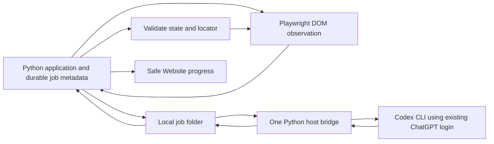

# Codex local DOM exploration agent

Created: 2026-10-23, Asia/Saigon. Status: **completed; 7/7 phases completed; CLI 0.164.0 isolation qualified; synthetic live DOM canary passed**.

## Authorized revision: container bridge (2026-10-23)

The user explicitly authorized creating a container and mounting the existing Codex
credential for this job. This supersedes the host-only/no-credential-mount design
below and in phases 03/07 and ADR-010. Use a dedicated Linux bridge container,
mount only the existing `auth.json` read-only, and use separate ephemeral Codex
runtime storage. Never bake credentials into an image or expose their contents in
logs. Do not mount the host home, repository, Docker socket or application secrets.
Keep the selected account/model, provider consent, budgets and approval boundary.
Qualify Linux tool/filesystem/network restrictions with synthetic sentinels before
mounting the real credential for a metadata-only login-status check. Model tools
must remain unable to read the credential mount. Read-only mount means token
refresh may fail; report it without modifying the host login or switching auth.
Add a dedicated image and qualification harness under `docker/codex-bridge/` in
phase 03; integrate opt-in startup in phase 07. Container process-group termination
replaces native Windows process-tree handling; Docker Desktop mount semantics
still require tests. No new provider inference is authorized by this revision alone.

Historical phase 03 evidence (2026-10-24 12:18 +07:00): built a pinned Linux Codex
0.163.0/Python/uv image; synthetic job-read/outside-read/credential-read/proc-read
and job-write probes passed with a container-specific Moby seccomp profile. The
default Docker profile could not start bubblewrap; the local profile adds only
clone/unshare/mount/umount2/pivot_root while retaining non-root, no-new-privileges,
all capabilities dropped and read-only root. A loopback fake provider captured
one request with **zero tools** declared; no provider inference occurred.
Read-only real-credential mount with networking disabled returned ChatGPT login
available. D: bind mounts fail on this Docker Desktop instance; C: mounts work.
Transport/process/service implementation is underway. **48 Linux tests passed**
including fake child cancellation, output bounds and restart no-relaunch; **84
Windows contract/spool/service/settings tests passed** and Ruff passed. Doctor's
first integrated run failed closed; correcting its probe working directory and
rerunning is pending. Phase 03 remains in progress. The centralized proposal
prompt skeleton was pulled forward solely to compose the bridge entrypoint;
phase 04 still owns task context, validation, bindings and escalation accounting.

## Goal and confirmed request

Replace the failing remote Vision candidate-generation path with an opt-in Codex CLI bridge for local Web UI exploration. The application writes scoped jobs to a local folder; one host process runs Codex and returns structured proposals. Playwright continues to verify and execute actions, retain evidence and highlight confirmed targets.

Confirmed by the user:
- Use the account already signed into Codex, with the proposed economical model `gpt-6-luna`. Do not introduce an OpenAI API key or switch accounts/models automatically.
- Prefer a compact DOM observation; add a screenshot only when needed.
- Produce a feature plan now. Do not implement, run inference, change tenant settings or deploy as part of planning.

This is local file exchange with a remotely hosted OpenAI model, not offline inference. An assistant subagent in this conversation is not the long-lived application worker. The bridge will be a separate Python process launched with `uv`.

## Measurable acceptance

1. A tenant can explicitly select Codex with provider-bound DOM consent; legacy Gemini/HF settings and historical sessions still load. New Codex sessions require v4.
2. On the synthetic controls fixture, an ordinary button/link/input task produces verified actions from a DOM-only job: no screenshot file is created for Codex and no image argument is passed.
3. Screenshot escalation is explicit, at most once per observed state, requires separate image consent, and consumes another model call from the same session budget. Denial, exhaustion or a changed state causes a safe stop.
4. Exactly one Codex subprocess is active per bridge. A duplicate, stale, wrong-tenant, wrong-model, wrong-snapshot or malformed result never causes a browser action.
5. Queue time, CLI startup, DOM/image calls and browser work share the existing session deadline, normally 120 seconds. A timeout/cancel/revocation terminates the owned process tree; late files cannot resume a session.
6. The Website shows waiting for bridge, processing DOM, requesting an image, validating result and stopped reasons through the existing activity transport. Existing confirmed-click highlights remain grounded in worker evidence.
7. Codex proposes only actions. No new shell/browser authority, test verdict or draft-approval bypass is given to its output.
8. Fake-CLI and local browser tests pass without provider access. A separate bounded synthetic canary records actual CLI/model access, latency, usage and action success; a mock pass is never called live success.

## Evidence from the source scout

| Existing path | Observed behavior and consequence |
| --- | --- |
| `apps/control-plane/application/vision_model_batch.py` | Model-call port accepts a mandatory screenshot and immutable tenant/session/provider/model identity. Add an explicit observation/proposal boundary rather than disguising Codex as a Gemini HTTP model. |
| `apps/control-plane/infrastructure/vision/model_batch.py` | Checks server API keys, creates Gemini inline-image or HF Drive delivery, and enforces remaining time. Dispatch Codex before those credential/image paths. |
| `apps/control-plane/application/vision_trace_events.py` | v4 owns BFS, rate limiting, session fencing, branch restoration, proposal recording and final handoff. `primitive()` supplies `expected_locator` only for replay today. DOM proposals must carry their binding through queue/restore into prepare. |
| `apps/control-plane/application/vision_operations.py` | `bounded()` renews leases while awaiting remote work; cancellation propagates. Preserve this while adding bridge cancellation/policy checks. |
| `workers/playwright/src/vision-checkpoints.ts` | Public fingerprints omit form values; private form state remains in browser memory. Do not export its raw internal traversal as a DOM observation. |
| `workers/playwright/src/vision-locators.ts` | Grounds coordinates to a unique visible/actionable locator, rejects password inputs, and validates expected descriptors. Reuse these checks for DOM-selected elements. |
| `packages/contracts/src/auto_at/contracts/vision_worker.py` | Private v4 identity includes tenant, project, session and fencing token; prepare already accepts an expected descriptor. Add a versioned read-only observation capability without changing deterministic runner contracts. |
| `apps/control-plane/agents/shared/runtime.py` | All enabled Vision currently requires screenshot consent; max steps defaults to 3 and session time to 120 seconds. DOM consent must become distinct; every CLI invocation must count. |
| `apps/control-plane/application/vision_policy.py`, `apps/control-plane/api/v1/routes/vision.py` | Provider readiness is currently API-key presence; response/request literals only allow HF/Gemini. Bridge readiness needs a port and safe status, not a fake key. |
| `apps/control-plane/application/vision.py`, `apps/control-plane/application/vision_reload.py` | Submission freezes provider/model and limits; reload creates a fresh session from encrypted retained intent. Freeze input consent/mode too and keep old sessions unchanged. |
| `apps/control-plane/domain/activity.py` | Progress stages and metadata are allowlisted. Never forward arbitrary Codex JSONL/messages to the dashboard. |
| `apps/control-plane/infrastructure/persistence/models.py` | Sessions already store provider/model/prompt provenance, leases and limits; no bridge job registry or immutable input-policy snapshot exists. |
| `apps/dashboard/app/components/vision-progress-timeline-model.ts`, `apps/dashboard/app/components/vision-live-screen.tsx` | Model-wait banner and SSE/polling progress already exist; extend them with bridge stages. |
| `apps/control-plane/agents/prompts/README.md` | Every model prompt is centralized and versioned; add a Codex-specific prompt module. |
| `benchmark/vision/gehihi/run_offline.py` | Existing isolated PostgreSQL/loopback test harness prevents accidental real calls. Extend its subprocess isolation for a fake CLI; Python socket blocking alone cannot isolate a child executable. |

Local read-only CLI inspection found Codex CLI 0.163.0 and support for `exec`, `--model`, `--json`, `--output-schema`, `--output-last-message`, `--image`, `--ephemeral`, `--ignore-user-config`, `--skip-git-repo-check`, and `--sandbox read-only`. This does not prove Luna account access or complete command/tool isolation.

The working tree already contains timeout/retry, Website highlight/progress and benchmark changes. Preserve them; do not roll them into this feature or undo them.

## Proposed design

- Provider ID: `codex_cli`; recipient: OpenAI; model pinned to `gpt-6-luna`.
- Add one optional nested Codex policy with DOM consent and input mode `dom_first`. Existing screenshot consent is reused only as a separately granted OpenAI image permission.
- Host bridge runs on Windows under the signed-in user's account. Only the spool is bind-mounted into API/workflow containers by an opt-in Compose override. Never mount the Codex auth directory, browser profile or user home into Docker.
- Proposed host spool is an explicit absolute directory outside the repository, such as `%LOCALAPPDATA%/AutoAT/codex-jobs`; resolve it in Settings/setup, not from a submitted job. Container path is `/codex-jobs`. One bridge binds to one configured tenant; production multi-tenant isolation is out of scope.
- DB job metadata is authoritative. Files are transport, never authority to execute. Scope includes bridge ID, tenant/project/session, session fencing token, request sequence, snapshot ID, request hash and deadline.
- Per-job directory has immutable `request.json`, `dom.json`, optional `screenshot.png`, `response.schema.json`, plus atomically published claim/status/result/cancel receipts. `response.json` is the validated final envelope. `events.jsonl` contains sanitized progress only. CLI intermediate output is separate and untrusted.
- At most 100 DOM elements / 64 KiB observation JSON; labels capped at 120 characters. Include role, safe accessible name, type, enabled/editable state and opaque element reference. Exclude form values, hidden DOM, scripts, tokens, cookies, raw HTML, and URL query/fragment. These are proposed local limits to validate against fixtures.
- DOM decisions reference server-issued element IDs. The model cannot submit executable selectors/scripts. The worker retains the corresponding validated descriptor and checks it again at execution.
- Screenshot escalation is a structured `need_screenshot` outcome, never triggered by a transport/CLI error. Recheck consent, scope, state and remaining budget before supplying a PNG. An image-stage result cannot request another image.
- Read-only Codex invocation uses centralized prompt text, a fixed executable/model and schema, ephemeral sessions, no resume, no user MCP/hooks/plugins/config inheritance, and bounded output. Feed the validated job context via stdin; image via a trusted path only when consented. The CLI may read the job context, but is not the browser executor.
- Start with low reasoning/Standard speed if supported by the installed CLI/account. Readiness must reject unsupported settings instead of selecting another model. This is a proposed tuning choice; quality is evaluated, not assumed.
- Host sandbox/command restrictions are enforced and tested, not merely requested in a prompt. Phase 3 must prove the model cannot execute arbitrary commands or access credentials/unrelated files. If installed CLI controls cannot provide this boundary, keep readiness blocked and report the concrete missing capability; never silently use unrestricted mode.

## Pre-flight decisions and constraints

| Concern | Plan boundary |
| --- | --- |
| Execution contract | Preserve `TestExecutionRequest` / `TestExecutionResult` v1 in `packages/contracts/src/auto_at/contracts/execution.py`. No new test runner; Playwright remains pinned at 1.50.1. |
| Provider/auth | User selected existing Codex account plus Luna. App authentication/RBAC and local Temporal stay unchanged. CLI auth material stays in the existing host credential store. |
| Data/PII | DOM text and screenshots remain potentially sensitive. Redact before spool/transfer; omit credentials/values; keep approved synthetic sites for initial evaluation. Text redaction cannot anonymize arbitrary pixels. |
| Consent/authority | Bind DOM and optional image permissions to `codex_cli`; never inherit Gemini/HF consent. Explicit tenant setting enables new sessions only. Existing draft approval remains necessary. |
| Cost/rate | One process globally, session call budget and rate limit include image escalation, input/output byte caps, no automatic CLI retry/fallback. CLI may make internal model turns; do not claim a strict token/USD ceiling from process count or existing `max_cost_usd`. Record available token usage and actual model, reject model mismatch. |
| Retention | Spool is transient working data: remove payloads after acknowledged result, cancellation or expiry; restart cleanup handles expired jobs. DB safe metadata and existing trace evidence use existing policies. No new production retention duration or raw CLI transcript archive is selected. |
| Isolation/RBAC | One trusted local user/tenant per bridge, tenant checked against DB and envelope. Filesystem ACL plus process sandbox; a directory name is not tenant authorization. Policy writes retain MANAGE_TENANT and CSRF. |
| Observability | Stable job/session/correlation IDs, bounded stage codes, timings, CLI version, model and aggregate usage; no raw prompts, response bodies, command text or local paths in activity APIs. |
| Reliability | Atomic same-filesystem publication; exclusive claim; at-most-once CLI launch per job; do not re-launch abandoned claimed jobs. Expiry/revocation fences late output. Existing browser recovery remains evidence-only. |
| Deployment/SLO | Local Windows + Docker Compose only. Preserve 120-second session default; heartbeat every 2 seconds, stale after 10 seconds; observe cancel within 2 seconds and stop owned process tree within another 3 seconds. These are local acceptance targets, not production SLOs. |
| Evaluation | Fake CLI, owned DB and local browser fixtures, then a small separately reported live canary; compare DOM success/image escalation/latency/calls without changing verdicts. |

## Phase sequence and progress

| Phase | Objective | Status | Dependencies | Validation |
| --- | --- | --- | --- | --- |
| [01](phase-01-contracts-policy.md) | Contracts, immutable consent/job metadata and provider policy | completed | none | 139 focused checks passed; 78 contract/runtime checks passed after consent refinement; Ruff passed |
| [02](phase-02-dom-observation.md) | Bounded DOM observation and fresh locator binding | completed | 01 contracts | 39 Python checks; worker typecheck/schema parity; 55 browser tests passed |
| [03](phase-03-local-bridge.md) | Atomic spool, isolated container CLI lifecycle and cancellation | completed | 01 contracts | 108 Linux tests; sandbox/tool injection, real-login doctor and bind-mount checks passed |
| [04](phase-04-codex-proposals.md) | Central prompts, validated DOM/image proposals and budgets | completed | 01, 02, 03 | 171 focused tests and Ruff passed; no provider calls |
| [05](phase-05-orchestration.md) | Wire v4 sessions, durable job fencing, consent and events | completed | 01–04 | 47 integration tests; 188 focused checks; 135 Linux checks; final 15 adapter/browser and stale-binding check passed |
| [06](phase-06-dashboard.md) | Codex settings, disclosures and Website progress | completed | 05 stable API | 43 unit tests, 47 mocked browser tests, both typechecks and production build passed |
| [07](phase-07-validation-rollout.md) | Evaluation, opt-in local startup and rollback documentation | completed | 01–06 | v6 full suite: 872 passed, 2 RustFS skips separately passed; wire/doctor qualification passes; normal live DOM: 1 verified action, 1 call, 0 images |

Update this table at phase boundaries during execution. Phases 2 and 3 are independently testable after phase 1; no delegation is required.

### Execution record

- Authorized deployment follow-up, 2026-10-24: user requested run documentation,
  Docker restart, commit and push. Added rebuild/health/one-second-preview guidance;
  image transfer remains optional and unchecked. Rebuilt the API, dashboard,
  workflow/browser workers and benchmark target. Docker Desktop rejected the
  benchmark's D: bind mount, so its two fixture files now ship in a small image.
  Backed up the local database under ignored `auto-at-backup/codex-prestart-20261024/`
  before upgrading through `d1e2f3a4b5c6`. Default Compose startup passed; IPv4 API
  and dashboard returned 200, worker/benchmark connectivity and RustFS bucket
  access passed. Localhost IPv6 requests timed out; runbook health checks use IPv4.
  Existing artifact-retention job fails because `SqlAlchemyArtifactRepository`
  lacks `list_expired`; this unchanged repository issue is a follow-up limitation.
  Codex overlay/tenant activation and live image inference were not performed.
  Previous evaluation records below predate this requested application restart.

- Plan completed, 2026-10-24 19:09 +0700: **7/7 phases complete**. Prompt v6 supplies the
  verified response schema as prompt data instead of CLI `--output-schema`, while
  retaining strict local parsing and independent Playwright verification. The
  normal bridge passed its live Toggle modal canary: **1 verified action, 1 call,
  0 images, 9.156s**, using the existing login and requested Luna with isolated
  `--yolo`. Full isolated regression: **872 passed, 2 RustFS skips**, 370.31s;
  both RustFS tests passed separately on a fresh retry after a connection reset.
  Ruff, both TypeScript typechecks, generated-contract parity and diff checks
  pass. Execution v1 is unchanged. Exact paths, commands, deviations and evidence
  are in [phase 07](phase-07-validation-rollout.md). No next implementation phase.
  Local activation remains opt-in and was not performed; live image validation
  remains explicitly unverified/disabled. The records below preserve prior states.

- Schema-delivery investigation, 2026-10-24 18:58 +07:00: user requested "find the
  way to do". Full actual-canary wire capture confirmed the task, enabled bound
  target and full schema reached the CLI. A single controlled live diagnostic
  removed provider `--output-schema`, supplied the identical schema in prompt text,
  and retained strict local parsing/Playwright verification. It **passed** with
  one verified DOM click in 8.89s, one call, zero images (3,560 input / 82 output
  tokens). This establishes a working alternative, not the provider-internal
  cause. Integrating the same delivery as v6 and validating the normal bridge is
  in progress; phase 07 is not yet marked complete. Account/model/YOLO/container/
  zero-tool/consent/approval boundaries stay unchanged.

- YOLO revision validated, 2026-10-24 18:45 +07:00: `exec --yolo` is active only
  in the dedicated container. Doctor verifies the outer hardening; all three
  real-CLI wire probes confirm full-access mode with zero model tools. 61 focused
  offline checks pass, no skips; Ruff passes. One bounded live DOM call returned
  stop/no_safe_action in 11.083s (3,345 input / 24 output tokens). Zero verified
  actions or images. Phase 07's quality gate remains unresolved; the requested
  YOLO change is complete. See phase 07 for exact files, commands and limitations.
  Cumulative history is now 11 CLI invocations and 8 reported completions.

- User-authorized YOLO revision, 2026-10-24: user requested "use --yolo for codex
  cli in isolation". Resume phase 07 with `exec --yolo` only inside the dedicated
  hardened container, retaining the fixed zero-tool catalogue, existing account,
  Luna, proposal schema, independent browser verification and image-consent gate.
  This explicitly supersedes the requirement for an active inner CLI sandbox.
  Container isolation and unavailable model tools now enforce the boundary;
  fallback sandbox probes must not be described as effective YOLO restrictions.
  Requalify offline before one bounded synthetic DOM call. No application rollout.

- Authorized CLI revision outcome, 2026-10-24 15:30 +07:00: **isolation fixed;
  phase 07 still in progress for live action quality**. Container pin is 0.164.0;
  the native host CLI/login/model selection are unchanged. A build-generated
  catalogue removes only Luna's three tool-capability fields. Full wire probes
  show zero tools and unsupported injected calls; filesystem/network, Windows
  mount/locking and offline real-login doctor pass. JSONL still hides rejected
  unknown custom attempts, so it is not a complete attempt audit.
- Full isolated suite passed **857 tests, 2 RustFS skips** (391.05s), followed by
  **152 passing checks, no skips** (86.54s) for final v5 prompt/contract/process/
  submission/provenance/end-to-end behavior. UI/browser evidence remains from the
  unchanged earlier validations. Exact paths, commands and limitations are in
  phase 07 and the machine-readable evaluation record.
- This revision's three bounded DOM canaries returned stop/complete, requested a
  screenshot without consent, and stop/no_safe_action. **No verified live action
  or image call.** v5 uses the centralized immutable model-instructions file;
  task and eligible bound target were independently confirmed in the prompt.
  Cumulative history is 10 invocations, 7 reported completions; token totals are
  67,047 input / 165 output, 7,808 cached input (aborted usage unavailable).
- Remaining decision: authorize a new bounded DOM diagnostic budget to investigate
  quality beyond this completed three-call batch. Do not enable tenants or claim
  phase 07 completion. Image testing remains disabled without separate consent.
  Application services/settings/database are untouched; owned test containers
  are removed. Earlier blocker entries below are historical and superseded where
  they describe the CLI-pin decision or current isolation status.

- Authorized CLI revision, 2026-10-24: user replied "yep, check it" to changing
  the CLI pin and qualifying a replacement. Phase 07 resumes with offline
  version/configuration probes; keep Luna, existing account, isolation, consent
  and budgets. Qualification must pass before another bounded live canary.
  No further approval is needed for this CLI-pin investigation and revision.

- Historical blocker, 2026-10-24 14:54 +07:00: **phase 07 remains in progress**.
  The complete credential-free wire probe found declarations in
  `input.additional_tools` that earlier checks missed. `agents.enabled=false`
  removes collaboration tools, but CLI 0.163.0 still advertises `functions.exec`,
  `functions.wait` and both user-input tools. An injected custom call receives
  `code-mode host is disabled` internally, while JSONL hides the attempt and its
  final response passes the event reader. The earlier zero-tools qualification
  is withdrawn; phase 03 filesystem/mount evidence remains historical evidence.
  Doctor now returns `bridge_cli_unsupported` before credential/process access.
  Safe work: corrected full-surface probe, regression tests, explicit agent/goal
  disabling, rebuilt local bridge image and documentation. No live calls, auth
  mounts, tenant changes, application restarts or migrations on this resume.
  Decision needed: authorize revising the CLI pin to qualify another version,
  retaining the existing account, Luna, sandbox, consent and proposal boundary.
  A different CLI is not yet selected or qualified. Live action quality remains
  a separate unresolved gate; the tool finding does not explain the safe stops.
  Exact paths and validation are in phase 07. No later phase is started.
  Final isolated resume regression: **131 passed, no skips**; Ruff and diff
  checks passed. Full-suite/UI/browser reruns deferred while the CLI gate remains
  blocked. This preserves earlier evidence without claiming plan completion.

- Phase 07 resumed, 2026-10-24 14:45 +07:00: inspect the exact pinned-CLI
  outbound prompt/schema using a credential-free loopback provider before any
  further bounded live validation. Preserve the existing model, safe stops,
  disabled image transfer and application settings. The live action gate remains
  unresolved; prior working-tree changes and validation history are preserved.

- Current handoff, 2026-10-24 14:38 +07:00: **6/7 phases completed**. Phase 06 is
  complete; phase 07 implementation, offline evaluation and local rollout/rollback
  artifacts are ready, but its live action gate is not satisfied. User confirmed
  Luna works in Codex; corrected bridge invocations now return valid structured
  responses and usage through the existing login. Both navigation and local-button
  tasks return `stop/no_safe_action`, including with centralized `codex-dom-v3`.
  The live model produced **zero verified actions and zero image transfers**.
  This is a proposal-quality limitation, not a login/model-access blocker. Do not
  mark the plan complete, enable a tenant, force an action, or switch models.
- Final validation evidence: full isolated suite **839 passed / 2 RustFS skips**;
  those two RustFS checks passed separately. After the CLI warning fix, **40 focused
  tests passed**; v3 contract/prompt/submission/end-to-end checks passed **116**;
  final benchmark/button-canary checks passed **10**. Dashboard **43 unit / 47
  mocked browser** tests and worker **55 browser** tests passed, along with
  typechecks, dashboard build, Ruff and contract parity. Exact commands, paths and
  limitations are in phase 07 and `benchmark/vision/codex/validation-20261024.json`.
- Seven bounded live CLI invocations were recorded: three startup-aborted, then
  four valid structured responses. Latest button task took 7.468 seconds and
  stopped safely. Reported usage for the four completed calls is 43,756 input /
  94 output tokens (7,808 cached input); aborted usage and actual-model event are
  unavailable. No further automatic live attempts are scheduled. Next work is a
  bounded investigation of why Luna refuses the supplied eligible target; image
  consent remains absent and image capability unverified/disabled. All owned
  canary/test containers and the standalone dashboard fixture have been stopped;
  running application services, tenant policies and existing changes are preserved.

- Phase 07 validation update, 2026-10-24 14:25 +07:00: full isolated Python suite
  passed **839 tests** with two RustFS skips; both storage checks then passed in
  disposable host-launched containers. Dashboard validation remains 43 unit / 47
  mocked browser passes; worker DOM/locator/operation tests passed 55. Added the
  disabled opt-in Compose overlay, credential-free offline harness, approval/run
  end-to-end fixtures, rollback helper, setup runbook and bounded synthetic canary.
  No application migration, restart or tenant enablement occurred.
- Three initial single-call canary attempts stopped before any verified action.
  User confirmed Luna works in the existing Codex account. Offline reproduction
  identified the cause: pinned CLI 0.163.0 emits its deliberately disabled Code
  Mode host warning as an `item.error` before `turn.started`. The parser now
  accepts only that exact startup warning, retaining rejection of provider errors,
  modified/mid-turn warnings and tool events. Both a valid schema response and
  unsolicited-tool rejection have been verified with the real CLI against a
  loopback fake provider, with zero declared tools. Final focused tests and a
  corrected live DOM canary are underway; **phase 07 remains in progress**.

- Phase 06 completed 2026-10-24 13:35 +07:00: independent DOM/image consent,
  readiness polling, frozen submission/reload fingerprint, safe Codex stages and
  terminal-event failure reasons are validated. **43 unit tests and 47 mocked
  browser tests passed**, with dashboard/worker typechecks and production build.
  Exact paths and commands are recorded in phase 06. No provider calls or settings
  changes outside mocked fixtures occurred.
- Phase 07 started 2026-10-24 13:35 +07:00. Local session history confirms the
  original full-plan execution request and container/credential authorization.
  Continue with offline harness, opt-in container configuration, setup/rollback
  documentation and final validation under the authorized container revision.

- Phase 06 resumed 2026-10-24 13:32 +07:00 from the checked-in plan and existing
  working-tree implementation (agentmemory REST session lookup returned HTTP 404).
  Dashboard/worker typechecks, 43 dashboard unit tests and the production build
  pass. Added Codex browser scenarios for separate consent, readiness, frozen
  create/reload confirmation, SSE/polling and terminal precedence. Browser
  validation is in progress; initial stale-confirmation scenarios need investigation.
  Fixed the terminal activity path to show its safe failure reason while the
  result endpoint still reports running. No real inference or tenant changes.

- Phase 05 completed 2026-10-24 13:16 +07:00. New Codex sessions freeze consent and
  require v4/readiness/confirmation fingerprint; durable job receipts are fenced;
  DOM bindings survive BFS restoration; image jobs use verified checkpoint frames;
  progress and bounded cleanup acknowledgment are explicit. Exact changed paths,
  migration reconciliation and validation results are in phase 05. Owned PostgreSQL
  fixture `auto-at-codex-phase5-fixture` remains running for final validation on
  loopback port 55437; application services have not been migrated or restarted.
- Phase 06 started 2026-10-24 13:16 +07:00. Consume additive API consent/readiness
  and activity fields in existing settings/Website views, preserving user changes
  to confirmed-click highlights and selected-history screens. Current overall
  progress: **5/7 phases completed**; no real provider inference has occurred.

- Phase 04 completed 2026-10-24 12:54 +07:00. Central v2 task context/prompt/schema,
  whole-batch validation and trusted bindings, shared DOM/image reservations,
  scoped durable-before-file adapter and closed HTTP fallback are implemented.
  **171 focused tests** and Ruff passed; exact paths/commands/deviations are in
  phase 04. No inference occurred. Phase 05 is unlocked.
- Phase 05 started 2026-10-24 12:54 +07:00. Wire v4 orchestration, immutable consent,
  transactional job fencing, readiness and safe progress. Current overall status:
  **4/7 phases complete**. Earlier timestamped state entries are historical.

- Phase 01 started 2026-10-23 20:38 +07:00: offline contracts, provider-bound DOM consent, safe bridge configuration and additive metadata. Existing uncommitted Vision changes are preserved. No tenant enablement or inference is part of this phase.
- Reconciliation: current migration head is `f9a0b1c2d3e4`; the proposed revision ID is unused. The catalogue's current fallback readiness treats every non-Gemini provider as HF, so phase 01 will also explicitly report Codex unavailable until its readiness port is wired. This prevents an HF key from enabling Codex during staged implementation.
- Phase 01 completed 2026-10-23 20:51 +07:00. Added closed observation/job/output/receipt contracts, independent consent, fixed local settings, pure guards/ports, immutable metadata migration and ADR-010. Acceptance commands and exact changed paths are recorded in phase 01. Migration ran only on owned UUID databases in `auto-at-codex-phase1-fixture` at port 55437; application storage is untouched.
- Validation: focused phase 01 suite passed 139 tests; after tightening recipient-switch consent, 78 contract/runtime tests and `uv run ruff check .` passed. Initial migration test expectation used InternalError but psycopg raises ProgrammingError; corrected and rerun successfully. Broader `uv run pytest -q` remains running and has reported failures/errors, requiring investigation before final validation; no full-suite pass is claimed.
- Phase 02 started 2026-10-23 20:51 +07:00. Add read-only DOM observation and worker-owned fresh target binding. Phase 01 unlocks phases 02/03; current next unit is phase 02. Overall 1/7 acceptance units completed, full-suite regression investigation remains open.
- Phase 02 completed 2026-10-23 21:02 +07:00: bounded DOM projection and private scoped observation endpoint, capability negotiation, fresh descriptor binding during prepare, generated TS contracts and synthetic adversarial tests. 39 focused Python tests, schema parity, typecheck and 55 browser tests passed. Exact paths and limitations are in phase 02.
- Broader baseline result: 676 passed, 6 failed, 35 errors. All 35 errors were inaccessible shared pytest temp storage; rerun with `--basetemp .pytest-codex-validation-20261023` passed 35/35. Five logging failures were caused by Alembic disabling already-loaded loggers in the new early migration test; restoring logger state fixed the reproducer (49 migration/Gemini/runner tests passed together). One schema failure was caused by editing generator imports during an already-running pytest process; a fresh contract run passed. Full stable-checkout rerun remains due at final validation.
- Phase 03 started 2026-10-23 21:02 +07:00. First qualify native CLI isolation before allowing a host bridge to run. Overall 2/7 phases completed; no provider invocation, application migration or tenant enablement.
- Phase 03 blocker recorded 2026-10-23 21:08 +07:00: installed native CLI 0.163.0 rejects MXC (`native MXC is unavailable on this executor`) and rejects the tested elevated job-only read profile (`requires effective :root read access`). Synthetic inside/outside sentinel commands never started. The required protection against credential/unrelated-file reads is not qualified. See phase 03 for exact probes and official references. User direction requested: MXC-capable host or an explicitly revised isolated bridge environment. No fallback, auth change, broader permissions, provider calls or later phases started. Stable-source final regression validation is underway; phase 03 remains in progress, not completed.
- Cleanup limitation: automatic approval review rejected recursive removal of the task-created `.pytest-codex-validation-20261023/` and `C:/Users/hen/AppData/Local/Temp/auto-at-codex-probe-4p5azdvf` with the generic reason `blocked by policy`. They remain in place; no alternate deletion mechanism was used. The final test run uses an ignored, unique directory under `.pytest-artifacts/`.
- Cleanup retry after explicit user authorization (`clean it`): verified the two paths above and `.pytest-artifacts/codex-phase12-85a9d6b4087f4e2c8bbd9d80febebe3a` resolve exactly and contain no reparse points. Automatic approval review again rejected the native PowerShell removal command before execution (`blocked by policy`). All three directories remain; no alternate deletion mechanism was attempted.
- Final handoff validation (2026-10-23 21:15 +07:00): `uv run pytest -q --basetemp D:/Person/CaoHoc/KhoaLuanTotNghiep/agent-at/auto-at-ui/.pytest-artifacts/codex-phase12-85a9d6b4087f4e2c8bbd9d80febebe3a --tb=short` passed **731 tests**, 13 fixture/collection/deprecation warnings, in 337.14 seconds. No skips. A subsequent pure UTF-8 output-byte guard passed `uv run pytest tests/test_codex_bridge_contracts.py -q` (**53 passed**) and `uv run ruff check .`. This last isolated guard was not followed by another full-suite run. Worker typecheck, generated-contract parity and 55 browser tests passed. `git diff --check` passed; execution v1 has no diff. The task-owned PostgreSQL fixture was stopped and auto-removed; running application services were not migrated/restarted.
- Current state (2026-10-24 12:31 +07:00): **3/7 completed; phase 04 next; phases 04–07 not started**. Phase 03 completed under the user-authorized container revision. The real credential was mounted read-only only for offline login/doctor checks; the doctor reports authenticated and capabilities-qualified, with model access unverified. No model inference, app migration, tenant enablement or deployment occurred. Runtime source, exact commands and limitations are recorded in phase 03. All probe containers were removed; the local image remains. Phase 04 is unlocked.
- Phase 03 validation: 108 Linux contract/spool/service/process/settings tests passed without skips; 84 earlier Windows contract/spool/service/settings tests passed. Ruff and normal `git diff --check` passed; a check with autocrlf forcibly disabled incorrectly treated existing CRLF lines as whitespace errors, so it was discarded and rerun with repository settings. Execution v1 has no diff. Synthetic denied-read/write probes, unsolicited tool rejection, real-login doctor and Windows/Docker Desktop publication/locking/cleanup checks passed. Full application Python/browser regression is deferred to final integration validation; prior phase 01–02 results remain historical evidence.
- Resume check (2026-10-23 21:21 +07:00): native CLI is still 0.163.0; bridge infrastructure and CLI entrypoint remain absent. Existing changes are preserved. The execution request does not specify the pending isolation choice: retain the Windows design on an MXC-capable host, or revise it for a separately isolated bridge environment. Phase 03 remains blocked on that material architecture decision; phases 01–02 and their recorded validation remain the completed safe work. No sandbox probes, inference, implementation tests, or later phases were run during this resume check.

## Risks, migration and rollout

- Phase 04 started 2026-10-24 12:31 +07:00. Implement bounded task context, versioned
  prompt/schema, whole-batch semantic validation and one image escalation with
  shared reservations. Reconciliation: phase 01 request omitted task context;
  add a bounded private context field for new prompt version `codex-dom-v2`,
  preserving old synthetic v1 fixtures. This implements the already-planned task
  intent/observed-summary input without changing execution v1 or public API.

- File transport alone does not fix model-service availability or guarantee lower latency. Luna/quota/login availability must be checked and failures shown honestly.
- Shared host credentials must not become a general-purpose tenant shell. Sandbox qualification is a release gate, especially on Windows.
- DOM enumeration misses canvas/closed shadow roots and may hit cross-frame limits. Report unsupported/truncated state; screenshot proposals still require unique locator verification and may safely stop.
- DOM can change during a model call or BFS restoration. Persist safe proposal binding and verify fresh state/descriptor; never fall back to coordinate-only clicking for a DOM selection.
- Policy JSON is `extra=forbid`. Roll out migration and compatible API/worker before UI enablement. Add a nullable input-policy snapshot to old sessions and a separate scoped job table; do not rewrite past provider/consent.
- Disable new Codex submissions, cancel/drain jobs and stop the host bridge before rollback. Convert only new Codex policy keys to a disabled old-compatible policy before downgrading parsers, preserving other overrides and history.
- Keep general test drafting/reporting providers unchanged. This plan replaces exploration proposals only; downstream generation may still require its configured provider.
- No production rollout, API billing, provider/model fallback, background Windows service installation, arbitrary-agent shell access or permanent screenshot archive is included.

## Assumptions and remaining questions

Assumptions: local development deployment; one trusted user/tenant per bridge; existing 120-second deadline and explicit approval boundaries; ephemeral spool rather than a file-history product; provider switch is opt-in for new sessions. These choices do not select a new production retention policy.

No user decision blocks writing this plan. Implementation must verify (a) Luna access with the current login, (b) installed CLI sandbox/tool restriction behavior, (c) Windows/Docker atomic-file and ACL behavior, and (d) measured DOM/image quality. Failures are concrete compatibility gates, not permission to change model, authentication or execution authority.

## Official references already checked

Checked 2026-10-23; recheck CLI capabilities before implementing:
- [Codex non-interactive execution, JSONL, schema and output files](https://learn.chatgpt.com/docs/non-interactive-mode)
- [Codex model selection and availability](https://learn.chatgpt.com/docs/models)
- [Codex subscription usage and pricing](https://learn.chatgpt.com/docs/pricing)

Use `$feature-plan-execution` to implement this plan. Planning changed only this directory.
